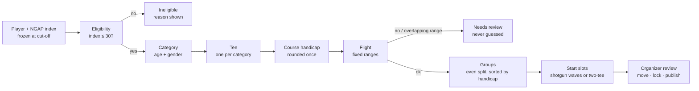

# Project plan: TeeLine Golf (IGCC Tournament Desk)

Golf tournament management for **Iloilo Golf & Country Club (IGCC)**, built by **Syntaxure Labs**.
The organizer adds players; the system routes each one to a category, tee, flight, group and start
slot; the organizer reviews, overrides and publishes; players read their pairings on a phone.

> **Status date:** 18 Oct 2026 · **Branch state:** `develop` is the only long-lived branch ·
> **Product name:** TeeLine Golf (approved direction; trademark clearance has not been established)

This is the single plan for humans and AI agents. Section 1 is the 60-second version. Everything
marked **Verified** was checked against the code, the migration or the tests on the date above.
Anything not marked is a plan, not a fact.

---

## 1. Where we are, in short

| Area | State | Evidence |
| --- | --- | --- |
| Routing engine (`src/lib/routing`) | **Built**, pure functions, no DB; **lock-aware re-run** | 26 unit tests |
| Draw checks (`src/lib/draw`) | **Built**: blocking / warning / info issues, move rules | 15 unit tests |
| NGAP CSV import logic (`src/lib/ngap`) | **Built**: mapping, match/merge review queue, strict plan | 25 unit tests; no `.xlsx`; no DB writes |
| Database schema (`supabase/migrations`) | **Applied to the real project** on 18 Oct 2026: `golf-management-system` (`egfwfyznbndunqfqzxjx`, ap-southeast-1), club row seeded, `player-photos` created private, RLS checked against the anon key. **All eleven migrations are in step**, including the player portal (`20261023000000`, `…0001`) and the event-setup pair (`20261024000000`, `20261025000000`) plus the notifications schema (`20261026000000`) | 14 tables, RLS on all; `supabase migration list --linked` shows local and remote in step |
| Supabase data layer (`src/lib/auth`, `src/lib/supabase`, `src/lib/data/supabase`) | **Wired (merged 18 Oct, `b8d9c7a`)**: the store uses `createSupabaseAdapters` and `loadDeskState` when a Supabase URL is configured, and the mock adapters when it is not. Not yet exercised end to end with real course and tournament rows | `src/lib/data/supabase/adapters.ts`, `load-desk-state.ts`, `domain.ts`; 24 tests |
| Deployment | Vercel project **`golf-management-system-sl`** (team `j-akiru5s-projects`), production tracks `main` at `https://golf-management-system-sl.vercel.app`; pushes to feature branches build previews. Before the 18 Oct advance, production served the pre-TeeLine build from `main` | `vercel ls`, `vercel inspect`; production env vars not yet confirmed from the repo |
| Staff auth and roles (`20261019000000_staff_auth_audit.sql`, `src/lib/auth/roles.ts`) | **Applied 18 Oct 2026 and verified**: `owner` / `organizer` / `desk`; publishing, tournament settings and member management are owner/organizer only, in RLS; registration audit columns stamped by trigger. Two staff accounts exist (`admin` = owner, `member1` = desk) | Verified by signing in as each role: owner sees both member rows, desk sees only its own |
| Player auth and the player area (`src/lib/auth/routes.ts`, `src/app/(player)`, `src/lib/player`) | **Built, tested and applied.** One sign-in page for players and staff, `/my` with a claim step and a read-only view of the player's own entry and published start. The database half is live; what is missing is a test account linked to a test player | `routes.test.ts` (15), `portal.test.ts` (7), `claim.test.ts` (4); guard matrix checked over HTTP with a Supabase URL configured; the three functions answered correctly against the live project (see section 7) |
| Organizer screens (`src/app`) | **Built**: on the session store in demo mode; with Supabase configured the same screens read and write the project through the adapters. An end-to-end pass with real event data is still pending | Public TeeLine landing at `/`, control room at `/admin`, plus Tournaments, Players, Registration desk, Import, Draw, Print center, Settings, Course & holes, Clubhouse display, Player view and profiles |
| Data boundary (`src/lib/data`) | **Built as mock adapters** over the session store | `PlayerRepository`, `TournamentRepository`, `RegistrationRepository`, `HandicapImportAdapter`, `PairingsRouter`, public allow-list |
| Brand and visual design | **TeeLine Golf** identity: public landing page, fairway-and-flag vector mark, Ivory / Charcoal themes; the IGCC crest stays a separate club asset | Tokens in `src/app/globals.css`, logo variants in `public/brand`, contrast guarded by `src/styles/contrast.test.ts` |
| Printing | **Print components and pure helpers built**: sorted start sheet, allow-listed pairings sheet, per-group 18-hole scorecards, handicap dots, and A4 print CSS | `src/lib/print` tests; dev-only preview at `/print-preview`; real course data and club-printer test still pending |
| Merged (PR #17) | **Event setup and the notification schema**, merged into `develop` as `863c253` on 18 Oct 2026: the desk saves course, tees, holes, categories and flights in one guarded, manager-only transaction, enters the real tee and hole numbers, loads the saved tees and holes instead of the samples, adds the paging primitive, and writes the notifications migration. Its migrations `20261024000000`, `20261025000000` and `20261026000000` are all applied to the live project (verified over the API) | Section 8, step W1 done |
| Merged (PR #23) | **The alerts bell and the paged lists** (`feat/desk-lists-and-bell`): the bell in the shell, the notification loader, paging applied to the players, registration and import review lists, and the import review tabs. Merged into `develop` as `1fd2b76` on 18 Oct 2026. It shipped with two bugs that browser checking found and the follow-up below fixes | Follow-up PR `fix/desk-browser-found` |
| In flight (settings saves) | **Settings that save** (`feat/settings-saves`, based on the amendment in PR #26): draft-then-save with a Save on every section plus Save all changes, the tournament-level fields carried by the guarded `save_event_setup`, the entry link on the deployed domain, and Add a day incrementing with every day editable. Migration `20261027000000_setup_tournament_fields.sql` is written and **not yet applied** | PR open; the owner applies the migration before this build is deployed |
| Long lists | **Paged on the desk's lists.** `src/lib/data/paging.ts`: 50 rows a page, paged in the browser, queries unchanged. Applied to the player directory, the registration desk and the import review tabs. Switching tab, search or filter returns to page 1, and ties break on the record id so editing a row cannot move it to another page. **Deliberately not paged**: print, the draw groups and the desk's player search | Decision 13 settled; gap 10 closed for the desk screens |
| Alerts | **Bell built.** Decision 14 is stored, desk-facing notifications (option B): `notifications` + `notification_reads` with per-user read state, `sync_notifications(tournament)` and `mark_notifications_read(tournament)`, all applied to the live project. The bell merges the live draw issues with the stored rows, de-duplicates them, and counts unresolved blocking and warning whatever their read state; read state only quiets info. The full sync cycle was checked over the API: a warning appeared and cleared when the cause was fixed, and a dismissed info notice stayed read in a fresh session | Gap 11 closed; merged (#23, `1fd2b76`) |
| Scores, results | **Not started** (Phase 2) | No `scores` table yet |

Whole suite: 34 test files, 402 tests passing (`pnpm test`) on `feat/settings-saves` today; `develop` has 31 files and 384 tests. The settings work adds 18 cases: the per-section payload mapping (5), the calendar maths behind Add a day (7), and the entry-link URL rules (6). Separately, `pnpm verify:ui` runs 36 checks in a real browser against a running dev server. It is not part of `pnpm test`, because it needs the server up, but it is what found the two bugs in PR #23.

**The one thing blocking a real event:** the wiring exists but the project has no course, tee, hole or
tournament rows, so the desk has nothing real to show. Provisioning and an end-to-end pass with real
data (section 8, steps 1 and 2) come first, and the test staff accounts must be rotated before the
event.

---

## 2. Source of truth (read in this order)

1. **The code and tests in this repo.** If this plan and the code disagree, the code is what runs.
2. [`docs/spec/IGCC_Tournament_Desk.md`](spec/IGCC_Tournament_Desk.md): the build spec v1 sent to the organizer, with the rules the organizer confirmed on 17 Oct 2026.
3. This plan: status, gaps, roadmap, decisions made since the spec.
4. [`README.md`](../README.md): how to run the project.

Rules in the spec are **tournament settings, not constants**. Never hard-code a rule from section 3 into
the engine; it must come from `TournamentConfig`, categories, tees or flights.

---

## 3. Confirmed rules (organizer, 17 Oct 2026)

Full table is in the spec. The ones that drive the code:

| Rule | Value |
| --- | --- |
| Handicap source | Imported from the NGAP export. The system never computes an official index. |
| Course handicap | `Index × (Slope ÷ 113) + (Course Rating − Par)`, then × allowance (100%), **rounded once** at the end. Plus handicaps are stored negative and shown as `+n`. |
| Max handicap | 30, checked on the **NGAP index** (not the course handicap). Above 30 cannot register. |
| Categories | Regular, Senior 60–69, Super Senior 70+ (Silver tee), Ladies (own category and own tees). Age is taken on tournament day. |
| Flights | Fixed handicap ranges per category. Basis defaults to index. |
| Shotgun | 18 holes × max 4 per hole = 72 per wave. Wave 2 starts at wave 1 + gap (default 300 min). A flight is never split across waves unless it exceeds the holes in a wave, and then it is flagged. |
| Two-tee ("barrel") | Holes 1 and 10, one pair of groups per interval (default 12 min). |
| Scoring | Paper cards. No live scoring. |
| Photos | Taken or uploaded with recorded consent; kept off the public pairings page. |
| Tenancy | IGCC only for now; data model is multi-club ready. |

### Defaults chosen while organizer answers are pending

| Open question | Default in code | Where |
| --- | --- | --- |
| Flights on index or course handicap | Index | `TournamentConfig.flightBasis` |
| Flight not divisible by 4 | Even split (14 → 4, 4, 3, 3); minimum group 3 | `src/lib/routing/groups.ts` |
| Order inside a flight | By handicap | routing engine |
| Photos on public page | Never | `PairingsView`, `photoOf` |

---

## 4. How routing works



Every step records its result so the organizer can see why a player landed where they did.
Nothing is guessed: a missing index, no matching category, or a missing or overlapping flight range
marks the player `needs_review`, not a silent default.

**Worked example (placeholder tee numbers):** male, 63, index 14.2, Senior tee 70.1 / 125 / 72.
`14.2 × (125 ÷ 113) + (70.1 − 72) = 13.81 → 14` → Senior flight containing 14.

### Start formats

- **Shotgun:** groups fill holes 1–18 in flight order. If the next flight does not fit in the holes
  left in wave 1, the whole flight moves to wave 2 (labels 1A…18A, 1B…). Wave 2 start = wave 1 start + gap.
- **Two-tee:** slot `n` starts at `first tee + floor(n ÷ 2) × interval`, hole 1 if `n` is even, hole 10 if odd.
  Capacity depends on pace of play (spec assumes ~2 h per nine, which the club has not confirmed).

---

## 5. Architecture and conventions

### Stack

Next.js 16 (App Router) · React 19 · TypeScript strict (with `noUncheckedIndexedAccess`) · pnpm 10 ·
Biome (lint and format) · Vitest · `supabase-js` and plain SQL migrations (no Prisma) · Vercel.

### Layout

```text
src/lib/routing/   pure routing engine (no DB, no network), lock-aware re-runs
src/lib/draw/      draw validation: issues + drop rules
src/lib/ngap/      CSV import, column mapping, match and merge review queue
src/lib/poster/    canvas poster generator (preview == export)
src/lib/data/      domain types (club_id), cut-off freeze rule, public allow-list,
                   mock adapters (PlayerRepository, TournamentRepository,
                   RegistrationRepository, HandicapImportAdapter, PairingsRouter)
src/lib/store/     session store (DEMO ONLY, to be replaced by Supabase behind the adapters)
src/lib/demo/      demo club, tees, categories, flights, players, events and the sample NGAP file
src/components/    UI; src/components/draw/ is the draw control room; src/components/print/ the print center
src/app/(desk)/    organizer screens;  src/app/(public)/  player-facing pages
supabase/migrations/   schema;  supabase/seed.sql   development seed
docs/              this plan, the spec and the handoffs
```

### Rules that keep it correct

- The routing engine and draw checks stay **pure functions**. Test them; do not put I/O in them.
- Pairings shown to players come from a **frozen `Published` snapshot** (names, hole, time only),
  never from the live board. Editing the board after publishing shows "Published, with changes"
  until the organizer publishes again.
- Publishing is **blocked** by blocking issues (duplicate player, over capacity, ready player with no
  group, ineligible player in a group). Warnings need acknowledgement.
- Photos are used only where consent is recorded (`photoOf`). Private bucket, never on public pairings.
- Colors are tokens on `:root` with dark redefinitions; contrast is guarded by `src/styles/contrast.test.ts`.
- No external font or script calls (fonts are bundled via `@fontsource`).

### Database design

Verified in `supabase/migrations`, and **applied to the `golf-management-system` project on 18 Oct 2026**:

- `club_id` on every table; row-level security through `public.is_club_member(club_id)`.
- Composite foreign keys `(id, club_id)` so a row in one club cannot reference another club's data.
- `public.public_pairings(tournament_id)`: security-definer function returning names, flight, hole and time only. No login needed.
- Private `player-photos` bucket, paths under `{club_id}/`.
- `btree_gist` exclusion constraint prevents overlapping flight ranges within a category.
- Registrations store `frozen_index` so a later NGAP upload cannot change a published draw.
- Clubs and memberships are created with the service role during onboarding, not from the app.

**Staff-only auth (`20261019000000_staff_auth_audit.sql`):**

- Roles are `owner`, `organizer` and `desk`, held in `club_members.role`. The staff-only decision has
  since been amended by the player portal (below): a golfer may hold an account, but it is never a
  `club_members` row.
- `public.has_club_role(club_id, roles[])` is the role test; it is security-definer so it cannot
  recurse through `club_members` RLS.
- RLS is the enforcement, not the UI: `tournaments` is read-only to members and writable only by
  owner/organizer (publishing and every tournament setting live there), and `club_members` is
  manageable only by owner/organizer. Every other table stays open to all club staff.
- `registrations.registered_by`, `updated_by` and `updated_at` are stamped by trigger from the
  session (`auth.uid()`), so a client cannot set or spoof them. There is no separate activity table.

**Player portal (`20261023000000_player_portal.sql` and `…0001`, applied 18 Oct 2026):**

- `public.players.user_id` links one account to one directory entry, with a unique partial index.
  The link is deliberately **not** a `club_members` role: `is_club_member()` gates every club table,
  so a player role would hand a player the whole club's data.
- `public.current_player_id()` answers "who is signed in" for the proxy and the sign-in action.
- `public.claim_player_record(name, ngap_id)` is the only write a player can make. It matches like
  the entry form (NGAP id first, then a unique exact name), refuses an ambiguous match and a record
  another account holds, and only ever sets `user_id`.
- `public.player_portal_entries()` returns one allow-listed projection of the caller's own entry and
  their start, read from `tournaments.published_snapshot`, never the live board.
- Route areas, decided in `src/lib/auth/routes.ts` and tested there: public (`/`, `/pairings`,
  `/enter/[id]`, `/login`), player (`/my`), staff (the desk). Only the guarded areas are in the
  proxy matcher, so public pages never pay for a session lookup.

**In step, with one migration written but not yet applied.** Every migration on `develop` is applied
to the live project, including `20261026000000_notifications.sql` (gap 11). On `feat/settings-saves`,
`20261027000000_setup_tournament_fields.sql` is written and **not yet applied**: it must be applied
before a build with that code is deployed, because the screen calls the new parameters. A new
migration must use a version after `20261027000000`; those numbers are spent.

**Schema vs spec:** the migration has 14 tables: the spec's tables except `scores` (Phase 2), plus `club_members`
(needed for RLS).

### Git workflow

- Base branch `develop`. Multi-file work goes on a dedicated branch and a pull request into `develop`.
- `main` exists and is kept level with `develop` (advanced for the production build); **`staging` is skipped on purpose** because Jeff is a solo dev (decision 12).
- Commit messages and PR descriptions carry the attribution lines required by the tooling in use.
- A repo-state claim ("it is merged", "it is deployed") must be checked against the remote, not memory.

---

## 6. Screens: status

| Screen | State |
| --- | --- |
| Overview | Control room: illustrated course map with hole pins, event card, attention list (blocks, review, re-freeze, deferred imports, payments), quick actions, readiness, publish, divisions, Handicap Index histogram, session log in a rail drawer, open questions. Demo data |
| Tournaments | Demo events with dates, cut-off, entries and draw state; switch the working event, create a demo event, clear the selection to see the no-tournament state |
| Players list | Directory with search (name, nickname, NGAP ID, home course) and filters (status, category, gender, home course); add a player with photo consent. In memory |
| Player profile | Photo with consent flag, handicap history with the frozen marker, registration facts, private-details panel, poster generator (1080×1350 championship, 1080×1080 card) |
| Registration desk | Find a player or start a new one, member/guest, sponsor question, per-day tee-time preferences (Day 4 flagged), shirt sizes, extra fields, payment recorded by hand, eligibility review after saving |
| Import handicaps | CSV, column mapping, match and merge queue with decisions, apply, deferred rows, import history; applies to the session's handicap records |
| Draw control room | Generate, move (drag or Move, with a reason), lock, re-run keeping locks, override list, issues panel, publish dialog, routing explanation per player, draft / published / changed states |
| Print center | Start sheet, pairings, per-group scorecards, handicap dots, and A4 print CSS. Published vs draft is labelled |
| Settings | Setup wizard: basics, course and tees, cut-off and handicap rules, categories, flights, start and groups, registration fields, live readiness checks. **Draft-then-save**: a Save on every section plus a page-level Save all changes, with the section save as the fallback when the bulk write fails and unsaved sections marked. In connected mode everything on this screen is carried by the guarded `save_event_setup` transaction (gap 14, decision 17). Owner/organizer only; the desk sees it read-only. Tee name and hole number are fixed identities, and flight ordering is read-only pending decision 6 |
| Sign in | One page for players and staff, with account creation for players; an account's area follows what it is (a club_members row or a linked player record). Demo builds skip it entirely |
| My golf (player area) | `/my`: link your member record by name and NGAP number, then read your own entries and published start. Applied; needs a test account and one player row to claim |
| Public pairings | Search by name, large text, print; built through the public allow-list projection (name, flight, hole, time only) |
| Course & holes | Hole 1 overview and green view with shot line and yardage markers drawn from anchor files. **Pictures are an illustration, not IGCC's real hole** |
| Clubhouse display (spotlight) | 16:9 player card for the clubhouse TV, single player or rotation. Shows recorded data only |
| Real course and tee entry | **Pending**: course rating, slope, par and stroke index are editable in Settings, but the values on file are placeholders until the club supplies the scorecard |
| Score encoding and results | Phase 2 |

---

## 7. Verified gaps between spec and code

These are places where the spec promises something the code does not do yet. Checked on 18 Oct 2026.

1. **Re-run and locked groups.** *Fixed in the demo shell*: `route()` takes locked groups, keeps
   their players and slots, releases a lock that no longer makes sense with the reason, and warns
   when a locked slot pushes a flight across waves. Covered by `src/lib/routing/locks.test.ts`.
2. **Persistence is wired but unproven.** The store picks the Supabase adapters and loads the real
   desk when `NEXT_PUBLIC_SUPABASE_URL` is set, and falls back to the in-memory demo when it is not
   (merged 18 Oct). The write path has not been exercised end to end, because the project still has
   no course, tee, hole or tournament rows; the demo screens still run on the session store.
3. **Cut-off date is applied in the desk** (frozen onto each registration; re-freeze offered), but
   the database write is still missing.
3a. **The player portal is applied; the end-to-end pass is not.** `/my`, the claim step and the two
   portal functions are built, tested, and **applied to the `golf-management-system` project**
   (`20261023000000_player_portal.sql` and `20261023000001_player_portal_grants.sql`). Against the
   live project: `player_portal_entries()` answers `{linked:false, player:null, entries:[]}` for a
   caller with no session, `claim_player_record()` answers `signed_out`, and after the grants file
   anon is refused with 42501. Still to do: a test account, and a player row for it to claim
   (the project has no players or events yet), then the claim and the entry list can be seen in the
   browser. Note for the owner: the `20261022000000_versioned_publish` objects were already in the
   database but the migration had never been recorded, so it was marked applied
   (`supabase migration repair`) before the portal files were pushed; and anon can still execute
   `save_draw`/`publish_pairings`/`unpublish_pairings` (they refuse any caller without a staff role,
   but the `revoke … from public` in that file did not take effect for the `anon` role).
4. **Printing** has props-driven start, pairings and scorecard components, plus tested sorting and
   handicap-dot helpers. The current desk still supplies placeholder/missing hole data, so its cards
   show the missing-data state and watermark. It has not been printed on the club's paper or printer.
5. **Settings are editable, but two things are not what they look like.** The tee and hole values are
   placeholders, editable in Settings, until the club supplies the scorecard. In connected mode the
   course-side fields persist through `save_event_setup`; the tournament-level fields (name, dates,
   state, cut-off, config rules, registration wording) update the screen only and revert on reload.
   See gap 14.
6. **Tee data is placeholder.** Demo and test numbers (e.g. White 71.5 / 128 / 72) are invented.
7. **Wave rule vs. small flights.** Keeping flights whole can push a small flight to wave 2; an
   organizer decision is still needed (section 10).
8. **Import is CSV-only** and the NGAP format has still not been seen; the queue's column mapping is
   the guard against guessing it.
9. **Multi-day events are a demo assumption.** Age and the cut-off read the first day, because the
   club has not said which day of a multi-day event counts.
10. **Paging is applied to the desk's lists.** Decision 13 was answered on 18 Oct 2026: 50 rows a
    page, paged **in the browser**, queries unchanged (a round trip per page is slower at the club's
    field size, and the print path needs the full list anyway). `src/lib/data/paging.ts` holds the
    maths (7 cases, including the one that bites: a filter that shrinks the list must not strand you
    past the end, and a one-page list stays silent). `src/components/paging/` holds the React glue:
    switching tab, search or filter returns to page 1 in the same render rather than in an effect
    that would flash the wrong rows, and ties break on the record id so editing a row cannot move it
    to another page. Applied to the player directory, the registration desk and the import review
    tabs. **Print is deliberately not paged**: a start sheet is a piece of paper and must carry the
    whole field, which `src/lib/print/start-sheet.test.ts` now asserts at 126 players. The draw
    groups and the desk's player search are not paged either. Merged (#23, `1fd2b76`).
11. **Notifications are built.** Decision 14 was answered on 18 Oct 2026: stored,
    desk-facing notifications (option B), over derived-only alerts, because "mark as read" has to
    survive a refresh and more than one person may need to see an alert. The agreed design:
    `notifications` (id, club_id, tournament_id, kind, subject, severity, title, detail, created_at,
    resolved_at, unique on `(tournament_id, kind, subject)` so one problem cannot pile up as
    duplicates) and `notification_reads` (notification_id, user_id, read_at), plus
    `sync_notifications(tournament)`, which computes the current alerts from state that already
    exists (blocking draw issues, players needing review, unplaced players, stale indexes,
    unpublished changes, cut-off approaching), upserts the new ones and stamps `resolved_at` on the
    ones that no longer apply. That keeps writers out of every feature and stops alerts going stale.
    RLS follows the established shape: members read their club's rows, and a user manages only their
    own read rows. Player messaging (SMS or Messenger) stays Phase 3 and is a different feature.
    **Applied to the live project and now built** (`20261026000000_notifications.sql`: both tables,
    `sync_notifications`, `mark_notifications_read`, two RLS policies). The bell merges the live
    `validateDraw` issues with the stored rows rather than copying the draw rules into SQL, so it
    cannot disagree with the Draw screen's issues panel; it de-duplicates across the two sources, and
    the badge counts unresolved blocking and warning **whatever their read state**, so dismissing a
    notice can never hide something that stops publishing. The full sync cycle was checked over the
    API on 18 Oct 2026: a `needs_review` warning appeared, cleared when the cause was fixed, a
    `cutoff_soon` info notice was dismissed, and that read state survived a fresh session. Both roles
    can call both functions. **Seen in a browser on 18 Oct 2026** (`pnpm verify:ui`: 36 checks, no
    console errors): the panel's all-clear and real-alert states, the focus trap, Escape returning
    focus to the bell, the mobile sheet below `lg`, and both themes. It found two bugs that typecheck,
    lint, build and the whole unit suite had passed, both fixed on `fix/desk-browser-found`: the
    panel's text resolved to ivory on ivory in the light theme, and clearing a search that returned to
    a filter already used landed on the page last left for that filter instead of page 1.
12. **The draw was computed in the browser and never saved.** *Fixed in code and applied; not yet
    exercised.* `route()` is a real pure engine and it runs live: changing players, settings or a move
    re-runs it, locked groups are kept, and the draw checks re-validate. But the current store only
    dispatched these actions to the in-memory reducer; the old `saveTournamentDraw` belonged to the
    parked legacy store, so with Supabase configured a generated, moved or published draw was lost on
    refresh. It now goes through `save_draw`, one transaction that checks the role and a draw
    revision (a stale screen is refused, not allowed to overwrite). The write path is covered by unit
    tests with a fake client. The migration **is applied**; what has not happened is the end-to-end
    run, because the project has no course, tee, hole or tournament rows yet.
13. **The public pairings page was not public.** *Fixed in code and applied.* `/pairings`
    read the organizer's session store. It is now a server page that calls the anonymous
    `public_pairings` function, cached for 60 seconds and refreshed on publish. Each publish writes an
    immutable row in `pairings_versions` (version 1, 2, 3) and the page and the version number show
    which one players are looking at. With no Supabase URL the demo page is unchanged. Production
    serves this page today; it shows the "not out yet" state because nothing has been published.
14. **The Settings screen looked like it saved, and part of it did not.** *Checked in the code on
    18 Oct 2026; fixed in code the same day.* There is **no Save button by design** in the old sense:
    the screen is draft-then-save. A **Save all changes** carries every section in one guarded write,
    and a **Save** on every section is the fallback when that bulk write fails; both stay. The gaps
    that were found, and their state:
    - **Tournament-level settings were never written.** *Fixed.* `src/lib/data/supabase/adapters.ts`
      had `saveTournamentRow()`, which upserts the `tournaments` row (name, dates, state, cut-off,
      config, registration JSON), but `setup.save` never called it. The event name, days, registered
      state, cut-off, max index, allowance, stale days, flight basis, start format, first tee time,
      interval, wave gap, holes count, sponsor question, response email, desk instructions and
      registration fields changed on screen and were lost on reload. `save_event_setup` now takes
      them as optional parameters, so they land in the same manager-only, revision-guarded
      transaction.
    - **The copy said demo when it was not.** *Fixed.* The page header and the "Where changes live"
      card follow the real mode now.
    - **There was no role gate.** *Fixed.* Settings is owner/organizer only in the UI, the same rule
      RLS and `save_event_setup` already enforced; the desk sees the screen read-only.
    - **Deliberately read-only, not bugs:** tee name and hole number (a category points at a tee name;
      a hole number is its identity), "Order inside a flight" (fixed at "By handicap, lowest first"
      until decision 6 is answered), shirt sizes and the payment instruction (display only), and
      there is no remove control for a category, where flights and registration fields have one.
    - **Database half:** `20261027000000_setup_tournament_fields.sql` re-creates the function with the
      new parameters. It is written and must be applied before a build with this code is deployed;
      see the migration note in section 5.

---

## 8. Roadmap

Order matters: each step unblocks the next. Effort is not estimated here on purpose; no velocity data exists yet.

### Phase 1: first IGCC event

1. **Database connection** *(needs Jeff at a computer with Supabase access)*
   - ~~Create the Supabase project (Pro)~~ **Done**: `golf-management-system` (`egfwfyznbndunqfqzxjx`).
   - ~~Link the CLI and apply both migrations; seed the club row~~ **Done**: `supabase link` and
     `supabase db push --include-seed`, verified with `supabase migration list --linked`; RLS
     checked with the anon key; `player-photos` exists as a private bucket.
   - Regenerate the database types (`supabase gen types typescript --linked`) to replace the
     hand-written `src/lib/supabase/types.ts`.
   - Auth: **applied and verified 18 Oct 2026** — roles `owner`/`organizer`/`desk` in `club_members`,
     enforced by RLS (`has_club_role`) with registration audit columns stamped server-side. Public
     sign-ups are turned off in `supabase/config.toml`. Two staff accounts exist (`admin` = owner,
     `member1` = desk); signing in as each proves the split — the owner sees both member rows, the
     desk sees only its own. Accounts are test-only and their passwords must be rotated.
     Still to do: add the golf pro as `organizer`.
   - **Player portal.** ~~Apply `20261023000000_player_portal.sql`~~ **Applied 18 Oct 2026**, with a
     small hardening file (`…0001`) that takes the default `anon` execute grant back. Still to do,
     and it needs Jeff: turn on "Allow new users to sign up" for the project (or create player
     accounts by hand), decide whether email confirmation is required, and add one player row with a
     test account to claim it, so the claim flow and `/my` can be exercised with real data. The
     project currently has no players and no events.
   - Add the course, tee and hole rows. The real IGCC Course Rating, Slope, Par and stroke index are
     still pending from the club, so this waits on the scorecard.
   - Verify the `player-photos` storage policy with a real upload.
   - **Wire the merged data layer to the shell.** The Supabase repositories, mappers and store were
     merged in PR #5 and parked at `src/lib/data/supabase` and
     `src/lib/store/legacy-supabase-store.tsx`; they were written against the earlier `Desk`
     contract. Port them to the shell's domain types (`src/lib/data/types.ts`) and implement the
     adapters behind `src/lib/data/adapters.ts`: players, handicap records, tournaments,
     registrations, groups, the import queue's write path and the frozen public snapshot. Until
     this is done, the desk runs on local demo data even when Supabase is configured.
2. **Real course data:** the setup wizard is editable, but the tee and hole values are deliberately
   locked as sample data. Enter IGCC's real Course Rating, Slope, Par and stroke index per tee and
   hole, checked against the club scorecard.
3. **NGAP import end to end:** get a real sample export, set the default mapping, review the merge
   queue with real names, and confirm the cut-off behaviour with the organizer.
4. **Lock-aware re-run:** built in the demo (`route()` takes locked groups; tests cover lock
   stability, release reasons and two-tee alternation). The database version follows step 1.
5. **Registration desk:** demo built (directory search, new player, member/guest, tee-time
   preferences, payment recorded by hand, cut-off freeze and re-freeze). Copying a list from a past
   event and writing to the database are not built.
6. **Print:** build the data adapter and pass authoritative hole/tee provenance into the existing
   print assembler. Print on real paper at the club and verify the A4 layout before the event.
7. **Long lists and alerting:** both decisions are settled. Apply the paging primitive (decision 13)
   to the players, registrations, import rows and print sheets. Build the notification centre
   (decision 14): the two tables, `sync_notifications(tournament)`, the adapter wiring and the bell
   panel, starting with the migration applied and tested against the live project so a
   hanging-guard class of bug is caught immediately. Do this before the field and the print runs
   grow.
8. **Deploy:** done except CI. The Vercel project and env vars are live and production tracks `main` at `golf.syntaxure.dev`; `staging` is skipped on purpose (solo dev). Still to do: CI (typecheck, lint, tests, build) on pull requests.
9. **Dress rehearsal:** run a full fake tournament with the organizer using real IGCC data before the real event.

### Scheduling and the public pairings page (built in `feat/versioned-publish`, 18 Oct 2026)

**Status.** Steps 2 to 5 are in code and tested, and the migration
`supabase/migrations/20261022000000_versioned_publish.sql` **is applied** to the real project. It was
applied by hand at some point without a history row; the objects were verified over the API and the
history was recorded with `supabase migration repair --status applied 20261022000000`, so nothing was
re-run. Step 1 is the one still open: it needs real tee data, so nothing has been seeded and the
public page is showing its empty state.

**Where scheduling stands.** The grouping is dynamic, not a static shell: category, tee, course
handicap, flight, group and slot come from the pure engine in `src/lib/routing`, driven by tournament
settings, and manual moves are checked by `src/lib/draw`. What is missing is trust: the save and
reload path has not run against the real project (there are no rows yet), and the revision guard, the
versioned publish and the public page have never been exercised with real names and real numbers.

**Principles.**

- The engine stays pure and is the only place that decides a group. Persistence stores its output.
- Publish is an explicit organizer action that creates a numbered, immutable version.
- Players see only a published version, through the anonymous allow-listed function. No login, no
  working board, no registration record, no photos.
- Names, flight, hole and time only, as in `src/lib/data/public.ts`, until decision 15 says otherwise.

**Steps (in order; each needs the one before).**

1. **Prove persistence end to end.** Needs decision 1 for real tee data, or the demo rows clearly
   labelled. Create the course, tees, holes and a tournament in the project, run a draw, save, reload
   and check the same groups and locks come back. Add a round-trip test for the mappers and
   `saveTournamentDraw`.
2. **Stop silent overwrites.** *Done 18 Oct 2026 and applied.* `tournaments.draw_revision` and the
   `save_draw` guard: a save that carries an old revision is refused and the screen offers a reload.
3. **Versioned publish.** *Done 18 Oct 2026 and applied.* `pairings_versions` (tournament, version
   number, snapshot, published by, published at, note); publishing writes the next version and the
   current one is what `public_pairings` returns. Unpublish stays owner/organizer only. The version
   number and time show on the public page and on printed sheets. Still open from the original step:
   the publish dialog does not list what changed since the live version (players moved, added,
   removed); it only says whether anything changed.
4. **Public page.** `/pairings` becomes a server-rendered page that calls `public_pairings` with the
   anon key, cached with ISR (about 60 seconds) and revalidated on publish. It shows the full list by
   wave, hole and time, plus a name search and a flight filter (the data is about 100 players, so the
   filter runs in the browser). Mobile first, print friendly, shows "Pairings v3, updated 14 Nov 07:10",
   and "Pairings are not out yet" before the first publish. Optional: a QR code on printed sheets.
5. **Harden.** Tests that the anon function returns nothing for an unpublished tournament, never returns
   anything beyond the allow-list, and that a published version cannot be edited. Check the page on a
   Vercel preview with the anon key only. Accessibility pass. No external fonts or scripts.
6. **Not now.** Realtime updates, SMS or Messenger notices (Phase 3), player self-service swaps.

**Late changes after publish (withdrawals, sponsor groups).** The organizer edits the draw and
publishes a new version. Players see the new version after the cache refreshes; the page shows the
version and time so a stale printout is easy to spot (decision 16).

### The next milestone: the organizer UAT (not handed over yet)

**What it proves.** That the whole loop works with the club's own numbers and people: sign in, set up
an event, register players, make and review a draw, print the sheets, publish, and let a player claim
a record and read their start. It is the first time anyone outside this repo uses the product.

**Definition of done.** The organizer completes the walkthrough below on `golf.syntaxure.dev` without
a blocking error; a reload keeps the draw and its locks; publishing shows a version; a player sees
only their own entry. Every finding is written down with a severity the same day.

| # | Workstream | What it covers | Owner |
| --- | --- | --- | --- |
| W1 | ~~Land PR #17~~ **Merged 18 Oct 2026** | Event setup, the tee and hole editors, the tee/hole loading fix, the paging primitive and the notifications migration. Merged into `develop` as `863c253`. `main` still needs re-levelling and production redeploying | Done |
| W2 | Long lists and alerts | **Merged in PR #23, with a follow-up**: the bell in the shell, and paging on the players, registration and import review lists plus the import review tabs. The full notification sync cycle was verified over the live API, and the screens were **seen in a browser** (`pnpm verify:ui`: 36 checks, no console errors), which found two bugs now fixed on `fix/desk-browser-found`. Still to finish: a dev-only preview of every bell and pager state. The draw groups, print and the desk's player search are deliberately not paged | Owner reviews the follow-up |
| W3 | Real club data, then prove the path | Course Rating, Slope, Par and stroke index from the scorecard (decision 1); decisions 3 to 7 and 9; a fresh NGAP export and a re-freeze; **and the print page's `courseDataStatus` hard-coded to `"placeholder"` must be derived from the loaded rows**, so real data prints without the watermark | Organizer, with the club |
| W4 | Accounts, access, privacy | Rotate the two test accounts; create the golf pro as `organizer`; decide player sign-ups; one player account and one player row to claim; verify the photo consent line and a real upload | Jeff and Claude |
| W5 | The UAT itself | The run sheet, the session, the findings, the fallback (printed sheets, unpublish, redeploy the previous build) | Jeff and the organizer |
| W6 | Production hygiene | CI on pull requests (there is none); revoke `anon` execute on `save_draw`, `publish_pairings` and `unpublish_pairings`; a deliberate deploy step after each merge, since Vercel does not auto-deploy `main`; spend limits and backups | Jeff |

**The run sheet (one page, to be handed over).**

1. Open the site with no account: the landing page, then the published pairings (no sign-in needed).
2. Sign in as the organizer: lands on the control room, with name and role shown.
3. Setup: enter the real ratings, categories and flight ranges. Try saving twice to see the guard
   refuse a stale save rather than overwrite.
4. Players: add two or three with birthdates, gender and indexes; check the eligibility review.
5. Draw: make it, move one player by hand with a reason, lock a group, re-run and confirm the lock holds.
6. Print: start sheet, pairings and scorecards on the club's paper; the layout should survive A4 and a
   photocopier.
7. Publish, then open the pairings on a phone and search a name.
8. Player side: sign in as a player, claim the member record, and confirm the entry and start look right.

**Sequence and critical path.** W1 first (it unblocks W3), W4 in parallel, W5 when W1 and W3 are done,
W2 and W6 alongside. The longest lead item is the club's data, which is not in our hands.

**Risks.** The club's two files (scorecard, NGAP export) may not arrive in time: run the UAT on
clearly labelled sample numbers if so, which is what the print watermark exists for. PR #17 may grow
while open: merge it as soon as the checks pass and put new work on a fresh branch.

### Phase 2: results

Score encoding from paper cards, gross and net per flight, tie-breaks, results export. Needs the organizer's tie-break rule. Adds the `scores` table.

### Phase 3: growth

Player self-registration and online payment, SMS or Messenger notices, onboarding a second club.

### Not planned

Computing an official WHS index · live mobile scoring · posting scores back to NGAP.

---

## 9. Running costs (monthly, as of 17 Oct 2026)

Budget given to the funder: **₱5,000 per month**. FX used: 1 USD = ₱63.03.

| Item | USD / month | Notes |
| --- | --- | --- |
| Vercel Pro | $20 | One seat; includes usage credit. Hobby is non-commercial only, so Pro is needed. |
| Supabase Pro | $25 | 8 GB database, daily backups (7 days). Free tier pauses after a week idle and has no backups. |
| OpenCode Go (agents) | $10 | $5 for the first month. Claude models are not included in it. |
| **Total** | **$55 ≈ ₱3,467** | First month $50 ≈ ₱3,152. About ₱41,600 per year. With 12% VAT possible: ≈ ₱3,883. |

Cost controls to set when the accounts are created: a **low Vercel spend limit** (the default on-demand
budget is $200) and **Supabase spend cap on**. Prices change; re-check before paying. The full sheet
is a separate document and is not kept in this repo.

---

## 10. Open decisions

Decisions that belong to the people named, not to an agent.

| # | Decision | Owner | Blocks | Default meanwhile |
| --- | --- | --- | --- | --- |
| 1 | Real Course Rating / Slope / Par / stroke index per tee | Organizer / club | First real draw | Placeholder numbers (unsafe for real use) |
| 2 | Sample NGAP export | Organizer | Import mapping defaults | Mapping chosen in UI |
| 3 | Tees for Regular, Senior, Ladies; Ladies senior split? | Organizer | Category setup | Demo mapping |
| 4 | Flight basis: index or course handicap | Organizer | Flight assignment | Index |
| 5 | Flight not divisible by 4 | Organizer | Group sizes | Even split, min 3 |
| 6 | Ordering inside a flight | Organizer | Groups | By handicap |
| 7 | Photo visibility | Organizer | Privacy copy | Desk and organizer only |
| 8 | Results and tie-break rule | Organizer | Phase 2 | None |
| 9 | Small flight near the end of wave 1 (e.g. 3-group Ladies): split, fill from another flight, or move to wave 2 | Organizer | Shotgun layout | Keep whole, flag |
| 10 | Product name and legal clearance | Jeff | Public branding | TeeLine Golf approved as the product direction; not represented as legally cleared |
| 11 | Vector (SVG/PDF) crest from the club; real course pictures and hole positions | Jeff / club | Print, large displays, real course map | 320px PNG crest; illustrated placeholder course |
| 12 | ~~Create `staging` and `main` branches~~ Partly settled 18 Oct 2026: `main` exists and is kept level with `develop`; `staging` is deliberately skipped because Jeff is a solo dev. Cleaning up the merged feature branches is still open | Jeff | Pipeline | `main` = `develop`; no `staging` |
| 13 | ~~Pagination for the long lists~~ **Settled 18 Oct 2026:** 50 rows a page, paged in the browser; the repositories still fetch whole tables because the print path needs the full list | Jeff | — | Applied and merged (#23, `1fd2b76`) to the player directory, the registration desk and the import review tabs. Print, the draw groups and the desk's player search are deliberately not paged |
| 14 | ~~Alerts in Phase 1~~ **Settled 18 Oct 2026:** stored, desk-facing notifications (option B), not derived-only alerts | Organizer | — | Two tables plus `sync_notifications(tournament)`; built and merged (#23, `1fd2b76`, gap 11) |
| 15 | Public pairings page: names, flight, hole and time only, or also handicap or category | Organizer | Public page content | Names, flight, hole, time |
| 16 | After a publish, do late changes always mean a new version, and should the page mark what moved | Organizer | Publish flow | New version each time; version and time shown, no change marks |
| 17 | ~~How the Settings screen persists tournament-level fields in connected mode~~ **Settled 18 Oct 2026:** carry them in the guarded `save_event_setup` transaction, not a second row write | Jeff | — | Built: migration `20261027000000_setup_tournament_fields.sql` (written, not yet applied) plus draft-then-save with Save all changes and a Save on every section |

---

## 11. Risks

- **Data.** Wrong tee data means wrong handicaps for every player. Check against the club scorecard before the first event.
- **Process.** A stale NGAP file means players register on old indexes. Someone must upload a fresh export before every cut-off.
- **Privacy.** Photos, birthdates and contact details are personal data under the Data Privacy Act of 2012. Consent line before photos, private storage, names only on the public page.
- **Scope.** The router proposes; the organizer decides. Withdrawals and sponsor groups on the day are normal, so overrides are core.
- **Unproven schema.** The migration has not run on a real Supabase project. Expect small fixes in step 1.
- **Single point of knowledge.** The routing rules live partly in the organizer's head. Unconfirmed defaults in section 3 must be confirmed before launch.

---

## 12. Working with AI agents

Agents should read, in order: `AGENTS.md` → this plan → the spec → the code they are about to change.

Default model routing for the OpenCode Go setup (Jeff's preference):

| Task | Model |
| --- | --- |
| Scaffolding | DeepSeek V4 Pro |
| Complex tasks | Kimi 3 |
| Design | Claude Sonnet |
| Reasoning | GLM 2.5 |
| All-around, quick edits | MiMo v2.5 Pro |
| Frontend UI, minimal tasks | Flash 3.6 (Antigravity) |

Caveat: the cost sheet found that **Claude models are not included in OpenCode Go**, so the "Claude Sonnet — design"
row needs a separate Claude subscription or API access, or Claude Design for the final visuals.

Agent ground rules:

- Inspect the code before claiming something works or is broken.
- Run `pnpm typecheck && pnpm lint && pnpm test` before every commit; do not weaken a test to make it pass.
- Do not apply migrations to, or change, production data without the owner's explicit say-so.
- Schema changes, auth changes and rule changes (section 3) need the owner's decision first.

---

## 13. Launch checklist (first real event)

- [x] Database applied to a real Supabase project (18 Oct) and tested with a staff login; two test accounts exist and must be rotated before the event
- [ ] Real IGCC tee data entered and checked against the club scorecard
- [ ] Sample NGAP export received; import tested with the real file; fresh export uploaded before cut-off
- [ ] Open decisions 3-7 and 9 confirmed by the organizer
- [x] Lock-aware re-run built (gap 1)
- [ ] Start sheet and scorecards printed on real paper at the club
- [x] Pagination applied to the player directory, the registration desk and the import review tabs; print, the draw groups and the desk's player search stay unpaged (decision 13, PR #23)
- [x] The organizer has said what alerts they expect: stored, desk-facing notifications (decision 14, settled; the schema is live, the bell is built and it has now been seen in a browser in both themes and in both the all-clear and alert states, which is how two bugs in it were found)
- [ ] The UAT run sheet handed to the organizer and the session held (section 8, "The next milestone")
- [ ] CI on pull requests (typecheck, lint, test, build)
- [ ] `anon` execute revoked on `save_draw`, `publish_pairings` and `unpublish_pairings`
- [ ] Photo consent line shown before every photo; private bucket verified
- [ ] Public pairings page checked on an older phone
- [ ] Deployed build on `main` opened once with a staff login (production env vars confirmed first)
- [ ] Player portal exercised with a real account and one claimed player row (the migration is applied; sign-ups or a hand-made account are still needed)
- [ ] Vercel spend limit set; Supabase spend cap on; backups understood
- [ ] Dress rehearsal with the organizer
- [ ] Rollback plan: how the organizer runs the day from a printed sheet if the site is down

---

## 14. Decision log

| Date | Decision |
| --- | --- |
| 17 Oct 2026 | Rules confirmed by the organizer (spec v1). Rules are tournament settings, not constants. |
| 17 Oct 2026 | Stack: Next.js + Supabase (`supabase-js` and SQL migrations, not Prisma) + Vercel. |
| 17 Oct 2026 | Multi-tenant data model from day one (`club_id` + RLS), IGCC the only tenant. |
| 17 Oct 2026 | Importer is mapping-based so the app is not tied to a guessed NGAP format. |
| 17 Oct 2026 | Database work deferred until Jeff can set up Supabase in person; shell and UI built on demo data first. |
| 17 Oct 2026 | Interim brand forest / ivory / gold; final design to be done in Claude Design. |
| 17 Oct 2026 | Photos shown only with recorded consent and never on the public page. |
| 17 Oct 2026 | PRs #1 (organizer UI) and #2 (design system) merged into `develop`. |
| 17 Oct 2026 | Clubhouse design system adopted (Claude Design artifact). UI moves to Tailwind v4 + shadcn/ui primitives (Radix) + Lucide, themed from the design system tokens. Fonts bundled with `@fontsource` (Geist, Manrope, Cormorant Garamond, Bebas Neue). |
| 18 Oct 2026 | TeeLine Golf approved as the product brand direction. Trademark clearance remains unverified. The public landing page is `/`; the existing organizer control room is `/admin`. |
| 17 Oct 2026 | Frontend and backend split into two branches: `feat/clubhouse-ui` (UI) and `feat/supabase-data` (data layer, own worktree). They meet only at the `useDesk()` contract. Handoff prompt: `docs/handoffs/backend-supabase-data.md`. |
| 18 Oct 2026 | Phase 1 shell work continued on `feat/igcc-tournament-desk-shell` (own worktree, base `develop` @ 6d49b6c). Screens added: Tournaments, Registration desk, Print center; Settings became an editable wizard; Import gained a match/merge review queue; the draw gained lock-aware re-runs, override reasons and per-player routing explanations. |
| 18 Oct 2026 | The event's demo name is "Bamboo Tee (demo sample title)": the repo materials never name the November event, so the title is editable and flagged for confirmation. |
| 18 Oct 2026 | Two demo events: Bamboo Tee (12 to 15 Nov 2026, shotgun, cut-off 1 Nov) and an empty Monthly Medal sample for empty states. All demo dates and the cut-off are labelled as needing confirmation. |
| 18 Oct 2026 | Day 4 "11:30PM Tee Off" is stored exactly as supplied and shown with a "needs organizer confirmation" flag; it is never silently changed. |
| 18 Oct 2026 | Freeze semantics: the latest NGAP record on or before the cut-off is copied onto the registration; a later import never moves it, and the desk offers a manual re-freeze. |
| 18 Oct 2026 | The interface carries a "Demo shell · local session data" badge; public pairings are built through an allow-list projection; payments stay manual and unverified. |
| 18 Oct 2026 | Supabase data layer merged (PR #5, `feat/supabase-data`): email/password auth, membership guard, club-scoped repositories, `tournaments.published_snapshot` and the reworked `public_pairings` RPC. It was written against the earlier `Desk` contract. |
| 18 Oct 2026 | `feat/igcc-tournament-desk-shell` merged into `develop` directly (owner's instruction). The shell keeps the app: it runs on the session store and the mock adapters. The Supabase layer was preserved rather than dropped: it moved to `src/lib/data/supabase` with `src/lib/store/legacy-supabase-store.tsx`, still compiling and tested. |
| 18 Oct 2026 | The Supabase project `golf-management-system` (`egfwfyznbndunqfqzxjx`) was linked with the CLI and both migrations are applied, with the club row seeded and `player-photos` created as a private bucket. RLS checked with the anon and service keys. The database is empty of players, registrations and events. `supabase/config.toml` is committed so the CLI runs from the repo. |
| 18 Oct 2026 | Known state after the merge: with Supabase configured, the sign-in guard and login page work, but desk screens still read and write local demo data. The data layer must be wired behind the shell's `src/lib/data/adapters.ts` interfaces. The interface says so in a banner. |
| 18 Oct 2026 | **Staff-only auth model.** Three roles in `club_members.role`: `owner`, `organizer`, `desk`. Desk may register players and edit registrations; only owner/organizer may publish, unpublish, change tournament settings or manage members. Enforced in RLS (`has_club_role`), not by hiding buttons. Public sign-ups are off. Golfers do not need accounts, and `public.players` keeps no `user_id` so a player record is never a login identity. |
| 18 Oct 2026 | **Registration audit is columns, not a table.** `registrations` gains `registered_by`, `updated_by` and `updated_at`, stamped by trigger from `auth.uid()` so a client cannot spoof them. No separate activity-log table. |
| 18 Oct 2026 | Jeff supplies the first staff accounts (`admin` as owner, `member1` as desk); the golf pro's real account is added later as `organizer`. These are **test-only** accounts with a shared placeholder password, created at Jeff's explicit instruction after the risk was raised; they must be rotated before the first real event. |
| 18 Oct 2026 | **Supabase wiring merged** (`b8d9c7a`): the store uses `createSupabaseAdapters` and `loadDeskState` behind the same adapter interfaces, and keeps the in-memory demo when no Supabase URL is set. Provisioning (course, tees, holes, a tournament) and an end-to-end pass with real data are the remaining steps. |
| 18 Oct 2026 | **Pagination and notifications were never in the plan.** They are now gaps 10 and 11 with decisions 13 and 14. Defaults meanwhile: render every row, and keep the overview attention list plus the shell bell as the only alerts. Player messaging stays Phase 3. |
| 18 Oct 2026 | In review, not merged: `feat/desk-components` (PR #9: props-driven registration-desk and shell components, a dev-only preview, and `agentRules: false`) and `feat/print-components` (print sheets and tested helpers). `feat/lock-aware-rerun` (`90b534d`) duplicates work already in `develop`; do not merge it. |
| 18 Oct 2026 | **Versioned publish built** (`feat/versioned-publish`): `save_draw` and `publish_pairings` database functions, `draw_revision` guard, `pairings_versions`, server-rendered `/pairings` with flight filter and version stamp, `/api/revalidate-pairings`. The proxy no longer runs on `/pairings`, so the page can be cached. Migration written, not applied. |
| 18 Oct 2026 | **Scheduling and public pairings plan agreed with the owner.** Publishing is explicit and versioned. The public page is `/pairings`: full list plus name search, no login. No realtime for now; refresh or ISR (about 60 seconds) is enough. Steps are in section 8. Schema changes (draw revision, `pairings_versions`) need owner approval before they are applied. |
| 18 Oct 2026 | **Players may hold accounts (owner's instruction).** This amends the staff-only decision of the same day: golfers now use the product themselves. The link lives on `public.players.user_id`, one account per record, and is never a `club_members` role, because `is_club_member()` gates every club table. A player can read their own entry and their published start, and the claim step is the only write they can make. |
| 18 Oct 2026 | **Route areas.** Public: `/`, `/pairings`, `/enter/[id]`, `/login`. Player: `/my`. Staff: the desk. One sign-in page serves both; where an account lands follows what it is, not where it signed in. The proxy matches only the guarded areas, so public pages never do a session lookup. Demo builds (no Supabase URL) stay open, with the banner. |
| 18 Oct 2026 | **The player portal migration is applied.** `20261023000000_player_portal.sql` and `20261023000001_player_portal_grants.sql` are live on `golf-management-system`; `supabase migration list --linked` shows local and remote in step. The file was renumbered from `20261022000000`, which `feat/versioned-publish` had already taken, and its projection function was rewritten after the first push attempt failed on a CTE reference inside a nested subquery (it now joins the CTE); the failed attempt applied nothing. The three functions were then checked against the live project. |
| 18 Oct 2026 | **A hand-applied migration was recorded, not re-run.** The `20261022000000_versioned_publish` objects (`pairings_versions`, `tournaments.draw_revision`, the new `public_pairings`) were already in the database but absent from the migration history, so `db push` refused to move past them. Their existence was verified over the API first, then `supabase migration repair --status applied 20261022000000` recorded them. Follow-up for Jeff: anon can still execute `save_draw`, `publish_pairings` and `unpublish_pairings` (each refuses a caller without a staff role), so the `revoke … from public` lines in that file are worth re-checking. |
| 18 Oct 2026 | **`main` advanced to `develop` (fast-forward) for the organizer's UAT.** Production on Vercel tracks `main`, so this is what puts the TeeLine build, the sign-in areas and the player area on the stable URL instead of a hash-named preview. `staging` is skipped on purpose (solo dev, decision 12), and `main` is kept level with `develop` after every docs merge. The plan was reconciled in the same pass: the portal block, the My golf row and the obsolete "Ready to merge" row all now match the code and the database, and the event-setup pair is recorded as applied. |
| 18 Oct 2026 | **Pagination settled (decision 13).** 50 rows a page, paged in the browser: the repositories keep fetching whole tables, because a round trip a page is slower at the club's field size and the print path needs the full list anyway. The pure maths lives in `src/lib/data/paging.ts` with 7 tests, including the case that bites (a filter that shrinks the list must not strand you past the end). Applying it to the four long lists is the remaining UI step, on the other agent's screens. **Later the same day:** applied to the player directory, the registration desk and the import review tabs. Print is deliberately left alone, because a start sheet is a piece of paper and must carry the whole field. |
| 18 Oct 2026 | **Notifications settled (decision 14): stored, desk-facing alerts.** Two tables (`notifications`, `notification_reads`) plus `sync_notifications(tournament)` and `mark_notifications_read(tournament)`, which compute the alerts from state that already exists, upsert the new ones and resolve the stale ones, so no writer is scattered through the app and an alert cannot go stale after the problem is fixed. Chosen over derived-only alerts because read state has to survive a refresh and more than one person may need the alert. `unique (tournament_id, kind, subject)` makes an alert idempotent. Player messaging stays Phase 3 and is a different feature. The migration `20261026000000` is applied to the live project; the wiring and the panel were built later the same day. |
| 18 Oct 2026 | **Bell and paging built (PR #23).** The bell is a pointer, not a source of truth: it merges the live `validateDraw` issues with the stored rows and de-duplicates across the two, so the draw rules are **not** copied into SQL and the bell cannot disagree with the Draw screen's issues panel. The badge counts unresolved **blocking and warning whatever their read state**, so dismissing a notice can never hide something that stops publishing; read state only quiets info, and "Dismiss notices" states how many it will quiet. Paging resets to page 1 when the tab, search or filter changes, and ties break on the record id so an edit cannot move a row to another page. The import review tabs read their buckets back out of the `Resolution` instead of re-deriving them, so the tab counts and the Apply button answer from one rule. The full sync cycle was checked over the live API on 18 Oct 2026: a `needs_review` warning appeared, cleared when the cause was fixed, a `cutoff_soon` info notice was dismissed, and that read state survived a fresh session; both roles can call both functions, so no RLS or grant change was needed. |
| 18 Oct 2026 | **The screens were checked in a browser, and PR #23 had shipped two bugs.** `pnpm verify:ui` drives a running dev server and covers the paging rules including the print-media hiding, the import tabs and their progress, the bell's all-clear and real-alert states, the focus trap, Escape, the mobile sheet and both themes. It found two bugs that typecheck, lint, build and the whole unit suite had all passed. First, the bell's panel paints a page surface inside the dark header chrome, which re-points the ink tokens at the ivory-on-dark pair, so in the light theme the heading was ivory on ivory and the body copy was barely legible. Second, paging stored the page number and only *masked* it when the filter changed, so clearing a search that returned to a filter you had already used dropped you on the page you last left that filter on rather than page 1. Both are fixed on `fix/desk-browser-found`, the reset now has a unit test that states the bug directly, and the browser check is kept rather than thrown away: neither class of bug is visible to a type checker or a pure test, and #23 merged with both of them in it. A dev-only preview of every bell and pager state is still not built. |
| 18 Oct 2026 | **Settings investigated (amendment, gap 14).** Jeff reported fields that look uneditable and no Save button. The missing button is by design: every edit writes on change (the session store in demo, `save_event_setup` when connected) and the session bar is where saving, saved and errors appear. The investigation found a real gap: in connected mode the tournament-level fields are never written, because `setup.save` calls only `save_event_setup` and not the existing `saveTournamentRow`; the page copy still claims nothing is written anywhere; and Settings is not role-gated, so a desk user's edit applies locally and the write is refused. Tee name, hole number, flight ordering, shirt sizes and the payment instruction are intentionally read-only. Recorded as gap 14 and decision 17; the proposed fix is to carry the tournament-level fields in the guarded `save_event_setup` transaction rather than add a second, unguarded write path. |
| 18 Oct 2026 | **Two save levels settled and built (decision 17, gap 14 fixed).** Jeff's instruction: a page-level **Save all changes** plus a **Save** on every section, with the section save as the fallback when the bulk write fails; both must stay. The tournament-level fields now ride the guarded `save_event_setup` transaction (migration `20261027000000_setup_tournament_fields.sql`, written, not yet applied) rather than a second row write. The screen is draft-then-save, unsaved sections are marked and can be discarded, the copy follows the real mode, and Settings is owner/organizer only. Two desk bugs fixed in the same work: the public entry link is built from `NEXT_PUBLIC_SITE_URL` (the deployed domain) instead of the browser origin, and Add a day adds the next calendar day with every day editable instead of cloning the last date. |

---

## 15. Glossary

- **NGAP:** the national golf association whose handicap index export the club provides.
- **Index / handicap index:** the player's NGAP number; not course-specific.
- **Course handicap:** index adjusted for a tee's Slope, Course Rating and Par.
- **Playing handicap:** course handicap × allowance (100% for now), rounded.
- **Category:** Regular, Senior, Super Senior, Ladies. Decides the tee.
- **Flight:** a handicap band inside a category; players in a flight play together.
- **Shotgun start:** everyone tees off at once from different holes. **Wave:** a full set of 18 holes; the second wave (B) starts after a gap.
- **Two-tee ("barrel") start:** groups start from holes 1 and 10 at timed intervals.
- **Cut-off date:** the date whose index is frozen for the event.
- **Draw:** the set of groups and start slots; **published** means players can see it.
- **RLS:** row-level security, the database rule that keeps one club's data from another.
