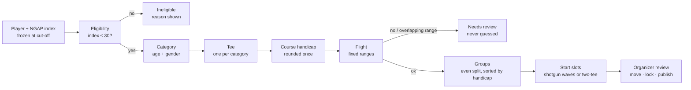

# Project plan: Starter (IGCC Tournament Desk)

Golf tournament management for **Iloilo Golf & Country Club (IGCC)**, built by **Syntaxure Labs**.
The organizer adds players; the system routes each one to a category, tee, flight, group and start
slot; the organizer reviews, overrides and publishes; players read their pairings on a phone.

> **Status date:** 17 Oct 2026 · **Branch state:** `develop` is the only long-lived branch ·
> **Working name:** "Starter" (not trademark-cleared, see [Open decisions](#10-open-decisions))

This is the single plan for humans and AI agents. Section 1 is the 60-second version. Everything
marked **Verified** was checked against the code, the migration or the tests on the date above.
Anything not marked is a plan, not a fact.

---

## 1. Where we are, in short

| Area | State | Evidence |
| --- | --- | --- |
| Routing engine (`src/lib/routing`) | **Built**, pure functions, no DB | 21 unit tests |
| Draw checks (`src/lib/draw`) | **Built**: blocking / warning / info issues, move rules | 15 unit tests |
| NGAP CSV import logic (`src/lib/ngap`) | **Built**, column mapping chosen in the UI | 16 unit tests; no `.xlsx`; no UI-to-DB writes |
| Database schema (`supabase/migrations`) | **Written and tested on a throwaway Postgres 16**; **not applied to any real Supabase project** | 14 tables, RLS on all |
| Organizer screens (`src/app`) | **Built on in-memory demo data**; a refresh resets everything | Overview, Players, Player profile + poster, Import, Draw, Setup, public Pairings |
| Brand and visual design | Interim (forest / ivory / gold). Final visuals to be done in Claude Design | Logos received only as low-res screenshots |
| Printing | **Partial**: browser print of the pairings page only | No start sheet, no scorecards |
| Scores, results | **Not started** (Phase 2) | No `scores` table yet |

Whole suite: 5 test files, 101 tests passing (`pnpm test`).

**The one thing blocking a real event:** nothing the organizer does is saved. The next build step is
the database connection (section 8, step 1). Until then the app is a working demo, not a tool.

---

## 2. Source of truth (read in this order)

1. **The code and tests in this repo.** If this plan and the code disagree, the code is what runs.
2. [`docs/spec/IGCC_Tournament_Desk.md`](spec/IGCC_Tournament_Desk.md): the build spec v1 sent to the organizer, with the rules the organizer confirmed on 17 Oct 2026.
3. This plan: status, gaps, roadmap, decisions made since the spec.
4. [`README.md`](../README.md): how to run the project.

Rules in the spec are **tournament settings, not constants**. Never hard-code a rule from section 3 into
the engine; it must come from `TournamentConfig`, categories, tees or flights.

---

## 3. Confirmed rules (organizer, 17 Oct 2026)

Full table is in the spec. The ones that drive the code:

| Rule | Value |
| --- | --- |
| Handicap source | Imported from the NGAP export. The system never computes an official index. |
| Course handicap | `Index × (Slope ÷ 113) + (Course Rating − Par)`, then × allowance (100%), **rounded once** at the end. Plus handicaps are stored negative and shown as `+n`. |
| Max handicap | 30, checked on the **NGAP index** (not the course handicap). Above 30 cannot register. |
| Categories | Regular, Senior 60–69, Super Senior 70+ (Silver tee), Ladies (own category and own tees). Age is taken on tournament day. |
| Flights | Fixed handicap ranges per category. Basis defaults to index. |
| Shotgun | 18 holes × max 4 per hole = 72 per wave. Wave 2 starts at wave 1 + gap (default 300 min). A flight is never split across waves unless it exceeds the holes in a wave, and then it is flagged. |
| Two-tee ("barrel") | Holes 1 and 10, one pair of groups per interval (default 12 min). |
| Scoring | Paper cards. No live scoring. |
| Photos | Taken or uploaded with recorded consent; kept off the public pairings page. |
| Tenancy | IGCC only for now; data model is multi-club ready. |

### Defaults chosen while organizer answers are pending

| Open question | Default in code | Where |
| --- | --- | --- |
| Flights on index or course handicap | Index | `TournamentConfig.flightBasis` |
| Flight not divisible by 4 | Even split (14 → 4, 4, 3, 3); minimum group 3 | `src/lib/routing/groups.ts` |
| Order inside a flight | By handicap | routing engine |
| Photos on public page | Never | `PairingsView`, `photoOf` |

---

## 4. How routing works



Every step records its result so the organizer can see why a player landed where they did.
Nothing is guessed: a missing index, no matching category, or a missing or overlapping flight range
marks the player `needs_review`, not a silent default.

**Worked example (placeholder tee numbers):** male, 63, index 14.2, Senior tee 70.1 / 125 / 72.
`14.2 × (125 ÷ 113) + (70.1 − 72) = 13.81 → 14` → Senior flight containing 14.

### Start formats

- **Shotgun:** groups fill holes 1–18 in flight order. If the next flight does not fit in the holes
  left in wave 1, the whole flight moves to wave 2 (labels 1A…18A, 1B…). Wave 2 start = wave 1 start + gap.
- **Two-tee:** slot `n` starts at `first tee + floor(n ÷ 2) × interval`, hole 1 if `n` is even, hole 10 if odd.
  Capacity depends on pace of play (spec assumes ~2 h per nine, which the club has not confirmed).

---

## 5. Architecture and conventions

### Stack

Next.js 16 (App Router) · React 19 · TypeScript strict (with `noUncheckedIndexedAccess`) · pnpm 10 ·
Biome (lint and format) · Vitest · `supabase-js` and plain SQL migrations (no Prisma) · Vercel.

### Layout

```text
src/lib/routing/   pure routing engine (no DB, no network)
src/lib/draw/      draw validation: issues + drop rules
src/lib/ngap/      CSV import, column mapping
src/lib/poster/    canvas poster generator (preview == export)
src/lib/store/     in-memory desk store (DEMO ONLY, to be replaced by Supabase)
src/lib/demo/      demo tees, categories, flights, players
src/components/    UI; src/components/draw/ is the draw control room
src/app/(desk)/    organizer screens;  src/app/(public)/  player-facing pages
supabase/migrations/   schema;  supabase/seed.sql   development seed
docs/              this plan and the spec
```

### Rules that keep it correct

- The routing engine and draw checks stay **pure functions**. Test them; do not put I/O in them.
- Pairings shown to players come from a **frozen `Published` snapshot** (names, hole, time only),
  never from the live board. Editing the board after publishing shows "Published, with changes"
  until the organizer publishes again.
- Publishing is **blocked** by blocking issues (duplicate player, over capacity, ready player with no
  group, ineligible player in a group). Warnings need acknowledgement.
- Photos are used only where consent is recorded (`photoOf`). Private bucket, never on public pairings.
- Colors are tokens on `:root` with dark redefinitions; contrast is guarded by `src/styles/contrast.test.ts`.
- No external font or script calls (fonts are bundled via `@fontsource`).

### Database design

Verified in `supabase/migrations/20261017000000_init.sql`:

- `club_id` on every table; row-level security through `public.is_club_member(club_id)`.
- Composite foreign keys `(id, club_id)` so a row in one club cannot reference another club's data.
- `public.public_pairings(tournament_id)`: security-definer function returning names, flight, hole and time only. No login needed.
- Private `player-photos` bucket, paths under `{club_id}/`.
- `btree_gist` exclusion constraint prevents overlapping flight ranges within a category.
- Registrations store `frozen_index` so a later NGAP upload cannot change a published draw.
- Clubs and memberships are created with the service role during onboarding, not from the app.

**Schema vs spec:** the migration has 14 tables: the spec's tables except `scores` (Phase 2), plus `club_members`
(needed for RLS). Tested on a throwaway Postgres 16; **never applied to a real Supabase project.**

### Git workflow

- Base branch `develop`. Multi-file work goes on a dedicated branch and a pull request into `develop`.
- Planned pipeline `develop → staging → main`. **`staging` and `main` do not exist yet** (see decisions).
- Commit messages and PR descriptions carry the attribution lines required by the tooling in use.
- A repo-state claim ("it is merged", "it is deployed") must be checked against the remote, not memory.

---

## 6. Screens: status

| Screen | State |
| --- | --- |
| Overview | Built (demo data) |
| Players list | Built; add/edit/remove players, in memory |
| Player profile | Built; photo with consent flag, poster generator (1080×1350 championship, 1080×1080 card) |
| Import handicaps | Built; CSV, column mapping, applies to in-memory players |
| Draw control room | Built; generate, drag or move players, lock, issues panel, publish dialog, draft / published / changed states |
| Setup | Built **read-only** (tees, categories, flights shown, not editable) |
| Public pairings | Built; search by name, large text, print button |
| Course and tee entry | **Not built** (needs the DB step) |
| Tournament setup wizard | **Not built** |
| Registration desk (directory search, copy from past event) | **Not built** |
| Cut-off freeze UI | **Not built** (`cutoff_date` exists in the schema only) |
| Start sheet and scorecards with handicap dots | **Not built** |
| Score encoding and results | Phase 2 |

---

## 7. Verified gaps between spec and code

These are places where the spec promises something the code does not do yet. Checked on 17 Oct 2026.

1. **Re-run moves locked groups.** Spec step 10: "Re-running the router never moves a locked group."
   Today the `generate` action rebuilds the whole draw and resets every group to `locked: false`
   (`src/lib/store/desk-store.tsx`), and `route()` has no notion of locked groups. Locking only
   protects against manual moves. *Fix:* give `route()` locked groups as fixed input and route only the remaining players.
2. **Nothing persists.** All screens use `DeskProvider` in-memory state.
3. **Cut-off date is not applied.** The engine takes one index per player; there is no step that picks "latest index on or before the cut-off".
4. **Printing is incomplete.** Only the browser's print of the pairings page exists.
5. **Setup is read-only.** Real IGCC ratings cannot be entered through the app yet.
6. **Tee data is placeholder.** Demo and test numbers (e.g. White 71.5 / 128 / 72) are invented. Wrong numbers give wrong playing handicaps.
7. **Wave rule vs. small flights.** Keeping flights whole can push a small flight (the demo's Ladies, 3 groups) to wave 2 when one hole is left in wave 1. Needs an organizer decision (see section 10).
8. **Import is CSV-only.** The real NGAP export format has not been seen; if it is `.xlsx`, support must be added.

---

## 8. Roadmap

Order matters: each step unblocks the next. Effort is not estimated here on purpose; no velocity data exists yet.

### Phase 1: first IGCC event

1. **Database connection** *(needs Jeff at a computer with Supabase access)*
   - Create the Supabase project (Pro). Apply the migration (`supabase db push`). Run `seed.sql` for the club row.
   - Auth: organizer login, `club_members` row, RLS tested with a real user.
   - Verify the `player-photos` storage policy with a real upload.
   - Replace the in-memory store with Supabase reads and writes: players, handicap records, tournaments, registrations, groups.
2. **Real course data:** setup screens editable; enter IGCC's real Course Rating, Slope, Par and stroke index per tee, checked against the club scorecard.
3. **NGAP import end to end:** get a real sample export, set the default mapping, write handicap records, apply the cut-off rule (gap 3).
4. **Lock-aware re-run** (gap 1), with tests.
5. **Registration desk:** directory search, tap to add, copy list from a past event, cut-off freeze.
6. **Print:** start sheet, pairings, scorecards with handicap dots (uses `holes.stroke_index`).
7. **Deploy:** Vercel project, env vars, `staging` and `main` branches, CI (typecheck, lint, tests, build).
8. **Dress rehearsal:** run a full fake tournament with the organizer using real IGCC data before the real event.

### Phase 2: results

Score encoding from paper cards, gross and net per flight, tie-breaks, results export. Needs the organizer's tie-break rule. Adds the `scores` table.

### Phase 3: growth

Player self-registration and online payment, SMS or Messenger notices, onboarding a second club.

### Not planned

Computing an official WHS index · live mobile scoring · posting scores back to NGAP.

---

## 9. Running costs (monthly, as of 17 Oct 2026)

Budget given to the funder: **₱5,000 per month**. FX used: 1 USD = ₱63.03.

| Item | USD / month | Notes |
| --- | --- | --- |
| Vercel Pro | $20 | One seat; includes usage credit. Hobby is non-commercial only, so Pro is needed. |
| Supabase Pro | $25 | 8 GB database, daily backups (7 days). Free tier pauses after a week idle and has no backups. |
| OpenCode Go (agents) | $10 | $5 for the first month. Claude models are not included in it. |
| **Total** | **$55 ≈ ₱3,467** | First month $50 ≈ ₱3,152. About ₱41,600 per year. With 12% VAT possible: ≈ ₱3,883. |

Cost controls to set when the accounts are created: a **low Vercel spend limit** (the default on-demand
budget is $200) and **Supabase spend cap on**. Prices change; re-check before paying. The full sheet
is a separate document and is not kept in this repo.

---

## 10. Open decisions

Decisions that belong to the people named, not to an agent.

| # | Decision | Owner | Blocks | Default meanwhile |
| --- | --- | --- | --- | --- |
| 1 | Real Course Rating / Slope / Par / stroke index per tee | Organizer / club | First real draw | Placeholder numbers (unsafe for real use) |
| 2 | Sample NGAP export | Organizer | Import mapping defaults | Mapping chosen in UI |
| 3 | Tees for Regular, Senior, Ladies; Ladies senior split? | Organizer | Category setup | Demo mapping |
| 4 | Flight basis: index or course handicap | Organizer | Flight assignment | Index |
| 5 | Flight not divisible by 4 | Organizer | Group sizes | Even split, min 3 |
| 6 | Ordering inside a flight | Organizer | Groups | By handicap |
| 7 | Photo visibility | Organizer | Privacy copy | Desk and organizer only |
| 8 | Results and tie-break rule | Organizer | Phase 2 | None |
| 9 | Small flight near the end of wave 1 (e.g. 3-group Ladies): split, fill from another flight, or move to wave 2 | Organizer | Shotgun layout | Keep whole, flag |
| 10 | Product name ("Starter" is not trademark-cleared) | Jeff | Public branding | "Starter" |
| 11 | Final visual design and original IGCC logo files | Jeff, via Claude Design | Brand polish | Interim theme |
| 12 | Create `staging` and `main` branches; clean up old feature branches; consider a Syntaxure organization for the repo | Jeff | Pipeline | Only `develop` |

---

## 11. Risks

- **Data.** Wrong tee data means wrong handicaps for every player. Check against the club scorecard before the first event.
- **Process.** A stale NGAP file means players register on old indexes. Someone must upload a fresh export before every cut-off.
- **Privacy.** Photos, birthdates and contact details are personal data under the Data Privacy Act of 2012. Consent line before photos, private storage, names only on the public page.
- **Scope.** The router proposes; the organizer decides. Withdrawals and sponsor groups on the day are normal, so overrides are core.
- **Unproven schema.** The migration has not run on a real Supabase project. Expect small fixes in step 1.
- **Single point of knowledge.** The routing rules live partly in the organizer's head. Unconfirmed defaults in section 3 must be confirmed before launch.

---

## 12. Working with AI agents

Agents should read, in order: `AGENTS.md` → this plan → the spec → the code they are about to change.

Default model routing for the OpenCode Go setup (Jeff's preference):

| Task | Model |
| --- | --- |
| Scaffolding | DeepSeek V4 Pro |
| Complex tasks | Kimi 3 |
| Design | Claude Sonnet |
| Reasoning | GLM 2.5 |
| All-around, quick edits | MiMo v2.5 Pro |
| Frontend UI, minimal tasks | Flash 3.6 (Antigravity) |

Caveat: the cost sheet found that **Claude models are not included in OpenCode Go**, so the "Claude Sonnet — design"
row needs a separate Claude subscription or API access, or Claude Design for the final visuals.

Agent ground rules:

- Inspect the code before claiming something works or is broken.
- Run `pnpm typecheck && pnpm lint && pnpm test` before every commit; do not weaken a test to make it pass.
- Do not apply migrations to, or change, production data without the owner's explicit say-so.
- Schema changes, auth changes and rule changes (section 3) need the owner's decision first.

---

## 13. Launch checklist (first real event)

- [ ] Database applied to a real Supabase project and tested with a real login
- [ ] Real IGCC tee data entered and checked against the club scorecard
- [ ] Sample NGAP export received; import tested with the real file; fresh export uploaded before cut-off
- [ ] Open decisions 3–7 and 9 confirmed by the organizer
- [ ] Lock-aware re-run built (gap 1)
- [ ] Start sheet and scorecards printed on real paper at the club
- [ ] Photo consent line shown before every photo; private bucket verified
- [ ] Public pairings page checked on an older phone
- [ ] Vercel spend limit set; Supabase spend cap on; backups understood
- [ ] Dress rehearsal with the organizer
- [ ] Rollback plan: how the organizer runs the day from a printed sheet if the site is down

---

## 14. Decision log

| Date | Decision |
| --- | --- |
| 17 Oct 2026 | Rules confirmed by the organizer (spec v1). Rules are tournament settings, not constants. |
| 17 Oct 2026 | Stack: Next.js + Supabase (`supabase-js` and SQL migrations, not Prisma) + Vercel. |
| 17 Oct 2026 | Multi-tenant data model from day one (`club_id` + RLS), IGCC the only tenant. |
| 17 Oct 2026 | Importer is mapping-based so the app is not tied to a guessed NGAP format. |
| 17 Oct 2026 | Database work deferred until Jeff can set up Supabase in person; shell and UI built on demo data first. |
| 17 Oct 2026 | Interim brand forest / ivory / gold; final design to be done in Claude Design. |
| 17 Oct 2026 | Photos shown only with recorded consent and never on the public page. |
| 17 Oct 2026 | PRs #1 (organizer UI) and #2 (design system) merged into `develop`. |

---

## 15. Glossary

- **NGAP:** the national golf association whose handicap index export the club provides.
- **Index / handicap index:** the player's NGAP number; not course-specific.
- **Course handicap:** index adjusted for a tee's Slope, Course Rating and Par.
- **Playing handicap:** course handicap × allowance (100% for now), rounded.
- **Category:** Regular, Senior, Super Senior, Ladies. Decides the tee.
- **Flight:** a handicap band inside a category; players in a flight play together.
- **Shotgun start:** everyone tees off at once from different holes. **Wave:** a full set of 18 holes; the second wave (B) starts after a gap.
- **Two-tee ("barrel") start:** groups start from holes 1 and 10 at timed intervals.
- **Cut-off date:** the date whose index is frozen for the event.
- **Draw:** the set of groups and start slots; **published** means players can see it.
- **RLS:** row-level security, the database rule that keeps one club's data from another.
