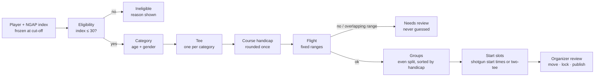

# Project plan: TeeLine Golf (IGCC Tournament Desk)

Golf tournament management for **Iloilo Golf & Country Club (IGCC)**, built by **Syntaxure Labs**.
The organizer adds players; the system routes each one to a category, tee, flight, group and start
slot; the organizer reviews, overrides and publishes; players read their pairings on a phone.

> **Status date:** 14 Nov 2026 · **Production:** `v0.52.2` (the 0.52.1 tabulator fix, deployed by 0.52.2 after Vercel blocked the 0.52.1 merge; see the decision log, 14 Nov 2026) · **Branches:** `develop` (integration, no deploy), `staging` (preview), `main` (production) ·
> **Product name:** TeeLine Golf (approved direction; trademark clearance has not been established)

This is the single plan for humans and AI agents. Section 1 is the 60-second version. Everything
marked **Verified** was checked against the code, the migration or the tests on the date above.
Anything not marked is a plan, not a fact.

---

## Live event override (internal, 13 Nov 2026)

**The 24th Bamboo Tee is running. The event follows the organiser's field list, not the other way
round.** This applies to the whole event, not only its data.

For this event the official member-guest sheet (as of 10 Nov 2026) is the authority for the field.
The event's own settings are working values: when the sheet and a setting disagree, change the
setting.

- **Adopt the sheet.** Statuses, indices, playing days, pairs, classes and the event's day rule may be
  corrected straight from it. No separate approval round, and no waiting for a "final" state.
- **Speed first.** Apply the sheet, then verify. Drop release ceremony that does not protect live
  scoring. Keep the checks that do: a round's frozen snapshot is what scoring reads, so changing a
  registration's frozen index does not rewrite a posted score.
- **Internal only.** No public page, player copy, email, print output or deck describes the event as
  provisional, draft or subject to change. The override changes how agents work, not what players are
  told.

Applied on 13 Nov 2026 and checked against the live project and `https://golf.syntaxure.dev/roster`:

| Change | Result |
| --- | --- |
| 33 official `needs_review` entries confirmed, each with the sheet's index | public roster 286 → 319 |
| `CAMOT, ARRIANE` corrected to `CAMOT, ARIANNE` | one name, now spelled as the sheet spells it |
| `LOCSIN, WILSON` (30.5) and `TOBES, JEROME` (30.6) moved to confirmed | both are above the 30 cap; routing still caps at 30 |
| `SEBASTIAN, BUTCH` and `ALAS-AS, FRED` added with their sheet schedules | two players the system had never registered |
| 8 registrations publishing `Index 0` given their sheet index | CAPARROS 8.2, LEVISTE 15.9, PANAGUITON 17.8, PAUIG 5.5, SUMULONG 1.1, CABANAYAN 20.1, TAN 21.7, YATCO 18.3 |
| `LIM, APOY` added for Day 3 AM only, as the sheet lists him | the event's `required_days` relaxed from 2 to null; `max_days` stays 2, so a one-day entry is valid |
| Public roster | **324 of 325 registrations**; the one `needs_review` row, `VILLASIS, VEL`, is not on the sheet |

Not blockers for the roster, still open: 39 public players have no class and 47 no category, because
their entries were never routed. `SIASON, TIM` carries `203` on the sheet; the live index is 20.3 and
is correct. `MANGALINDAN, VIC` on the sheet is the already-public `MANGALINDAN, VICTOR`.

---

## Second half of the 24th Bamboo Tee (plan of 14 Nov 2026)

The first half (Day 1 and Day 2, 12 and 13 Nov) was scored outside the system: standalone HTML sheets
in `docs/scoresheets`, a JSON export, and one-off upload scripts run by the orchestrator. It worked,
and it is not how the event should run. The goal for Days 3 and 4 and after is that the team uses the
system by itself.

### What the owner reported, and where each item stands

| # | Feedback | State on 14 Nov | Issue | Owner |
| --- | --- | --- | --- | --- |
| 1 | Complaints about index changes, schedule and names need one place. Use GitHub issues, not a new screen | Labels and the four issue forms are live; the runbook section is written. **The repository is public; the owner will make it private.** Until then a complaint uses the pair number or player ID only. Board still to set up | [#263](https://github.com/J-Akiru5/golf-management-system-sl/issues/263) | Jeff |
| 2 | The board could move players but not swap them | **Released in v0.46.0** (swap, set move and swap, typed commands). Code check done (`docs/handoffs/2026-11-14-board-edit-check.md`): board edits leave no audit row, and Undo erases the record. Manual test on production still to do | [#264](https://github.com/J-Akiru5/golf-management-system-sl/issues/264) | Jeff |
| 3 | Public scores as a table: name, index, gross and net, with search and filter | **Released in v0.47.0** by Lou: `/results`, every player with a published card, day and AM/PM filters, name search, each round's points. AM/PM comes from the published tee time | #261, #262 (closed) | Lou |
| 4 | The index could not be edited | **Released**: registration desk and player page in v0.44.1, the board in v0.46.0. The code check found that an edit reclasses one player, not the pair average (#268, P0), that any club member can change an index through the API (#269), and that the audit row has no old or new value (#265) | [#264](https://github.com/J-Akiru5/golf-management-system-sl/issues/264) | Jeff |
| 5 | Scoring lags at verification; manual entry must be complete and fast | `/scores` cannot save a card under this event's rules, so scripts were used. Entry has no player search or filters | [#258](https://github.com/J-Akiru5/golf-management-system-sl/issues/258) (save and import), [#259](https://github.com/J-Akiru5/golf-management-system-sl/issues/259) (entry screen) | Karl, Lou |
| 6 | A saved edit does not reach the public page | Board edits do in Live mode (v0.46.0). Scores still need a manual publish | [#260](https://github.com/J-Akiru5/golf-management-system-sl/issues/260) | Karl |
| 7 | A proper audit log behind every fast change | Audit tables and `/audit` exist; coverage of every public-facing write is not confirmed | [#265](https://github.com/J-Akiru5/golf-management-system-sl/issues/265) | Karl |
| 8 | Bring useful work from other branches to `main`; keep versions and this plan in step | `main`, `develop` and `staging` carry the same code at v0.46.0. Four open PRs to decide | [#266](https://github.com/J-Akiru5/golf-management-system-sl/issues/266) | Jeff |

### Decisions the owner made on 14 Nov 2026

- **Complaints** are GitHub issues in this repository, which the owner makes private.
- **Scores go public once verified.** Ticking a card verified publishes the next version without a
  Publish click. An unverified card stays on the desk. The frozen snapshot stays; this changes when
  it is taken. It replaces the rule "a score is public only after a manual publish" for this event,
  and the spec is updated when [#260](https://github.com/J-Akiru5/golf-management-system-sl/issues/260) lands.
- **`/scores` is the one place** the team enters and publishes scores. The `/scorecard` grid and the
  HTML sheets remain as a bridge until [#258](https://github.com/J-Akiru5/golf-management-system-sl/issues/258) lands.
- **The public scores table shows Stableford points**: name, index, gross points, net points, by day
  and session.
- **Fast control, checked afterwards.** Changes are made first; anything published without a check
  gets a `needs-verification` issue on the complaint desk.

### Order of work

1. **P0, during the event:** #258 save and import on `/scores`, #259 entry screen, #260 publish on
   verify, #263 complaint desk, #264 manual test on production, #268 pair-average class on an index edit.
2. **P1, as soon as P0 allows:** #265 audit coverage, #266 branch and PR triage, #269 index edit
   rights in the database (RLS: the owner decides). P2: #270.
3. **Until #258 and #260 are released**, each session is scored the way Days 1 and 2 were: the sheet,
   the export, and the orchestrator's upload. That path is known to work.

#259 depends on #258. #260 builds on the save path from #258. The rest are
independent and can run in parallel.

### Built on 14 Nov 2026 (second wave)

| Work | State | Migration | Evidence |
| --- | --- | --- | --- |
| #268 pair-average class on an index edit | **On `develop`.** The dialog classes both partners on the capped average in the event's flight basis, saves the class on the partner's row, and the engine now honours `flightBasis`. | None | `pnpm check` (2,690 tests and build) and `pnpm check:ui` (238 checks) on the merged tree |
| #204 player handicap record | **On `develop`.** The player page's Handicap history has Add index and Edit for an owner or organizer. One record per player and date; one audit row with the old and new index, the date and the reason. | `20261114000200_save_handicap_record.sql`, **NOT APPLIED** | Same gate; the record path fails soft until the function is applied |
| #204 / #270 point 2 played-round correction | **On `develop`.** `/scores` has Correct handicap for an owner or organizer. The guarded function audits the change, recalculates that player's result, and the next publish carries it to the public board. | `20261114000300_correct_handicap_snapshot.sql`, **NOT APPLIED** | Same gate; the sheet fails soft until the function is applied |
| #259 fast manual entry | **On `develop`.** Name search, day/session/class/card-state filters, entered/verified/missing counts, keyboard 18-hole grid, Save and next, 44px cells. | None | `pnpm check` and `pnpm check:ui`, with a browser section for the flow |
| #260 publish on verify | **On `develop` for the live browser.** Approving a card publishes the round after a two-second pause, one publication per run, and clears the public reads. The on/off choice is remembered per browser, event and day. The Publish button still works. **Still open:** a server-side per-round setting and one-step undo. | None | Browser checks for the toggle and the auto-publish path; no live publish was run |
| #258 card save on `/scores` | **Code on `develop`; the live function is missing.** `save_card_handicap_snapshot` is not in the live project, so the card-rules save fails there until `20261114000100_card_handicap_snapshot.sql` is applied by name. | `20261114000100_card_handicap_snapshot.sql`, **NOT APPLIED** | The live REST schema lists no such RPC (14 Nov 2026) |

**Owner action for the live event:** apply the three migrations in order
(`20261114000100`, `20261114000200`, `20261114000300`) in the Supabase SQL editor for the golf
project. The build machine cannot do it: the service-role key reaches data but not DDL, the CLI
account does not see the project, and there is no database password or management token here. Each
file is additive except `20261114000300`, which replaces the guard body and says so.

### Workload

| Person | Role | Issues | Load |
| --- | --- | --- | --- |
| Jeff | Lead, CI/CD and releases, orchestrator | #263, #264, #266, plus review, merge and release of everything | 3 issues and the gate |
| Karl (`Karlcalimotan`) | Backend | #258, #260, #265, #268, #269, #270 | 6 issues, the heaviest load; #258 and #268 are P0. #268 can move to the orchestrator's builders if Karl is on #258 |
| Lou (`dev-lou`) | Frontend | #259 (#262 done in v0.47.0) | 1 open issue; waits on #258's save path |

Jeff's issues are built by the orchestrator's builders (section 12). Karl's and Lou's are theirs,
through a pull request to `develop`.

---

## 1. Where we are, in short

| Area | State | Evidence |
| --- | --- | --- |
| Routing engine (`src/lib/routing`) | **Built**, pure functions, no DB; **lock-aware re-run** | 26 unit tests |
| Draw checks (`src/lib/draw`) | **Built**: blocking / warning / info issues, move rules | 15 unit tests |
| NGAP CSV import logic (`src/lib/ngap`) | **Built**: mapping, match/merge review queue, strict plan | 25 unit tests; no `.xlsx`; no DB writes |
| NGAP FAQ (public) | **A public FAQ page at `/faq`** rendering the NGAP's 18 WHS questions in the NGAP's words (`src/lib/public/ngap-faq.ts`), with a source card naming the 2024 document and a link to ngapwhs.com, plus two source gaps shown as notes: question 3's "(indicate date)" placeholder and question 17's table being an image. English only by the owner's decision; linked from the landing navigation. The reference copy is archived at `docs/ngap/wsh-faq.md` | PR #84; decision 35 |
| SEO and discovery | **Canonical host, metadata, OG card, robots, sitemap, llms.txt and structured data** (`src/lib/seo.ts`, `src/app/robots.ts`, `src/app/sitemap.ts`, `src/app/llms.txt/route.ts`, `public/og/teeline-og.jpg`): public pages indexed (home, pairings, FAQ), entry links and everything behind sign-in excluded, non-production deployments send `X-Robots-Tag: noindex`, and a hybrid photo + TeeLine-brand 1200 × 630 card replaces the upscaled 320 px crest. Organization/WebSite/SoftwareApplication/FAQPage JSON-LD; company facts from MDM. Search Console verification is the owner's step | PR `feat/seo-og`; `docs/seo.md`; decision 36 |
| Database schema (`supabase/migrations`) | **Applied to the real project and in step on 21 Oct 2026**: 23 migrations, including the scoring pair (`20261035000000`, `20261036000000`), the course-map migration (`20261034000000`, applied 20 Oct 2026) and the registration/day pair (`20261037000000`, `20261038000000`). The live project now has 45 tables, 15 of them scoring | `supabase migration list --linked` shows local and remote in step; the REST schema shows every scoring table and `groups.round_id` |
| NGAP FAQ (in review) | **NGAP's WHS FAQs captured as a reference section** (`docs/ngap/wsh-faq.md`): the 18 questions, reproduced from `NGAP-FAQs-FINALEDIT.pdf`, with the 2024 fee and billing context and the source's two gaps recorded. **Not shown in the app**; placement (help centre, a public page, or docs only) is decision 24 | PR `docs/ngap-faq`; decision 24 |
| Supabase data layer (`src/lib/auth`, `src/lib/supabase`, `src/lib/data/supabase`) | **Wired (merged 18 Oct, `b8d9c7a`)**: the store uses `createSupabaseAdapters` and `loadDeskState` when a Supabase URL is configured, and the mock adapters when it is not. Not yet exercised end to end with real course and tournament rows | `src/lib/data/supabase/adapters.ts`, `load-desk-state.ts`, `domain.ts`; 24 tests |
| Deployment | Vercel project **`golf-management-system-sl`** (team `j-akiru5s-projects`), production tracks `main` at **https://golf.syntaxure.dev**; production serves **v0.50.1 (14 Nov 2026)**; **v0.51.0** is prepared for the owner's merge. The 0.51.0 release adds the assigned list, the admin queue and the sign-in loop fix, and changes code only: the live scorecard documents are read and were backed up before promotion. The owner merged 0.50.0 (`57bb3e6`) and 0.50.1 (`100ad1c`) as Jeff, and Vercel deployed both; the v0.47.0–v0.49.0 tags were never deployed because Vercel rejected their authors. Karl's merges are still blocked by Vercel, so the owner merges to deploy. The tag, not the tip of `main`, is the release (`docs/VERSIONING.md`). `develop` is the integration branch and does not deploy; `staging` is the preview deployment. Only `main` and `staging` auto-deploy: `vercel.json` disables deployments for every other branch, so feature, release and throwaway branches build nothing. `staging` and `main` are protected: a change reaches them only through a pull request with both required checks passing. Every production deploy is a tagged release (section 5). **Set `NEXT_PUBLIC_SITE_URL` to that domain in Vercel** so player share links do not depend on the host the desk happens to use | `vercel ls`, `vercel inspect`; production env vars are not in the repo |
| Staff auth and roles (`20261019000000_staff_auth_audit.sql`, `src/lib/auth/roles.ts`) | **Applied 18 Oct 2026 and verified**: `owner` / `organizer` / `desk`; publishing, tournament settings and member management are owner/organizer only, in RLS; registration audit columns stamped by trigger. Two staff accounts exist (`admin` = owner, `member1` = desk) | Verified by signing in as each role: owner sees both member rows, desk sees only its own |
| Player auth and the player area (`src/lib/auth/routes.ts`, `src/app/(player)`, `src/lib/player`) | **Built, tested and applied.** One sign-in page for players and staff, `/my` with a claim step and a read-only view of the player's own entry and published start. The database half is live; what is missing is a test account linked to a test player | `routes.test.ts` (15), `portal.test.ts` (7), `claim.test.ts` (4); guard matrix checked over HTTP with a Supabase URL configured; the three functions answered correctly against the live project (see section 7) |
| Player scorecard breakdown (25 Oct 2026) | **Built, tested and applied to the database; the UI waits on PR #118.** `/my` shows the signed-in player's own frozen hole-by-hole card after a round is published: par, SI, gross, handicap strokes, net, gross and net Stableford points, with nine and total subtotals. The public leaderboard stays summary-only. Existing publications have no cards until republished | `src/lib/player/scorecard.ts`, `src/components/player/ScorecardBreakdown.tsx`; 872 tests; migration `20261042000000_player_scorecard_snapshot.sql` **applied 25 Oct 2026**; the live `build_round_snapshot` returned the existing 18-hole result with a `cards` array; no publication exists yet |
| Public player profile and team leaderboard (8 Nov 2026) | **Built on `feat/issue-198-profile-leaderboard`; migration applied to the live project on 8 Nov 2026.** The pairings navigation is Pairings, Players, Player Profile and Leaderboard. `?tab=profile` searches a confirmed player and shows their frozen card, partner, class, category and index. `/leaderboard` ranks two-man teams cumulatively across published rounds, with category and class filters, a ten-team limit and a `T` mark for ties; the anonymous leaderboard stays aggregate-only. The old per-round tables remain as a fallback for a database without the function | Issue #198; `public-team-leaderboard.test.ts`, `public-profile.test.ts`, `public-tabs.test.ts`; migration `20261108003000_public_profile_leaderboard.sql` **applied to the live project on 8 Nov 2026** (owner, SQL editor, four pieces; self-check passed; anonymous call confirmed; no round published yet, so not checked against live scores); full suite 1699/1701 with two resource-contention timeouts that passed in isolation; build deferred under red resources |
| Organizer screens (`src/app`) | **Built**: on the session store in demo mode; with Supabase configured the same screens read and write the project through the adapters. An end-to-end pass with real event data is still pending | Public TeeLine landing at `/`, control room at `/admin`, plus Tournaments, Players, Registration desk, Import, Draw, Print center, Settings, Course & holes, Clubhouse display, Player view and profiles |
| Data boundary (`src/lib/data`) | **Built as mock adapters** over the session store | `PlayerRepository`, `TournamentRepository`, `RegistrationRepository`, `HandicapImportAdapter`, `PairingsRouter`, public allow-list |
| API regulation (12 Nov 2026) | **Adopted for the HTTP surface; no migration.** `API_REGULATION.md` is in the repo, `docs/API.md` records the project decisions and deviations, and wrapped route handlers send `X-Request-Id` and `Server-Timing`. `/api/v1/pairings/version` is the versioned envelope; the legacy path keeps its body until 2027-01-31. The pairings page skips the auth round trip for signed-out visitors, and the leaderboard starts its three public reads together | `src/lib/api/timing.ts`, `src/lib/api/pairings-version.ts`, `pnpm api:check`; page p95 133-212 ms on the demo dev server; the version endpoint suite needs a connected run |
| Brand and visual design | **TeeLine Golf** identity: public landing page, fairway-and-flag vector mark, Ivory / Charcoal themes; the IGCC crest stays a separate club asset | Tokens in `src/app/globals.css`, logo variants in `public/brand`, contrast guarded by `src/styles/contrast.test.ts` |
| Printing | **Print components and pure helpers built**: sorted start sheet, allow-listed pairings sheet, per-group 18-hole scorecards, handicap dots, and A4 print CSS | `src/lib/print` tests; dev-only preview at `/print-preview`; real course data and club-printer test still pending |
| Merged (PR #17) | **Event setup and the notification schema**, merged into `develop` as `863c253` on 18 Oct 2026: the desk saves course, tees, holes, categories and flights in one guarded, manager-only transaction, enters the real tee and hole numbers, loads the saved tees and holes instead of the samples, adds the paging primitive, and writes the notifications migration. Its migrations `20261024000000`, `20261025000000` and `20261026000000` are all applied to the live project (verified over the API) | Section 8, step W1 done |
| Merged (PR #23) | **The alerts bell and the paged lists** (`feat/desk-lists-and-bell`): the bell in the shell, the notification loader, paging applied to the players, registration and import review lists, and the import review tabs. Merged into `develop` as `1fd2b76` on 18 Oct 2026. It shipped with two bugs that browser checking found and the follow-up below fixes | Follow-up PR `fix/desk-browser-found` |
| Merged (PR #27) | **Settings that save** (`feat/settings-saves`, merged as `45dce3c` on 18 Oct 2026, tagged `v0.7.0`): draft-then-save with a Save on every section plus Save all changes, the tournament-level fields carried by the guarded `save_event_setup`, the entry link on the deployed domain, and Add a day incrementing with every day editable. Migration `20261027000000_setup_tournament_fields.sql` is **applied live** and verified over the API | Merged; release line is now 0.8.0 |
| Releases | **v0.7.0** settings that save; **v0.7.1** the bell waiting for the connected desk; **v0.8.0** the help centre, shell polish, player languages and one shared draw revision, tagged at `06a2748`. `develop` and `main` are kept level and carry the v0.8.0 code plus docs-only commits; production's code is the v0.8.0 tag. See section 5, "Versioning and production" | tags `v0.7.0`, `v0.7.1`, `v0.8.0`; `git ls-remote --tags` |
| Long lists | **Paged on the desk's lists.** `src/lib/data/paging.ts`: 50 rows a page, paged in the browser, queries unchanged. Applied to the player directory, the registration desk and the import review tabs. Switching tab, search or filter returns to page 1, and ties break on the record id so editing a row cannot move it to another page. **Deliberately not paged**: print, the draw groups and the desk's player search | Decision 13 settled; gap 10 closed for the desk screens |
| Alerts | **Bell built.** Decision 14 is stored, desk-facing notifications (option B): `notifications` + `notification_reads` with per-user read state, `sync_notifications(tournament)` and `mark_notifications_read(tournament)`, all applied to the live project. The bell merges the live draw issues with the stored rows, de-duplicates them, and counts unresolved blocking and warning whatever their read state; read state only quiets info. The full sync cycle was checked over the API: a warning appeared and cleared when the cause was fixed, and a dismissed info notice stayed read in a fresh session. Issue #171 adds a per-item Mark as read and a Mark all as read, keeps live blocking and warning items out of the badge's read state, and closes the panel on navigation. The single-row function `mark_notification_read(notification)` is recorded as applied to the live project on 8 November 2026. Issue #219 moves a read alert out of the unread list into a collapsed **Read (N)** section, updates it optimistically, reverts on a failed write, and syncs the mark to other open tabs over a `BroadcastChannel`; blocking and warning items still count until fixed | Gap 11 closed; merged (#23, `1fd2b76`); follow-ups #171 and #219 (duplicate #197) |
| New-entry alerts | **One alert per entry waiting at the desk, derived from the registrations the bell already loads.** The bell names the player, links to `/register`, and clears the alert when the entry is confirmed or rejected. The stored `needs_review` summary is suppressed while these exist, so the badge counts players, not players plus a summary. A one-minute timer and window focus poll a single count, and the registration screen reloads once when it rises; every desk screen refreshes the stored alert. An entry submitted while the desk is open therefore appears without a manual reload, and no timer reloads an open form on another screen. No form is touched by a timer. Email (Resend) and the stored audit row are Phase 2 | Built on `feat/registration-alerts`; no migration needed |
| Merged (PR #28) | **Player languages**: English, Tagalog and Hiligaynon on the player surfaces (`src/lib/i18n`). A cookie-backed choice with the browser's preference as the fallback, typed dictionaries with coverage tests, a language picker in the player header, and the portal, pairings, demo pairings and entry pages reading their copy from the dictionary. Tagalog and Hiligaynon are drafts; **Jeff reads both languages and reviews them himself** (checklist in `docs/i18n-review.md`). Desk chrome is still English | `docs/i18n-review.md`; `verify:ui` section "player languages" |
| Merged (PR #31) | **The help centre**: a "?" in every shell with a step list for the screen, a first-run welcome, and a printable cheat sheet (`src/lib/help`, `src/components/help`). Desk guides are English literals with `data-help` anchors on the real controls, player guides are dictionary keys so they are translated, and "Show me" closes the panel and rings the control. Seen-state is per user in `help_seen` (migration `20261028000000`, **applied 18 Oct 2026** in the SQL editor, verified over the API) with localStorage always written, so the welcome shows once per person and once per browser. Merged into `develop` as `3b863e1` on 18 Oct 2026. A **Report a bug** action is a nice-to-have, not built (section 8, decision 21) | `verify:ui` sections "help centre", "cheat sheet", "first-run welcome" |
| Merged (PR #32) | **Shell polish**: the theme control is a dropdown (System / Light / Dark), the rail names its icons, and the rail expands into labelled rows. `src/lib/ui/rail.ts` holds the saved choice and the two numbers `globals.css` turns into `--rail-width`/`--rail-pad`; a pre-paint script applies it so a saved expanded rail never flashes compact, and the tooltips say what an alert dot means. The control room's absolute panels read the same variable instead of a hard-coded 112px. Merged into `develop` as `9054332` on 18 Oct 2026 | `verify:ui` section "shell: tooltips, theme and rail" |
| Merged (PR #33) | **The public entry form's own copy in English, Tagalog and Hiligaynon** (30 keys under `enter.form.*`): labels, hints, the "optional" and "to be confirmed" suffixes, the send button and the review note. What the club typed — instructions, extra questions, tee labels, the payment note — is their text and is passed through unchanged. The dev-only preview page renders the real form with a language picker, because the form is otherwise only reachable against a connected project | `verify:ui` section "entry form in three languages" |
| Merged (PR #64) | **The two aerial references are recorded and the per-hole review is written** (`docs/course-map/review.md`, images beside it, SHA-256 hashes recorded): neither reference is authoritative, the two layouts disagree on every hole number, and the checklist for Sir Philip plus the validation workflow for Ma'am Mary Ann are in that document. No layout is in the app; it still uses the illustrated placeholder | Decision 11 |
| Course map approval (Phase 2, in review) | **The versioning and approval design, the migration and the lifecycle logic** (`docs/course-map/approval-design.md`, `supabase/migrations/20261034000000_course_maps.sql`, `src/lib/course/map-lifecycle.ts` + tests): versions move draft → awaiting technical → awaiting validation → approved → published, with append-only reviews naming the reviewer, one published map per course enforced by a partial unique index, published versions immutable, and any placement edit withdrawing both confirmations. Writes only through four guarded functions; the tables are SELECT-only. **The migration is applied** (20 Oct 2026, verified again 21 Oct 2026), and no UI is wired | PR `feat/course-map-approval`; awaiting the owner's verification of the five decisions |
| Scoring engine (`src/lib/scoring`) | **Built, pure and tested** (21 Oct 2026): gross and net Stableford, the WHS handicap snapshot, stroke allocation, card validation for all three capture paths, multi-card reconciliation with desk resolutions, provisional boards and the finalization gate. The connected `/scores` workflow reads and writes through the applied RPCs (0.23.0) | 91 unit tests in 6 files; `pnpm typecheck` clean; design and applied schema in [`docs/spec/SCORING_IMPLEMENTATION.md`](spec/SCORING_IMPLEMENTATION.md) |
| Scores, results | **Engine, applied migrations, an end-to-end rollback test, and the connected desk.** The scoring schema and workflow are **applied to the live project** (21 Oct 2026), and the real RPCs were exercised against a disposable event: 18 verified holes, 2 approved cards, 1 desk resolution, 2 publications, 3 final results, 25 audit rows, and a final public snapshot with 3 gross rows. The test raised at the end and rolled every test row back. `/scores` now uses `desk.scoring`, which is connected when Supabase is configured and in-memory in the demo; card scanning is optional and needs the reader service | `supabase/migrations/20261035000000_scoring_schema.sql`, `20261036000000_scoring_workflow.sql`; `src/lib/data/scoring.ts`, `src/lib/data/supabase/scoring.ts`, `src/app/(desk)/scores/page.tsx`; the live database has the scoring tables and `groups.round_id` |
| Handicap in scoring (25 Oct 2026) | **Built and verified in the demo browser**: the Enter a card panel shows the round's handicap snapshot (NGAP index, course handicap, playing handicap, source, effective date, tee ratings, allowance and the calculation); the Cards table shows the index and playing handicap on each card; Net Stableford has a PH column. The registration's frozen index is shown beside the snapshot, with a warning when they differ or the snapshot uses another tee. **Display-only**: corrections go through the player record, so the frozen index and the audit trail stay intact. No migration | `checkHandicapSnapshot` (5 tests); `pnpm typecheck`, 869 tests, `pnpm build`; Playwright: summary, card line and PH column, mismatch warning, no console errors; light and dark checked |
| Production integrity review (21 Oct 2026) | **Diagnosis and fix in `feat/production-integrity`**: the two production import batches claimed 17 and 42 records while the database has 0 handicap records and 0 registrations; the cause is a client-only success message plus an apply path that never created players. The branch adds the awaited handicap import, the registration workbook import, the canonical player/membership/day model, audit logging, the explicit public day picker, a per-day Tee times screen and auth error mapping. Migration `20261037000000` and `20261038000000` are **applied to production and recorded**; the two-day rule is active for the 24th Bamboo Tee. No production credential was reset and no deployment to `main` was made | [`docs/production-integrity-2026-10-21.md`](production-integrity-2026-10-21.md), [`docs/STAFF_ACCESS.md`](STAFF_ACCESS.md), [`docs/IMPORT_RUNBOOK.md`](IMPORT_RUNBOOK.md) |
| Public programme (25 Oct 2026) | **Built in code and verified in the demo browser**: `/pairings` now shows the confirmed tee times for each playing day, a public player list (name, home club, frozen index, category, flight) and the organizers' rules of play, then the published pairings. Settings has a Rules of play section stored on `tournaments.rules_of_play`. The anonymous read is `public_programme()`, which returns null unless the event is published; a tee time is withheld until the desk ticks it confirmed. Migration `20261041000000_public_programme_rules.sql` is **applied to the live project on 26 Oct 2026**; the live page keeps its pairings-only view until an event is published | `pnpm typecheck`, 863 tests, `pnpm build`; Playwright check of the demo flow: 4 day tabs, 89 player cards, search, rules saved from Settings and read back on the page, no console errors |
| Caddie profiles and public photos (22 Oct 2026) | **Merged and applied**: caddie directory and per-player-day assignment, separate public-display photo consent and public bucket, admin player editing, audit reader and public leaderboard. Migration `20261039000000` is **applied and recorded** in production; PR #95 merged at `d774ddd` | [`docs/tasks/2026-10-22-caddie-profiles-public-photos.md`](tasks/2026-10-22-caddie-profiles-public-photos.md) |
| Event branding, calendar and email outbox (24 Oct 2026) | **Merged into `develop`**: optional event host and logo with a private `event-logos` bucket, `/calendar` with month and list views and double-booking rules, `.ics` and Google Calendar export, branded printed scorecards, and a queued email outbox with optional Resend delivery. Migration `20261040000000` was **applied to the live project on 24 Oct 2026**, and its migration-history row was recorded on 26 Oct 2026. Typecheck, lint, 858 tests, build and the 95-check browser suite passed on the rebased branch. `RESEND_API_KEY` and `EMAIL_FROM` are not configured; without them drafts stay queued | `feat/event-branding-calendar`; [`docs/tasks/2026-10-24-event-calendar-branding.md`](tasks/2026-10-24-event-calendar-branding.md) |
| Open round for scoring (8 Nov 2026) | **Code merged to `develop`; migration NOT applied.** `open_round` (migration `20261108000100_open_round.sql`, additive, owner/organizer only) opens a playing day from the **published** draw, creates draft rounds for every playing day, writes entries and handicap snapshots, refuses a stale revision or a moved draw, and names unresolved settings. `/scores` has a Round setup panel; runbook in `docs/SCORECARD_SCAN.md`. The SQL was checked by hand against the schema and never executed: the Supabase CLI account on the build machine gets 403 on the live project. **Before 12 Nov:** apply it, check it in a rolled-back transaction, and make sure a confirmed `tie_break_policies` row exists | Issue #149 (open); 1187 tests, build green; `supabase/migrations/20261108000100_open_round.sql` |
| Days show AM/PM (8 Nov 2026) | **Merged to `develop`.** Every registered day shows AM or PM with its time on the registration desk, player profile, public programme, entry form and print picker; unset days show the default (06:30 / 12:30 / last day 11:30) marked as a default. Pure helper in `src/lib/data/sessions.ts` | Issue #165 (closed); `sessions.test.ts`; Days editor checked in headless Chromium |
| Calendar fits the screen (8 Nov 2026) | **Merged to `develop`.** Month view has no page scroll at 1366x768 to 1920x1080 in both themes (measured), busy days scroll inside the cell with a "+n more" sheet, darker `--grid-line` token guarded by the contrast test | Issue #173 (closed); `verify:ui` section "calendar fills the viewport" |
| Scheduling audit (8 Nov 2026) | **Done, read-only.** 14 findings (4 block an event, 11 produce wrong output) in [`docs/audit-scheduling-2026-11-08.md`](audit-scheduling-2026-11-08.md); filed as issues #174 to #184. Two findings tied to the shotgun-wave code (the batch label write and the five-hour gap) are not filed until the wave removal lands | Issues #174 to #184 |
| Public day and hole filters (12 Nov 2026) | **Built on `feat/public-day-hole-filters`; awaiting manual review before staging.** The pairings day pills are a labelled dropdown, and a second dropdown filters the selected day by starting hole with an **All holes** option. A search still spans every day; a flight filter stays on the selected day. The row wraps on phones and the empty state offers **Clear filters** | `src/components/PairingsView.tsx`, `src/app/globals.css`, translations and `scripts/verify-ui.mjs`; 1940 tests, build and 170 browser checks passed; no migration |
| Public release and feedback (10 Nov 2026) | **Merged to `develop` as `d9db3b3`; both migrations applied to the live project and verified over the API.** Settings has a Public page tab with pairings, tee times, roster, leaderboard, photos and rules; the control room links to it while a surface is held; the public pages distinguish held from not published; the pairings version signature includes release changes. Public `/feedback` and the private `/feedback-inbox` provide validated submission, a honeypot, a database-backed rate limit, staff reading and owner/organizer triage. Live checks: `public_release_state` returns booleans with the 24th event's `pairings: false`; anon cannot select `public_feedback` or call the setter; mismatched consent and the honeypot write nothing; feedback table empty. The 24th event is still `published: false`, so its pairings remain unshown until the event is published. No staging/main promotion and no deployment | Issues #196, #208, #209; `20261110000100_public_release_enforcement.sql`, `20261110000200_public_feedback.sql`; 1815 tests, typecheck, lint and build passed; the feedback follow-ups are in the same batch and their migration is applied; see the next row |
| Feedback follow-ups (11 Nov 2026) | **Merged to `develop` as `75b1473`; migration `20261110000300_feedback_followups.sql` applied to the live project on 11 Nov 2026 and verified over the API.** Feedback can carry an optional event, the inbox filters and labels by event, and an owner/organizer can save a private resolution note while a desk account stays read-only. The desk shell shows a private new-feedback count that clears when notes move out of `new`; the optional digest endpoint queues one `feedback_digest` row only when the mail channel is configured. The public form accepts an optional `?event=` id; the database verifies the club and public visibility and otherwise stores a general note. Live checks: the follow-up columns exist; the 9-argument submission function accepts an event and returns `invalid_event` for a draft or unknown event; the honeypot writes nothing; anon cannot select the table; the feedback table stayed empty; the 24th event's policy is unchanged. 1848 tests, typecheck, lint, build and the full 129-check browser suite passed. No staging/main promotion and no deployment | Issues #208 and #210; `CHANGELOG.md`; `20261110000300_feedback_followups.sql` |
| Brand audit and player UX fixes (13 Nov 2026) | **Merged to `develop`; no migration.** Every player- and staff-facing surface is listed with the code that carries its brand values in this plan's [branding inventory](#branding-where-each-surface-gets-its-values-13-nov-2026) and in [`docs/brand/README.md`](brand/README.md#surface-by-surface). The tokens themselves live in `src/app/globals.css`. Four branding defects were fixed: the auth panel's hardcoded ivory, gold and muted-green values now use `--on-forest`, `--gold-on-forest` and `--on-forest-muted`, with the brand board's own quiet green added as `--on-forest-quiet` and checked in `src/styles/contrast.test.ts`; the PWA icon pipeline now renders the TeeLine app icon (`scripts/make-pwa-icons.mjs`) instead of the club crest the removed PowerShell generator still used, and `src/app/manifest.test.ts` pins the name, the two theme colours against the token set, the icon files on disk and the shortcuts; the service worker's never-visited offline page now carries the forest band, gold label and the product name instead of a bare `Offline` heading; the manifest comment that described the crest was corrected with `docs/mobile.md`. Two player UX defects were fixed: `/my/board` no longer presents a failed read as the club's empty state, and it offers the screen again; `/my/profile` gained the `loading.tsx` its sibling routes already had. Everything else checked out and was not touched — touch targets are 44 px or more (`.btn`, `.pf-back`, round pills, the tab bar, the account chip), form inputs are 16 px so iOS does not zoom, the player header and bottom bar honour `env(safe-area-inset-*)`, the onboarding sheet is `90dvh` with its own scroll, and the token contrast pairs are covered by 119 assertions. Public-read cache, its invalidation and the five payload queries are untouched. | `globals.css`, `AuthShell.tsx`, `manifest.ts`, `manifest.test.ts`, `make-pwa-icons.mjs`, `public/icons`, `sw.js`, `board/page.tsx`, `profile/loading.tsx`, dictionaries |
| Public read cache audit (12 Nov 2026) | **Merged to `develop`; no migration.** Every app-code path that can change one of the five shared public reads was listed and each one now drops the tag, so no held, unpublished or changed page can be served for the 30-second window after a desk action. The writers are: `publish_pairings` and `unpublish_pairings` (desk store publish job), `set_public_release` (Settings **Public page** toggle), `publish_round` and `finalize_round` (`/scores`), every adapter write through `queuedWrite` (event setup including rules of play, day rules and day start times, player records and photos, registrations, days and tee times, pairs, handicap import), the eleven adapter methods that write to the database directly (twelve call sites, because public photo consent has two branches), and `/api/import/commit`. `refreshPublicPage` now collapses a burst of writes into at most two requests, so an import does not send one per row. Reads that cannot change a public payload (account linking, arrival check-in, caddie assignment) deliberately do not clear. `src/lib/data/supabase/public-cache.test.ts` proves it with a fake cache, a fake database and the real revalidate endpoint: a cached advisory, a write through `refreshPublicPage` into the endpoint, and the next read answering the new text; plus one request per burst and no request without a session. 2319 tests, typecheck, biome and build pass | `public-cache.test.ts`, `draw-sync.ts`, `adapters.ts`, `scoring.ts`, `api/import/commit`, `api/revalidate-pairings`, `PublicReleaseCard` |
| Public page speed (12 Nov 2026) | **Built on `perf/pairings-load`; no migration, no logic change.** The public pages read the same frozen publication for every visitor, so those anonymous reads now go through `src/lib/data/supabase/public-cache.ts`: one shared cache keyed per event, kept 30 seconds, and cleared at once by `/api/revalidate-pairings` on a publish or unpublish and by the Settings **Public page** toggle. The pages still render per request, so the language cookie and the signed-in "You" marker behave exactly as before, and every cached call is the same allow-listed anonymous function the page called directly. Three player reads that waited in turn now start together: the group-mates read on `/my`, the round list and the portal on `/my/board`, and the record, photo and account email on `/my/profile`. **Measured** on a production build against the live project, from a phone viewport on this machine: `/pairings` server render 380 ms to 30 ms, `/leaderboard` 540 ms to 20 ms (its first request populates the cache), `/roster` 240 ms to 50 ms; a cold load of `/pairings` 489 ms to 244 ms and a tab tap 650 ms to 352 ms. Hydration blocking time was 59 ms, so no markup or rendering change was made. | `public-cache.ts`; `(public)/pairings`, `(public)/roster`, `(public)/leaderboard`, `(player)/my`, `(player)/my/board`, `(player)/my/profile`; `api/revalidate-pairings`; `PublicReleaseCard` |
| Player names and search (13 Nov 2026) | **Names are one form, `SURNAME, GIVEN`, and every search finds them.** `src/lib/names` holds the tidy, split, format and search-key helpers. Search ignores accents, capitals, punctuation and word order, so `ronnel adorio`, `adorio,ronnel` and `tanada` for `TAÑADA` all work; 14 search boxes use it (desk, register, staff app, pairings, public programme). The split used for the edit form read `ADORIO, RONNEL` as first name `ADORIO,`; it now reads the comma, and the add forms write `SURNAME, GIVEN`. **Live data fixed from the 10 Nov 2026 club sheet on 13 Nov 2026** by `scripts/fix-player-names.ts`: 19 names rewritten or corrected, ARENAS, BUNNY restored, 3 empty duplicates retired (Youn Smith, Ira Alquiros, Dennis Superfacial), 7 players added with their sheet schedule. The script fingerprints groups, group members, the published snapshot, draw revision, publish views and every existing registration before and after, and the run found them identical. The frozen snapshot keeps the old spelling until the next republish. Sheet spellings that look wrong (SEGOVIA FERANANDO, RODRIGUEZ CHRISTOPPHER, MACCSLIN, KRISPILI, DOUNG DA VIT, STAMMER/STUMMER, TECSON, PEFIANCO) were left as stored by the owner's instruction. No migration | Branch `fix/player-name-search`; `names.test.ts`, `logic.test.ts`, `domain.test.ts`; backup of the touched rows in `backups/` (local, git-ignored) |
| Team leaderboard cards and landing section (13 Nov 2026) | **The team row now always has a gross, and both partners' scorecards open from it.** Cause of the dashes: a pickup is stored with no stroke count, and the team total was null whenever either partner's total was null, so a pair with one pickup showed `—` for gross, net and to par next to a normal points score (pair 157 on 12 Nov). The row now shows the team's accumulated **Gross Stableford points** next to THRU and drops strokes, net strokes and to-par; each partner shows their own net and gross points; a Scorecards button opens both partners' frozen cards in the paper-card layout (`PaperScorecard`, copied from `docs/scoresheets/day1am-scores.html`). Pickup holes are kept on the public card and marked X; they were silently dropped by the card parser before. The landing page has a section after "For players": as of Day N of the event, Philippine time, Provisional or Final, top 5 teams, link to the full leaderboard; it shows only when the leaderboard is released. Cards are open to all viewers of the leaderboard (owner decision). No migration | `public-team-leaderboard.test.ts`, `public-team-cards.test.ts`, `portal.test.ts`, `paper-scorecard.test.ts`, `leaderboard-teaser.test.ts`; branch `feat/leaderboard-pair-cards` |
| Day 2 PM from the 13 Nov tee-off sheet (13 Nov 2026) | **Day 2 PM now equals the club's 12:30 PM shotgun sheet, published as version 6.** 15 groups, 59 players (holes 1, 2, 3, 5, 6, 8 to 17; holes 4, 7 and 18 are empty on the sheet). Day 1 and Day 2 AM are carried over from version 5 unchanged except that RODRIGUEZ, JOSHUA, whom the owner deleted, is removed from the two groups that listed him (Day 1 PM #21 and Day 2 AM #8; he has no scorecard). Added to the directory from the sheet: LEE, JENNY (registration needs review, no index on file). Sheet spellings matched to stored players: PADUANO, JOSEPH = PADUANO, JOSEPH STEPHAN; ANALUCAS, ZALDY = AÑALUCAS, RIZALDY. Ten players who were on the old Day 2 PM list but are not on the sheet had their tee, hole and confirmation cleared (LOPERA, BOB; MARAVILLA, FRANCIS; MAGHAMIL, MERLYN; TICAO, JOSHUA; PECINA, TIM; YU, ALEXANDER; TOBES, JEROME; VILLASIS, VEL; DEMONTEVERDE, EDWIN; PINTAC, JEFF) and keep their day selection. Open: PADUANO, JOSEPH; VILLANUEVA, TONY; VILLANUEVA, CARLOS and KIM IN SIL are registered for two other days, so the two-day limit blocked their Day 2 row; they are in the Day 2 PM groups anyway and the owner must pick the day each gives up. No migration | `scripts/apply-day2-pm-sheet.ts`; backups in `backups/` (local, git-ignored) Follow-up (13 Nov 2026, version 7): the two-day limit blocked four sheet players, so the owner chose the day each gives up. Paduano drops Day 3, Kim In Sil drops Day 1 PM, both Villanuevas drop Day 3; all four now have a confirmed Day 2 PM row and left the dropped day's groups (`scripts/fix-day2-pm-day-limits.ts`). |

| All scores page (13 Nov 2026) | **Released in v0.49.0; no migration.** `/results` lists **every player** with a published card, where the team board stops at ten teams, with a day filter (All days, Day 1, Day 2…), a morning and afternoon filter that works with or without a day chosen, a class filter, and a name search from the shared `@/lib/names` matcher that ignores capitals, accents and word order. It is dressed as the board is, not in a second visual language: the day, time and class filters are the leaderboard's own dropdowns, each card is the board's nameplate row, a **Show as** control swaps the cards for a ruled table with Player, Class, Net and Gross columns, and under the total a player's rounds appear with the day and the session each was played in and that round's own net and gross points. **No rank numeral and no leader styling**, because it is the whole field, not a ranking. The morning and afternoon split comes from the published pairings joined by player and date through `sessionForTime`, the same rule the pairings page prints, so no new database function is needed; when the desk holds the pairings the filter is hidden and one line says why, and rows without a start are counted rather than silently dropped. The public tab row gains a fourth tab, the phone bottom bar's **Board** opens All scores, the shared results shell carries the language control, the home hero has a **See all scores** button, and the team board links to the full list under its top ten. | `src/app/(public)/results`, `ScoresView.tsx`, `public-scores.ts`, `score-sessions.ts`, `public-tabs.ts`, `mobile-nav.ts`, the hero in `page.tsx`, dictionaries, `globals.css`, `scripts/verify-ui.mjs`; `pnpm check` passed (2514 tests, build) and `pnpm check:ui` passed (214 browser checks) on the release tree; checked at 390px in light and dark against the live project (144 players, 42 in Class B, 65 morning players across both days, 37 morning and 45 afternoon on Day 1) and against the demo build (20 players) |
| Public player paper card (13 Nov 2026) | **Merged to `develop` and promoted to `staging`.** The public player profile prints the frozen card as two nine-hole tables (Hole, Par, SI, Gross, Hcp, Net, Gross pts, Net pts) with OUT/IN totals and the row labels pinned on a phone. The card sits directly under the player's identity, before the pair score. A published pick-up stays X with 0 points and no stroke total; a card with a pick-up shows `-` for gross and net while its points still sum; a partial card no longer prints a partial sum as its total; a card naming another player is dropped. **Known limit:** `build_round_scorecards` cannot emit `pickedUp`, so a republish through the current builder would replace X with a proxy stroke. | `PlayerScorecardTable.tsx`, `portal.test.ts`, `scorecard.test.ts`, `public-profile.test.ts`; typecheck, lint, 2096 tests and build passed; 197 browser checks; live YATCO profile at 1440 and 390 (X on 4, 5, 8; gross/net `-`; gross pts 14, net pts 29); no migration |
| Public pages redesign (13 Nov 2026) | **Built on `develop`; unmerged. No migration, no data change.** A full restyle of the public surfaces (landing, pairings, roster, leaderboard, rules, FAQ, feedback, entry, sign-in) aimed at older, non-technical club members: names are the largest thing on the page, there are no avatar circles, the announcement stays open without any tap, and every control is at least 44 px. The pairings masthead now reads as one block: back at top left; the theme, language and help controls at top right; the TeeLine brand at bottom left; the event name, shotgun line and date at bottom right. Pairing cards are nameplate cards (serif hole number, time pill, big names, small flag motif, generous gaps, no drop shadows); tabs are a segmented control with the current page filled; the shotgun kicker is a caption line, not a plaque. The leaderboard got the same row treatment: rank and points in tabular figures, both partners' names stackable, a gold flag motif per row and a crown on #1, with the leader set in green in light mode and a pale card in dark mode. The language picker is no longer a native select with a platform arrow; it is a dark menu with the chosen language ticked. Members read plain-language copy throughout: the sign-in page no longer opens with a red "Sign in to continue" alert, the provisional leaderboard status is a plain word next to the published date, and the advisory banner carries a discard control that hides it for the rest of the Manila calendar day and returns at once when the text changes. The public mobile bottom bar (Club home, Pairings, Players, Board) now appears on every public page directly, with the number of results always visible on tags and with the roster index shown as a real numeral; the signed-in player bar is unchanged. Footer strips on the public pages are now hairlines with labelled gold-underlined links at 44 px targets. The public page surface carries a faint dot texture. Checked in the browser at phone width: all nine public pages, zero horizontal overflow; the advisory dismisses and stays dismissed after a reload on the same Manila day. The signed-in player bar keeps its own Board at `/my/board`; only the public bar points at the published leaderboard. | `src/app/(public)` pages, `globals.css`, `PublicAdvisoryBanner.tsx`, `MobileTabBar.tsx`, `mobile-nav.ts`, dictionaries `en`/`tl`/`hil`; `pnpm check` passed (typecheck, lint, 2405 tests, build) |
| Public card polish (14 Nov 2026) | **Built on `release/public-ui-polish`; no migration, no data change.** A pass over the public tournament screens aimed at older members. On `/pairings` each card head now reads hole at the left, start time at the far right and the class line under it on the left; the deck is taller and narrower (one column on a phone, then two, three and four from 480, 768 and 1100 px), the golf flag moved to the card's bottom right, and the head carries a faint dot grid instead of another badge. The Print button left the toolbar and the phone action bar, and the player help step that rang it plus its summary sentence went with it in all three languages. `/roster` gives each player one white card: the name in Manrope 700 at 20 px, the index labelled **Index** above its figure, and a pinned **View scores** bar with the flag above it. The player page header sets the name in the same bold grotesque at 25 px/700 instead of the serif, and a player with no card yet gets an outline flag. The board shows one scorecard at a time from a picker instead of every card stacked, and the public phone masthead is one row with a 44 px icon-only back link below 640 px (the header padding no longer forces `!important`, so the page CSS wins). | `globals.css`, `PairingsView.tsx`, `RosterView.tsx`, `TeamLeaderboard.tsx`, `PlayerProfileView.tsx`, `LeaderboardShell.tsx`, `ScorecardBreakdown.tsx`, `(public)/pairings/page.tsx`, `help/guides.ts`, the three dictionaries; `pnpm check` passed (249 files, 2724 tests, build) and `pnpm check:ui` passed (238 browser checks, 0 console errors) on this tree |
| Tabulation scorecard page (14 Nov 2026) | **Released in v0.46.0; no migration.** The tabulation team edits one day's cards on `/scorecard/` (a static page that saves one JSON document per day to the private `scorecard-documents` Supabase bucket through `/api/scorecards/[slug]`). **Import JSON** adds cards from a page export or a scorecard scan file; blanks written as `0`, `null` or `-` are stored as empty text, an unreadable cell is blanked and noted on the card, and a real out-of-range score is refused with the card and hole named. **Scan card** and **Take photo** send a shrunk photo to `/api/scorecards/scan`, which passes it to the card reader (`SCAN_INFERENCE_URL`, `SCAN_INFERENCE_TOKEN`) and returns a draft; the desk then picks Review now, Review later in a batch or Discard, and nothing from a photo is marked checked or stored. A tabulation account (app role `scorecard_role` or an email in `SCORECARD_TABULATION_EMAILS`) is not a `club_members` row: it lands on `/scorecard/` after sign-in, the page shows the account and has Sign out (`/api/auth/signout`), and club staff get a link back to the desk or staff app (`/api/scorecards/session`). The store retries the bucket check after a dropped connection. **Not exercised for real:** the card reader (only a mock was used) and a real tabulator sign-in | `src/lib/scorecards`, `src/app/api/scorecards`, `src/app/api/auth/signout`, `public/scorecard/index.html`; 2490 tests, build and 200 browser checks passed on the release tree; a real import saved to Supabase through a throwaway page |
| Pairings board edits (14 Nov 2026) | **Released in v0.46.0; no migration.** The draw board can swap two players (even between full groups), move or swap a pair or a set, and takes typed commands ("swap A with B", "move A to hole 12"). A player's index can be edited from the board; the class updates and a note shows when it no longer matches. **Live mode** publishes board edits after about two seconds as one version, with **Undo last change**; publishing sends no notifications. Promoted to staging as PR #256 on 13 Nov 2026 with typecheck, lint, 2490 tests, build and 200 browser checks passing. Not tried by hand on staging or production at the time of release | PR #256; `0be2d1f` to `a97a0b1` on `develop` |
| Scorecard review tools and batch-aware scanning (14 Nov 2026) | **Merged to `develop`; no migration.** Scanning asks which batch the cards belong to (`planScan`, `mergeInto` in `public/scorecard/index.html`): a player already in the chosen batch is matched by name and updated, so blank holes take the new scores, existing scores are kept, a disagreeing score stays and is written in the card note, and a card that gained scores is unchecked. A name matching several cards is added new with a note. **Take photo** opens a live camera view (`getUserMedia`) that takes several cards in a row; a blocked or missing camera offers the camera app or photo picker. An unreadable photo can still become a blank card to type in. The review panel has a name filter, a batch picker, Add card by hand, a **×** on every batch and Remove reviewed batches (the label only; no card is deleted). Checked with a mock reader and a real blocked camera, not a real card photo; the reader (`SCAN_INFERENCE_URL`) is still untried on a real card | `public/scorecard/index.html`; 2512 tests, build and 210 browser checks passed on the merged tree |
| Tabulator day, session and handicap (14 Nov 2026) | **Released in v0.50.1; no migration.** Every card on `/scorecard/` carries its playing day and its AM or PM shotgun, defaulting to the page's own; the field list is read one day at a time, so a Day 2 card is checked against Day 2's groups, and the scan dialog asks for the day and session of the new cards. **Add players from the system** brings a day's, session's and group's players in as blank cards with name, group, tee and class filled in, so no JSON file is needed. **Start a review batch** can begin empty, from the cards shown, from unbatched cards, from one day and session, or from cards picked by name. The page uses the event's handicap rules: the card's HDCP with the decimal dropped, a plus handicap giving strokes back, and the system's playing handicap when the card has none (frozen index, capped at `max_index`, on the player's tee, at the event's `allowance`). `/api/scorecards/field` now returns `maxIndex`, `allowance` and the event's playing days. A saved document's other playing days load their field lists after the document itself, so a Day 2 card is never checked against no list, and a card whose day is outside the event's list keeps that day in the dropdown. An added card joins the batch selected at the time and the view stays on that batch; **Add players from the system** and **Import JSON** also use the selected batch instead of starting a second one or falling back to All cards. `src/lib/scorecards/page-handicap.test.ts` holds the page's copy of the rules equal to `src/lib/routing/handicap.ts` and `src/lib/scoring/handicap.ts` over an index grid and every hole | `public/scorecard/index.html`, `src/lib/scorecards/field.ts`, `src/lib/scorecards/page-handicap.test.ts`; `pnpm check` passed (2522 tests, build), `pnpm check:ui` passed (214 checks), 13 batch-flow browser checks, 8 new unit tests, both page scripts parse; `release:check v0.50.1` passes; no migration |
| Tabulator assigned list and admin handoff (14 Nov 2026) | **Released in v0.51.0; the card-handicap migration is not applied. No data migration: the deploy changes code only, and the live scorecard documents were backed up before promotion (`backups/scorecard-documents-2026-11-14T02-58-00-880Z`, `day1am-r5` with 145 cards).** A fresh day/session page auto-lists every assigned player with a group and tee time, in start order, with the system playing handicap. Only the 18 hole scores and the card's HDCP box are typed; name, class and system handicap are read-only. A day, session, group or tee corrected by the tabulator is kept and labelled. An existing day with cards is never changed on load; **Refresh list from system** adds a missing player explicitly. **Send checked cards to admin** freezes only the checked cards, uses the card HDCP first and the system playing handicap when the box is blank, keeps the partner as marker, and leaves name-only cards for the admin. `/scores/review` lists the submissions; the admin reviews one, imports and approves it with a staff session, then publishes. The tabulator cannot approve or publish. The card-handicap migration is written and **not applied**; the admin import fails with a plain message until the owner runs it | `public/scorecard/index.html`, `src/lib/scorecards/field.ts`, `src/app/api/scorecards/submit`, `src/app/api/scorecards/submissions`, `src/components/scoring/TabulatorSubmissionsPanel.tsx`, `SheetImportPanel.tsx`, `ScoresDesk.tsx`, `src/lib/scorecards/submit-route.test.ts`, `src/lib/auth/routes.ts`; `pnpm check` passed (2612 tests, build), `pnpm check:ui` passed (222 checks, 0 console errors); migration not applied |
| Tabulator live sync for several users (14 Nov 2026) | **Released as v0.52.1 (PR #285, merge `cd6ca4d`, tag `v0.52.1`) and live since v0.52.2.** Vercel blocked the deploy of the 0.52.1 merge, so v0.52.2 (PR #286, no code change) was merged under a Vercel team member's identity to deploy the same code; the live page was checked and carries the Save card button, the sync status line and the "checked of" batch counts. No migration. Cause of the reported problem: the page read the shared document once at load and every save replaced the whole document, so a save by user 1 never reached users 2 and 3 and the last save erased the others. It was not a database fault: the document is one JSON file in the private `scorecard-documents` bucket and the plan upgrade does not touch it. Now each card and batch has a `rev` on the server clock, removals are tombstones, `PUT /api/scorecards/[slug]` merges with the stored document (`src/lib/scorecards/merge.ts`, 12 tests) and returns the merged copy, and `GET ?since=` answers `unchanged` cheaply. The page polls every 3 seconds, adopts others' cards without touching a card with unsaved edits, keeps the cursor, and one player added twice becomes one card (`fieldCardId`). A device that worked offline or on the older page merges in without loss: a blank hole takes the other side's score, a clash keeps the shared score and writes the other in the card note. Each card has a **Save card** button ("Saved at ... · everyone can see it" or "Unsaved changes"), each batch reads "24 checked of 132", and **Send checked cards to admin** sends only checked cards not yet sent, so two tabulators never send the same cards twice. Tried with two separate browser origins against the real bucket: a new card, an edit, the checked tick and a removal each arrived within one poll, typing was not interrupted, and an offline device lost nothing; the test documents were deleted. **Limit:** two people editing the same card within the same few seconds is last save wins for that card | `src/lib/scorecards/merge.ts`, `src/app/api/scorecards/[slug]/route.ts`, `public/scorecard/index.html`; 2702 tests, build and 238 browser checks passed |
| Tabulator Import JSON merges by player (14 Nov 2026) | **Built on `fix/import-json-no-duplicates` as v0.52.3; not released; no migration.** Import JSON used to skip only a card with the same id, so a file with other ids duplicated every player already on the page and ignored the file's scores for a card already there. It now runs through the photo scan's review (`reviewIncoming`, `planScan`, `mergeInto`): day, session and batch are chosen, the dialog starts on every card on the page, cards are matched by player name, an existing card takes only the file's scores for its blank holes (a clash keeps the card's score and is noted), and a player with no card gets one linked to the system's player (`linkToSystem`). Tried against the real field list with a scan file that overlapped two cards: no duplicate, 33 scores added, the stranger added with a note | `public/scorecard/index.html` |
| Public profile shows every player's playing handicap (14 Nov 2026) | **Built as v0.52.4 on `fix/public-profile-playing-handicap-stack`; migration written, NOT applied.** The public profile read the playing handicap only from the player's published cards (`cards[0]`), so players without a published card showed a dash. `profilePlayingHandicap` now uses the card's handicap when there is one and otherwise the playing handicap the system holds on the player's entry, which `public_player_scorecard()` has to return: `20261114000400_public_profile_playing_handicap.sql` is that function with two added lines (checked by test to be exactly that), same release gate and grants, no table or policy change. **Until the owner runs it in the Supabase SQL editor the live page is unchanged.** The stored value is the draw's, so it does not yet reflect the owner's cap-at-30 decision (not built) | `src/lib/data/public-profile.ts`, `src/components/public/PlayerProfileView.tsx`, `supabase/migrations/20261114000400_public_profile_playing_handicap.sql` |
| Desk is the authority for class and handicap (14 Nov 2026) | **Built on `release/staging-batch`; migration written, **NOT applied**. The owner's rule is that the desk's class and index always win, so a tabulator cannot change either by typing a card. `/api/scorecards/submit` now scores every submitted card with the desk's playing handicap: a card whose HDCP box disagrees is still scored off the desk, the card's own figure is kept as `cardHdcp`, and the reply says "Card handicap X not used; the desk handicap Y scores the card." A submission is refused when the desk holds no handicap for the player. A trigger reclasses an existing result when the desk class changes, and `reset_handicap_from_desk(round_entry, reason)` recalculates a played card's snapshot from the desk index with a reason recorded; both are service-role only. **The live data is not corrected yet:** 18 cards score off an index that differs from the desk (most of them index 0), and three results carry a class the desk disagrees with. | `src/app/api/scorecards/submit/route.ts`, `supabase/migrations/20261114000500_class_and_handicap_follow_desk.sql`, `scripts/desk-sync-2026-11-14.sql` (backfill); `pnpm check` passed (2,725 tests and build) on the source tree |
| Converge credited on the board and the home footer (14 Nov 2026) | **Built on `release/staging-batch`; no migration.** The club's connectivity partner carries a credit in white beside the TeeLine lockup in the clubhouse board's footer and on its "nothing published yet" screen, separated by a hairline, and the home page footer adds a quiet **Powered by** line with the Converge mark under the platform blurb, in the footer's own type. The mark is the official Converge SVG kept in the repository and printed white rather than in its teal so it reads on the forest background. The pairings, roster, leaderboard, rules and FAQ footers were left alone: their single row of links is navigation, not a credit strip. | `src/components/tv/TvBoard.tsx`, `src/components/tv/tv.module.css`, `src/app/(public)/page.tsx`, `src/app/globals.css`, `public/partners/converge-logo.svg`; checked on the running board and the home footer, with typecheck, Biome and the 14 TV board tests passing |

Whole suite: 76 test files, 776 tests passing (`pnpm test`) on the merged `develop` tree; the scoring
engine adds 6 files and 91 of those tests, and the demo scoring repository adds 7 more. Separately, `pnpm verify:ui` drives a real browser against a
running dev server (paging, the bell, the help centre, player languages and the shell), and is not part
of `pnpm test` because it needs the server up.

**The one thing blocking a real event:** the project has one event ("24th Bamboo Tee", open), a course
row and its registration wording. The 24th Bamboo Tee workbook was imported on 22 Oct 2026: 100
registrations (batch `1cb414cd`) with 200 selected days were written and read back. 44 rows whose
playing days were blank or short of the two-day rule were recorded as rejected, and 82 imported
profiles still need a birthdate and gender before they can be routed. **There are still no tees, no
hole rows and no groups.** The club's scorecard and an NGAP export are still needed, then the loop has
to run end to end with that data; the two test staff accounts must be rotated before the event.

---

## 2. Source of truth (read in this order)

1. **The code and tests in this repo.** If this plan and the code disagree, the code is what runs.
2. [`docs/spec/IGCC_Tournament_Desk.md`](spec/IGCC_Tournament_Desk.md): the build spec v1 sent to the organizer, with the rules the organizer confirmed on 17 Oct 2026.
3. This plan: status, gaps, roadmap, decisions made since the spec.
4. [`docs/VERSIONING.md`](VERSIONING.md) with [`CHANGELOG.md`](../CHANGELOG.md) and the `vX.Y.Z` tags: **the single source of truth for which version production runs**. `package.json` carries the number, the changelog records what is in each release, the tag marks the released commit, and this plan quotes it rather than redefining it.
5. [`README.md`](../README.md): how to run the project.

Rules in the spec are **tournament settings, not constants**. Never hard-code a rule from section 3 into
the engine; it must come from `TournamentConfig`, categories, tees or flights.

---

## 3. Confirmed rules (organizer, 17 Oct 2026)

Full table is in the spec. The ones that drive the code:

| Rule | Value |
| --- | --- |
| Handicap source | Imported from the NGAP export. The system never computes an official index. |
| Course handicap | `Index × (Slope ÷ 113) + (Course Rating − Par)`, then × allowance (100%), **rounded once** at the end. Plus handicaps are stored negative and shown as `+n`. |
| Max handicap | 30, checked on the **NGAP index** (not the course handicap). An index above 30 is **capped at 30**: the player still registers, class, tee and playing handicap use 30, and the index on file is kept (issue 190). The matching change to `save_handicap_snapshot` is written as `20261108001100_cap_handicap_snapshot_index.sql` and is **not applied**; until it is, opening a round still fails for a capped player. **Owner decision (14 Nov 2026): the playing handicap is also capped at the maximum, so nobody plays off more than 30 even when the tee formula gives 34. Not built yet; until it is, the rule above is what the code does** |
| Categories | Regular, Senior 60–69, Super Senior 70+ (Silver tee), Ladies (own category and own tees). Age is taken on tournament day. |
| Flights | Fixed handicap ranges per category. Basis defaults to index. |
| Shotgun | 18 holes × max 4 per hole = 72 per start. The rest of a session goes off one gap later (default 300 min) in the same session. A flight is never split across starts unless it exceeds the holes in one start, and then it is flagged. |
| Two-tee ("barrel") | Holes 1 and 10, one pair of groups per interval (default 12 min). |
| Scoring | Paper cards. No live scoring. |
| Photos | Taken or uploaded with recorded internal consent. A separate public-display consent is required for a copy to appear on public pairings, the leaderboard or printed start sheets. |
| Tenancy | IGCC only for now; data model is multi-club ready. |

### Defaults chosen while organizer answers are pending

| Open question | Default in code | Where |
| --- | --- | --- |
| Flights on index or course handicap | Index | `TournamentConfig.flightBasis` |
| Flight not divisible by 4 | Even split (14 → 4, 4, 3, 3); minimum group 3 | `src/lib/routing/groups.ts` |
| Order inside a flight | By handicap | routing engine |
| Photos on public page | Only with the separate public-display consent; initials otherwise | `public_pairings`, `public_player_photos`, `PairingsView` |

---

## 4. How routing works



Every step records its result so the organizer can see why a player landed where they did.
Nothing is guessed: a missing index, no matching category, or a missing or overlapping flight range
marks the player `needs_review`, not a silent default.

**Worked example (placeholder tee numbers):** male, 63, index 14.2, Senior tee 70.1 / 125 / 72.
`14.2 × (125 ÷ 113) + (70.1 − 72) = 13.81 → 14` → Senior flight containing 14.

### Start formats

- **Shotgun:** groups fill the holes in flight order. If the next flight does not fit in the holes
  left at the current start, the whole flight moves to the next start one gap later. A group is named
  by its start time and hole; there are no wave letters.
- **Two-tee:** slot `n` starts at `first tee + floor(n ÷ 2) × interval`, hole 1 if `n` is even, hole 10 if odd.
  Capacity depends on pace of play (spec assumes ~2 h per nine, which the club has not confirmed).

---

## 5. Architecture and conventions

### Stack

Next.js 16 (App Router) · React 19 · TypeScript strict (with `noUncheckedIndexedAccess`) · pnpm 10 ·
Biome (lint and format) · Vitest · `supabase-js` and plain SQL migrations (no Prisma) · Vercel.

### Layout

```text
src/lib/routing/   pure routing engine (no DB, no network), lock-aware re-runs
src/lib/draw/      draw validation: issues + drop rules
src/lib/ngap/      CSV import, column mapping, match and merge review queue
src/lib/poster/    canvas poster generator (preview == export)
src/lib/data/      domain types (club_id), cut-off freeze rule, public allow-list,
                   mock adapters (PlayerRepository, TournamentRepository,
                   RegistrationRepository, HandicapImportAdapter, PairingsRouter)
src/lib/store/     session store (DEMO ONLY, to be replaced by Supabase behind the adapters)
src/lib/demo/      demo club, tees, categories, flights, players, events and the sample NGAP file
src/components/    UI; src/components/draw/ is the draw control room; src/components/print/ the print center
src/app/(desk)/    organizer screens;  src/app/(public)/  player-facing pages
supabase/migrations/   schema;  supabase/seed.sql   development seed
docs/              this plan, the spec and the handoffs
```

### Rules that keep it correct

- The routing engine and draw checks stay **pure functions**. Test them; do not put I/O in them.
- Pairings shown to players come from a **frozen `Published` snapshot** (names, hole, time only),
  never from the live board. Editing the board after publishing shows "Published, with changes"
  until the organizer publishes again.
- Publishing is **blocked** by blocking issues (duplicate player, over capacity, ready player with no
  group, ineligible player in a group). Warnings need acknowledgement.
- Photos are used only where internal consent is recorded (`photoOf`), in the private bucket. A separate public-display consent is required before a copy is written to the public bucket or returned by a public projection.
- Colors are tokens on `:root` with dark redefinitions; contrast is guarded by `src/styles/contrast.test.ts`.
- No external font or script calls (fonts are bundled via `@fontsource`).

### Database design

Verified in `supabase/migrations`, and **applied to the `golf-management-system` project on 18 Oct 2026**:

- `club_id` on every table; row-level security through `public.is_club_member(club_id)`.
- Composite foreign keys `(id, club_id)` so a row in one club cannot reference another club's data.
- `public.public_pairings(tournament_id)`: security-definer function returning names, flight, hole, time, the published player id and a public photo path only where public consent is recorded. No login needed.
- Private `player-photos` bucket for originals; a separate public `player-photos-public` bucket for consented derivatives only.
- `caddies` profiles and `caddie_assignments` anchored to a player's selected day, so a draw re-run cannot destroy an assignment.
- `btree_gist` exclusion constraint prevents overlapping flight ranges within a category.
- Registrations store `frozen_index` so a later NGAP upload cannot change a published draw.
- Clubs and memberships are created with the service role during onboarding, not from the app.

**Staff-only auth (`20261019000000_staff_auth_audit.sql`):**

- Roles are `owner`, `organizer` and `desk`, held in `club_members.role`. The staff-only decision has
  since been amended by the player portal (below): a golfer may hold an account, but it is never a
  `club_members` row.
- `public.has_club_role(club_id, roles[])` is the role test; it is security-definer so it cannot
  recurse through `club_members` RLS.
- RLS is the enforcement, not the UI: `tournaments` is read-only to members and writable only by
  owner/organizer (publishing and every tournament setting live there), and `club_members` is
  manageable only by owner/organizer. Every other table stays open to all club staff.
- `registrations.registered_by`, `updated_by` and `updated_at` are stamped by trigger from the
  session (`auth.uid()`), so a client cannot set or spoof them. There is no separate activity table.

**Player portal (`20261023000000_player_portal.sql` and `…0001`, applied 18 Oct 2026):**

- `public.players.user_id` links one account to one directory entry, with a unique partial index.
  The link is deliberately **not** a `club_members` role: `is_club_member()` gates every club table,
  so a player role would hand a player the whole club's data.
- `public.current_player_id()` answers "who is signed in" for the proxy and the sign-in action.
- `public.claim_player_record(name, ngap_id)` is the only write a player can make. It matches like
  the entry form (NGAP id first, then a unique exact name), refuses an ambiguous match and a record
  another account holds, and only ever sets `user_id`.
- `public.player_portal_entries()` returns one allow-listed projection of the caller's own entry and
  their start, read from `tournaments.published_snapshot`, never the live board.
- Route areas, decided in `src/lib/auth/routes.ts` and tested there: public (`/`, `/pairings`,
  `/enter/[id]`, `/login`), player (`/my`), staff (the desk). Only the guarded areas are in the
  proxy matcher, so public pages never pay for a session lookup.

**In step.** Every migration on `develop` is applied to the live project (23 migrations, 45 tables,
last checked 21 Oct 2026): the scoring pair (`20261035000000`, `20261036000000`), the course-map
migration (`20261034000000`) and the registration/day pair (`20261037000000`, `20261038000000`). A new
migration must use a version after `20261038000000`; those numbers are spent.

**Schema vs spec:** the live schema has **45 tables**: the original 14, the course-map tables, the 15 scoring tables, and the seven registration/import/day tables from the production-integrity work. `scores` is no longer one table; the scoring model separates cards, OCR attempts,
desk resolutions, canonical hole scores, results and publications.

**The workflow is functionally verified on its main path.** A temporary `DO` block in the SQL editor
created a disposable event with a course, a tee, three players, a round and handicap snapshots, then
called the real `save_handicap_snapshot`, `submit_scorecard`, `approve_scorecard`, `resolve_hole`,
`publish_round` and `finalize_round` functions. It asserted 18 verified holes, 2 approved cards, 1
current resolution, 2 publications, 3 final results, 25 audit rows and a final public snapshot with 3
gross rows, then raised `SCORING_VERIFICATION_OK` and rolled the whole transaction back. The live
project still has only the real tournament, player and course; the one new `competition_rounds` row
is the default day-1 round created for the real tournament by the schema migration.

**Not yet covered by the live test:** two simultaneous approvals, the image-hash idempotency path,
an anonymous read of the published function, a 95% allowance against the TypeScript engine, and the
individual finalization gates (missing tie-break, card count or authority). The engine tests cover
the calculations and gates; the live negative tests remain to be added.

### Git workflow

- **Changed 8 Nov 2026 (owner's call).** `develop` is the integration branch and no longer deploys. Each issue is built on its own branch in its own worktree (inside it, an opencode master agent on `opencode-go/deepseek-v4.1-flash` assembles the work of its sub-agents). The orchestrator reviews the diff, runs `pnpm typecheck && pnpm lint && pnpm test && pnpm build`, then merges straight into `develop` with no pull request. When a batch on `develop` is stable it is promoted to `staging`, the preview deployment.
- `main` carries production and moves only on a tagged release, plus docs-only commits that do not change the build. See "Versioning and production" below. `staging` now exists (created 8 Nov 2026 from `develop`), which supersedes the earlier decision 12 to skip it.
- Only `main` (production) and `staging` (preview) auto-deploy; `vercel.json` disables every other branch, `develop` included.
- Migrations: the orchestrator may apply them to the live project after reviewing the SQL, and reports each one afterward. A migration that would drop or delete existing data is still reported before it is applied.
- Commit messages and PR descriptions carry the attribution lines required by the tooling in use.
- A repo-state claim ("it is merged", "it is deployed", "it is in production") must be checked against the remote or the tag, not memory.

### Versioning and production

[`docs/VERSIONING.md`](VERSIONING.md) is the single source of truth for what production runs. This
plan quotes it; it does not redefine it.

- **The number.** `package.json` `version` is the only version number. MINOR for something testers
  notice (a screen, a workflow, a rule setting, or a migration), PATCH for fixes and docs with no
  migration; MAJOR stays `0` until the club signs off the acceptance test.
- **The release commit.** An annotated tag `vX.Y.Z` points at the merge commit on `develop` that
  carries the bump. `CHANGELOG.md` lists what is in it and every migration with whether it is applied
  live. **The tag, not the tip of `main`, is the authoritative release.**
- **Production.** `main` tracks `https://golf.syntaxure.dev`. Its code must be the latest tagged
  release. A docs-only commit may sit on `main` after the tag, because it does not change the build;
  any code change reaches `main` only as a tagged release, never as an untagged push.
- **Database.** Migrations release separately and are applied by the owner. A migration version is
  spent once; every changelog entry states which migrations it expects and whether they are live.
- **Open task.** The app does not yet show `v{version} · {short commit} · {environment}`. Add it to
  the shell so a tester can quote exactly what they ran (W6).

---

## 6. Screens: status

| Screen | State |
| --- | --- |
| Overview | Control room: illustrated course map with hole pins, event card, attention list (blocks, review, re-freeze, deferred imports, payments), quick actions, readiness, publish, divisions, Handicap Index histogram, session log in a rail drawer, open questions. Demo data |
| Tournaments | Demo events with dates, cut-off, entries and draw state; switch the working event, create a demo event, clear the selection to see the no-tournament state. Shows the event logo and host when set |
| Calendar | `/calendar`: month and list views, create or edit an event with host, dates, status and logo; an exact course/date/tee-time overlap is refused and a same-day event is warned; exports all events as `.ics` and offers a Google Calendar link; queues email drafts and sends them when Resend is configured. Merged into `develop`; migration applied 24 Oct 2026 |
| Players list | Directory with search (name, nickname, NGAP ID, home course) and filters (status, pairing, category, gender, home course); add a player with photo consent. In memory |
| Player profile | Photo with consent flag, handicap history with the frozen marker, registration facts, private-details panel, poster generator (1080×1350 championship, 1080×1080 card) |
| Registration desk | Find a player or start a new one, member/guest, sponsor question, per-day tee-time preferences (Day 4 flagged), shirt sizes, extra fields, payment recorded by hand, eligibility review after saving |
| Import handicaps | CSV, column mapping, match and merge queue with decisions, apply, deferred rows, import history; applies to the session's handicap records |
| Draw control room | Generate, move (drag or Move, with a reason), lock, re-run keeping locks, override list, issues panel, publish dialog, routing explanation per player, draft / published / changed states |
| Print center | Start sheet, pairings, per-group scorecards, handicap dots, and A4 print CSS. Published vs draft is labelled |
| Settings | Setup wizard: basics, course and tees, cut-off and handicap rules, categories, flights, start and groups, registration fields, live readiness checks. **Draft-then-save**: a Save on every section plus a page-level Save all changes, with the section save as the fallback when the bulk write fails and unsaved sections marked. In connected mode everything on this screen is carried by the guarded `save_event_setup` transaction (gap 14, decision 17). Owner/organizer only; the desk sees it read-only. Tee name and hole number are fixed identities, and flight ordering is read-only pending decision 6 |
| Sign in | One page for players and staff, with account creation for players; an account's area follows what it is (a club_members row or a linked player record). Demo builds skip it entirely |
| My golf (player area) | `/my`: link your member record by name and NGAP number, then read your own entries and published start. Applied; needs a test account and one player row to claim |
| Public pairings | The public programme: searchable name, large text and print. It shows the confirmed tee times by playing day, a player list with home club, frozen index, category and flight, the published pairings, and the organizers' rules of play. Built through the public allow-list projections (the pairings from the frozen snapshot, the rest from `public_programme()`); no contact details, birthdate, gender or photos |
| Course & holes | Hole 1 overview and green view with shot line and yardage markers drawn from anchor files, plus the shared **course card** editor (par, stroke index, total par, tee-par mismatch warning). **Pictures are an illustration, not IGCC's real hole** |
| Clubhouse display (spotlight) | 16:9 player card for the clubhouse TV, single player or rotation. Shows recorded data only |
| Real course and tee entry | **Pending**: course rating, slope, par and stroke index are editable in Settings, and the same course-wide card is on Course & holes; the values on file are placeholders until the club supplies the scorecard |
| Score encoding and results | **Built and connected**: `/scores` enters a card by hand or from a scanned image, approves or rejects it, resolves conflicts, shows gross and net Stableford and keeps finalization behind its gates. Each card shows the round's handicap snapshot (index, course handicap, playing handicap) and the registration freeze, with a mismatch warning; a correction stays on the player record |
| Scorecard desk (12 Nov 2026) | **Built and verified**: `/scores` is the single-card scoring input with the searchable player picker, marker picker, readiness state and submit/correction actions. The body pairs the photo or scan with two nine-hole paper-card tables (Hole, Par, Hcp row, Score and Net pts, with OUT/IN totals) and the live gross/net Stableford, Holes with a score and written-total footer. The table scrolls inside the card on a phone. Cards, approvals, conflicts, bulk import and round setup are on `/scores/review`; standings, publication and finalization are on `/scores/results`. Selecting a player loads the latest current card for correction or starts a new one. A correction saves a new revision and keeps the old one; the browser check enters two cards, corrects one, and confirms three revisions. Readiness requires 18 valid holes, a player and a different marker, no blocking issue and no unchecked low-confidence cell. **Verified:** `pnpm typecheck`, `pnpm lint`, 2087 tests, `pnpm build`, and `pnpm verify:ui` 192/192 including the player picker and correction path. No migration |
| Day 1 AM final scoring release (12 Nov 2026) | **Released provisionally.** The public leaderboard is live on the Day 1 AM round. Publication v5 holds 36 cards, 36 gross rows and 36 net rows; 10 complete teams are ranked and 16 players are in an incomplete pair. The handicap written on the card is the playing handicap, with the decimal dropped. X is 0 points through the fast-release proxy; the true pick-up model is a follow-up. Markers are not published, and the two-point pick-up penalty is not applied. The live handicap snapshot table is frozen; the card handicap was applied to the round results and the published cards. The spec records the method and the caveat under "Day 1 AM final scoring release" |

### Branding: where each surface gets its values (13 Nov 2026)

Every surface below reads its colour and type from the tokens in `src/app/globals.css`; a screen does
not carry a brand hex of its own. The tokens are `--forest` `#073d2e`, `--gold` `#b89550`,
`--gold-on-forest` `#d7b568`, `--on-forest` `#f7f5ee`, `--on-forest-muted`, `--on-forest-quiet`
`#8db39b`, the dark theme's `--surface` `#171c19`, the type tokens `--f-sans` (Geist Variable),
`--f-display` (Manrope Variable), `--f-serif` (Cormorant Garamond) and `--f-condensed` (Bebas Neue),
all bundled through `@fontsource` in `src/app/layout.tsx`, plus the radii `--r-sm` to `--r-xl` and the
`--space-*` scale. The `@theme` block in the same file maps each one to the Tailwind utility the
screens use (`text-on-forest`, `bg-forest`, `font-serif`). The wordmark and symbol files are in
`public/brand` and reach the screens through `src/components/TeeLineLogo.tsx`.

| Surface | Where its brand values come from |
| --- | --- |
| Player shell and header | `src/app/(player)/layout.tsx` mounts `src/components/ui/AppTopBar.tsx`, which renders `TeeLineLogo variant="reverse"` (paths in `src/components/TeeLineLogo.tsx`) on the `.shell-chrome.band` bar; `--forest`, `--on-forest`, `--gold`, `--f-sans` |
| Player navigation | `src/components/MobileTabBar.tsx` (`PlayerBottomBar`, `PlayerDesktopNav`) and `.player-tabbar` in `globals.css`; `--surface-raised`, `--ink-muted`, `--forest` for the current tab, `env(safe-area-inset-bottom)` under the bar |
| Player page titles | `src/app/(player)/layout.tsx` metadata with `default: "My golf"` and `template: "%s \| TeeLine Golf"`; each page sets its own title (`Leaderboard`, `Scorecard`, `Course map`, `Profile`) |
| Player screens and their states | `src/app/(player)/my/**` and `src/components/player/**`: `.pf` record cards, `.live-board`, `--f-serif` headings, `.skeleton` loading blocks, and the `my`, `my/board`, `my/card`, `my/profile` `loading.tsx` files |
| Install and launcher icons | `src/app/manifest.ts` (`name: "TeeLine Golf · IGCC"`, `short_name: "TeeLine"`, `theme_color #073d2e`, `background_color #f7f5ee`, shortcuts to staff, My golf, pairings and leaderboard); `public/icons/icon-192.png`, `icon-512.png`, `maskable-512.png` rendered by `scripts/make-pwa-icons.mjs` from `public/brand/teeline-app-icon-forest.svg` |
| Favicon, Apple icon, status bar, dark theme colour | `src/app/layout.tsx`: `icons.icon` → `/brand/teeline-app-icon-forest.svg`, `icons.apple` → `/icons/apple-touch-icon.png`, `appleWebApp.title: "TeeLine"` with `statusBarStyle: "black-translucent"`, and `viewport.themeColor` `#073d2e` in light, `#171c19` in dark (the dark theme's `--surface`) |
| Auth and entry screens | `src/components/auth/AuthShell.tsx` and `src/app/(auth)/**`; `TeeLineLogo` reverse on the brand panel and light on the phone header, `.auth-brand` panel, `--on-forest`, `--on-forest-muted`, `--on-forest-quiet`, `--gold-on-forest`, safe-area padding at the top and bottom |
| Public pages | the `public-head` header each page renders (`(public)/page.tsx`, `(public)/pairings/page.tsx`, `(public)/roster/page.tsx`, `(public)/leaderboard/page.tsx`, `(public)/enter/[id]/page.tsx`, `(public)/faq/page.tsx`, `(public)/feedback/page.tsx`) with the reverse lockup; `.public-head` forest band, `--on-forest`, `--gold-on-forest` |
| Staff app and organizer desk | `src/components/staff/StaffShell.tsx` and `src/components/AppShell.tsx`, both with `AppTopBar` and the reverse lockup; desk sidebar `--nav-width`, `--forest`, `--r-*`, `--f-sans` |
| Emails | `src/lib/email/templates.ts`: plain text signed `TeeLine Golf`, with the event name and site link. A text draft cannot carry a logo or a colour, so it carries the name |
| Printed pairings | `src/components/print/PairingsSheet.tsx`: `/brand/teeline-horizontal-primary.svg` plus the words `TeeLine Golf`; `src/components/print/print.module.css` fixes ink for paper and uses Arial on purpose |
| Printed and on-screen scorecards | `src/components/print/Scorecards.tsx` renders the paper card in `src/components/public/PaperScorecard.tsx`, which has its own fixed ink (`#1f5a3c` header, `#b9c4bd` rules) so a printed card does not follow the screen theme; the event logo appears when the club set one |
| Offline | `src/app/offline/page.tsx` (reverse lockup) and the service worker's first-visit fallback in `public/sw.js`, which inlines `#073d2e`, `#f7f5ee`, `#cad7cf` and `#d7b568` because a worker cannot read the stylesheet |
| Error and 404 | `src/app/error.tsx` and `src/app/not-found.tsx`: the public header with the reverse lockup and `--on-forest-muted` for the club line |
| Social card | `src/lib/seo.ts` `SITE_NAME`, `SITE_TAGLINE` and `OG_IMAGE` (`/og/teeline-og.jpg`), built by `scripts/make-og-image.mjs` from the reverse horizontal lockup |
| Clubhouse spotlight display | `src/app/(display)/spotlight/[id]/page.tsx`: the club and event names on `--forest` and `--gold`. It carries no TeeLine wordmark on purpose, because on a clubhouse TV the screen is the club's, not the product's |

**What was wrong, and what changed.**

1. The auth panel in `src/components/auth/AuthShell.tsx` hardcoded four brand colours. Ivory, the
   muted green and the gold label now use `text-on-forest`, `text-on-forest-muted` and
   `text-gold-on-forest`. Its quietest line used `#8db39b`, the brand board's muted green, which had
   no token at all; `--on-forest-quiet` now exists in the light rule and in all three dark blocks and
   `src/styles/contrast.test.ts` holds it to 4.5:1 on forest; it measures 5.28:1 on the light forest
   and 6.54:1 on the dark one.
2. The launcher icons were still generated from the 320 px IGCC crest by the old PowerShell script,
   while `public/icons` and `docs/brand/README.md` had been the traced TeeLine mark since `7540910`.
   Running that script again would have replaced the product's icons with the club crest without any
   visible warning. It is gone; `scripts/make-pwa-icons.mjs` renders
   `public/brand/teeline-app-icon-forest.svg` through the Playwright Chromium the repo already
   installs, keeps the rounded corners for the "any" icons, and draws the maskable and iOS icons
   full-bleed on forest with the mark inside the 80 % safe zone. `src/app/manifest.test.ts` pins the
   name, the start screen, both theme colours against the token set, the icon files on disk and the
   shortcuts.
3. The first visit with no signal and nothing cached returned a page whose whole content was
   `<title>Offline</title><p>No connection…</p>`, with no name and no colour. `public/sw.js` now
   returns the forest band, the gold `TeeLine Golf` label and a 44 px action.
4. `src/app/manifest.ts` and `docs/mobile.md` both still said the launcher icons came from the club
   crest. Both now describe the TeeLine app icon and the one script that produces it.

**Player-side UX defects fixed.**

1. `/my/board` (`src/app/(player)/my/board/page.tsx`) ran its two reads through `Promise.allSettled`
   and turned every rejection into an empty list. Before: a request that never arrived rendered the
   club's own "The club has not published any results yet" and offered only "Open pairings", so a
   player could not tell a quiet club from a dead connection. After: the rejection is kept, the
   notice says the results could not be loaded and that the entry is fine, and it offers the same
   screen again (`player.board.loadFailed`, `player.board.retry`, in English, Tagalog and Hiligaynon).
   A genuinely empty board still shows the club's copy and no retry.
2. `/my/profile` had no `loading.tsx` while its four reads resolved, unlike `/my`, `/my/board` and
   `/my/card`. Before: a blank panel on a slow connection. After: `src/app/(player)/my/profile/loading.tsx`
   draws the same `.pf` frame, so the page does not reflow when the data lands.

**Checked and left alone.** The print palette and Arial in `print.module.css`, the dark toast palette
in `src/components/ui/toast.tsx`, the gold hover `#ebcb7e` in `.btn.gold:hover`, and the hero
illustration's gradient stops in `(public)/page.tsx`. No token carries those exact values, and the
brand must not invent one, so they stay literal and are noted here rather than silently changed.
Touch targets, input sizes, safe areas and the contrast pairs were checked and were already correct:
`.btn` and `.pf-back` are 44 px, round pills and the tab bar are 44 px or more, form inputs are 16 px
so iOS does not zoom, the player header and bottom bar use `env(safe-area-inset-*)` with
`viewportFit: cover`, the onboarding sheet is `90dvh` with its own scroll, and
`src/styles/contrast.test.ts` covers the token pairs.

---

## 7. Verified gaps between spec and code

These are places where the spec promises something the code does not do yet. Checked on 18 Oct 2026.

1. **Re-run and locked groups.** *Fixed in the demo shell*: `route()` takes locked groups, keeps
   their players and slots, releases a lock that no longer makes sense with the reason, and warns
   when a locked slot pushes a flight across start times. Covered by `src/lib/routing/locks.test.ts`.
2. **Persistence is wired but unproven.** The store picks the Supabase adapters and loads the real
   desk when `NEXT_PUBLIC_SUPABASE_URL` is set, and falls back to the in-memory demo when it is not
   (merged 18 Oct). The write path has not been exercised end to end, because the project still has
   no course, tee, hole or tournament rows; the demo screens still run on the session store.
3. **Cut-off date is applied in the desk** (frozen onto each registration; re-freeze offered), but
   the database write is still missing.
3a. **The player portal is applied; the end-to-end pass is not.** `/my`, the claim step and the two
   portal functions are built, tested, and **applied to the `golf-management-system` project**
   (`20261023000000_player_portal.sql` and `20261023000001_player_portal_grants.sql`). Against the
   live project: `player_portal_entries()` answers `{linked:false, player:null, entries:[]}` for a
   caller with no session, `claim_player_record()` answers `signed_out`, and after the grants file
   anon is refused with 42501. Still to do: a test account, and a player row for it to claim
   (the project has no players or events yet), then the claim and the entry list can be seen in the
   browser. Note for the owner: the `20261022000000_versioned_publish` objects were already in the
   database but the migration had never been recorded, so it was marked applied
   (`supabase migration repair`) before the portal files were pushed. Anon could also execute
   `save_draw`/`publish_pairings`/`unpublish_pairings`, `save_event_setup` and `sync_notifications`,
   because the `revoke … from public` in that file does not remove the grant Supabase makes to the `anon` role by name.
   *Fixed on 19 Oct 2026* in `20261030000000`, and made structural in `20261031000000`: a new function
   is private unless the migration that creates it grants otherwise.
4. **Printing** has props-driven start, pairings and scorecard components, plus tested sorting and
   handicap-dot helpers. The current desk still supplies placeholder/missing hole data, so its cards
   show the missing-data state and watermark. It has not been printed on the club's paper or printer.
5. **Settings are editable, but two things are not what they look like.** The tee and hole values are
   placeholders, editable in Settings, until the club supplies the scorecard. In connected mode the
   course-side fields persist through `save_event_setup`; the tournament-level fields (name, dates,
   state, cut-off, config rules, registration wording) update the screen only and revert on reload.
   See gap 14.
6. **Tee data is placeholder.** Demo and test numbers (e.g. White 71.5 / 128 / 72) are invented.
7. **Keeping flights whole vs. small flights.** Keeping flights whole can push a small flight to a
   later start; an organizer decision is still needed (section 10). The 24th Bamboo Tee showed the
   real shape on 6 November 2026: a playing day runs a morning and an afternoon shotgun, each filled
   from its own start time, and a session that overflows gets a second start inside itself. `route`
   draws that way through its `sessions` input. Waves were removed on 7 November 2026: a group is
   described by its start time and hole, and no letter is written anywhere.
   **8 November 2026 (streams S4 and S4b).** The per-day board is built in code: migration
   `20261108000500` gives every playing day its own round, the desk draws one day with its morning
   and afternoon sessions, a save names the day, and publishing keeps every day. The afternoon start
   is read from the day's stored `pm_start_time`, then the event's `pm_first_tee_time`, and only
   then the fixed defaults (06:30, 12:30, and 11:30 on the last playing day), so a one-day Saturday
   event no longer borrows Sunday's time. The Tee times screen reads only the board it is showing,
   writes one batch letter, warns when the field needs a third start, and lets the desk edit the
   afternoon start per day. The selected day survives a reload and an event switch. The routing
   engine refuses zero holes, a zero group size and invalid times instead of hanging or repairing
   them. **Still open:** the additive migrations `20261108000500` (a round per playing day),
   `20261108000800` (a day's own afternoon start), `20261108000900` (refuse an unnamed whole-event
   save) and `20261108001000` (per-day unplaced count) are written and **NOT applied**, so the draft
   is still checked as a document until they are. A locked group from another day can still
   duplicate a hole (C13), a two-tee start still ignores the AM/PM starts (C14), the calendar
   findings C7 and C8 are untouched, and the parked legacy writer
   `src/lib/data/supabase/persist.ts` still saves without a round (D3). Issues #174 to #184 track
   every finding.
8. **Import is CSV-only** and the NGAP format has still not been seen; the queue's column mapping is
   the guard against guessing it.
9. **Multi-day events are a demo assumption.** Age and the cut-off read the first day, because the
   club has not said which day of a multi-day event counts.
10. **Paging is applied to the desk's lists.** Decision 13 was answered on 18 Oct 2026: 50 rows a
    page, paged **in the browser**, queries unchanged (a round trip per page is slower at the club's
    field size, and the print path needs the full list anyway). `src/lib/data/paging.ts` holds the
    maths (7 cases, including the one that bites: a filter that shrinks the list must not strand you
    past the end, and a one-page list stays silent). `src/components/paging/` holds the React glue:
    switching tab, search or filter returns to page 1 in the same render rather than in an effect
    that would flash the wrong rows, and ties break on the record id so editing a row cannot move it
    to another page. Applied to the player directory, the registration desk and the import review
    tabs. **Print is deliberately not paged**: a start sheet is a piece of paper and must carry the
    whole field, which `src/lib/print/start-sheet.test.ts` now asserts at 126 players. The draw
    groups and the desk's player search are not paged either. Merged (#23, `1fd2b76`).
11. **Notifications are built.** Decision 14 was answered on 18 Oct 2026: stored,
    desk-facing notifications (option B), over derived-only alerts, because "mark as read" has to
    survive a refresh and more than one person may need to see an alert. The agreed design:
    `notifications` (id, club_id, tournament_id, kind, subject, severity, title, detail, created_at,
    resolved_at, unique on `(tournament_id, kind, subject)` so one problem cannot pile up as
    duplicates) and `notification_reads` (notification_id, user_id, read_at), plus
    `sync_notifications(tournament)`, which computes the current alerts from state that already
    exists (blocking draw issues, players needing review, unplaced players, stale indexes,
    unpublished changes, cut-off approaching), upserts the new ones and stamps `resolved_at` on the
    ones that no longer apply. That keeps writers out of every feature and stops alerts going stale.
    RLS follows the established shape: members read their club's rows, and a user manages only their
    own read rows. Player messaging (SMS or Messenger) stays Phase 3 and is a different feature.
    **Applied to the live project and now built** (`20261026000000_notifications.sql`: both tables,
    `sync_notifications`, `mark_notifications_read`, two RLS policies). The bell merges the live
    `validateDraw` issues with the stored rows rather than copying the draw rules into SQL, so it
    cannot disagree with the Draw screen's issues panel; it de-duplicates across the two sources, and
    the badge counts unresolved blocking and warning **whatever their read state**, so dismissing a
    notice can never hide something that stops publishing. The full sync cycle was checked over the
    API on 18 Oct 2026: a `needs_review` warning appeared, cleared when the cause was fixed, a
    `cutoff_soon` info notice was dismissed, and that read state survived a fresh session. Both roles
    can call both functions. **Seen in a browser on 18 Oct 2026** (`pnpm verify:ui`: 36 checks, no
    console errors): the panel's all-clear and real-alert states, the focus trap, Escape returning
    focus to the bell, the mobile sheet below `lg`, and both themes. It found two bugs that typecheck,
    lint, build and the whole unit suite had passed, both fixed on `fix/desk-browser-found`: the
    panel's text resolved to ivory on ivory in the light theme, and clearing a search that returned to
    a filter already used landed on the page last left for that filter instead of page 1.
12. **The draw was computed in the browser and never saved.** *Fixed in code and applied; not yet
    exercised.* `route()` is a real pure engine and it runs live: changing players, settings or a move
    re-runs it, locked groups are kept, and the draw checks re-validate. But the current store only
    dispatched these actions to the in-memory reducer; the old `saveTournamentDraw` belonged to the
    parked legacy store, so with Supabase configured a generated, moved or published draw was lost on
    refresh. It now goes through `save_draw`, one transaction that checks the role and a draw
    revision (a stale screen is refused, not allowed to overwrite). The write path is covered by unit
    tests with a fake client. The migration **is applied**; what has not happened is the end-to-end
    run, because the project has no course, tee, hole or tournament rows yet.
13. **The public pairings page was not public.** *Fixed in code and applied.* `/pairings`
    read the organizer's session store. It is now a server page that calls the anonymous
    `public_pairings` function, cached for 60 seconds and refreshed on publish. Each publish writes an
    immutable row in `pairings_versions` (version 1, 2, 3) and the page and the version number show
    which one players are looking at. With no Supabase URL the demo page is unchanged. Production
    serves this page today; it shows the "not out yet" state because nothing has been published.
    **Updated 18 Oct 2026:** it now reads the saved language from a cookie, so it renders per request
    instead of from the 60-second cache. At this club's size that is a fair trade for not handing a
    Hiligaynon reader an English page, and the publish action still refreshes what is cached around
    it. Decision 18.
14. **The Settings screen looked like it saved, and part of it did not.** *Checked in the code on
    18 Oct 2026; fixed in code the same day.* There is **no Save button by design** in the old sense:
    the screen is draft-then-save. A **Save all changes** carries every section in one guarded write,
    and a **Save** on every section is the fallback when that bulk write fails; both stay. The gaps
    that were found, and their state:
    - **Tournament-level settings were never written.** *Fixed.* `src/lib/data/supabase/adapters.ts`
      had `saveTournamentRow()`, which upserts the `tournaments` row (name, dates, state, cut-off,
      config, registration JSON), but `setup.save` never called it. The event name, days, registered
      state, cut-off, max index, allowance, stale days, flight basis, start format, first tee time,
      interval, gap between start times, holes count, sponsor question, response email, desk instructions and
      registration fields changed on screen and were lost on reload. `save_event_setup` now takes
      them as optional parameters, so they land in the same manager-only, revision-guarded
      transaction.
    - **The copy said demo when it was not.** *Fixed.* The page header and the "Where changes live"
      card follow the real mode now.
    - **There was no role gate.** *Fixed.* Settings is owner/organizer only in the UI, the same rule
      RLS and `save_event_setup` already enforced; the desk sees the screen read-only.
    - **Deliberately read-only, not bugs:** tee name and hole number (a category points at a tee name;
      a hole number is its identity), "Order inside a flight" (fixed at "By handicap, lowest first"
      until decision 6 is answered), shirt sizes and the payment instruction (display only), and
      there is no remove control for a category, where flights and registration fields have one.
    - **Database half:** `20261027000000_setup_tournament_fields.sql` re-creates the function with the
      new parameters. **Applied live on 18 Oct 2026**; an owner call writes the tournament-level
      values and returns `{ok, revision}`, with nothing but `draw_revision` changed, and a desk
      account is still refused with 42501.
15. **Two of the three languages are drafts.** The player surfaces carry Tagalog and Hiligaynon copy,
    but no native speaker has read it yet, and the desk chrome stays English for now. Golf terms
    stay in English on purpose (flight, tee, handicap, hole, shotgun) because that is how the club
    speaks them. Decision 18; the review checklist is `docs/i18n-review.md`.
16. **The desk did not load on the first client render after signing in.** *Fixed 19 Oct 2026.*
    live project, reproducible.* Sign in as staff: the redirect lands on `/admin` correctly, but the
    desk says "The tournament desk did not load" and the account chip reads "Not signed in · Session
    unavailable", with a Retry button. **Reloading fixes it every time**, and every later navigation
    works, so it only ever affects the first load after signing in. What was measured rather than
    guessed: the auth cookie is set and readable at the moment of failure (`document.cookie` lists
    `sb-…-auth-token`, not HttpOnly), and **no `/auth/v1/user` request is made at all**, which means
    `supabase.auth.getUser()` reported a missing session locally rather than being refused by the
    server. That points at the browser client built by `@supabase/ssr` seeing no session when the desk
    store constructs it, most likely because a client created earlier in the same page journey had
    already cached an empty one. **Not fixed**, because the root cause is not established and a
    speculative change to the auth path is worse than a reload. It is step 2 of the acceptance test,
    so the organizer will meet it first: `docs/RUNBOOK.md` has the workaround, and the run sheet
    should be read knowing this is expected once.
    **Narrowed on 19 Oct 2026, and it is not a race.** The first fix tried was a retry plus a
    subscription to `onAuthStateChange`, on the theory that the render beat the cookie. It did not
    help. What the cookie actually holds, read from inside the page: a well-formed, base64-prefixed
    `@supabase/ssr` session with `access_token`, `refresh_token`, `user` and an `expires_at` an hour
    away, and `document.cookie` returns it. So the session is real, complete and current, the server
    agrees, and the only thing that cannot see it is the browser client reading its own cookie. That
    rules out the token, the data and the timing, and leaves the client's cookie handling: the next
    thing to test is what `createBrowserClient` resolves when it is handed the same cookie, and
    whether the server client that wrote it and the browser client that must read it disagree about
    encoding. The retry and the subscription are kept: they cover a session arriving late, from
    another tab, which is a real case even though it is not this one.
17. **The public events list is written but not applied.** `public_open_events()` and its grant are in
    **Fixed 19 Oct 2026, and the cause was neither of the two things tried.** `DeskProvider` sits in
    the **root** layout, so it wraps the sign-in page as well. Its one read therefore runs while the
    visitor is still signing in: the diagnostic showed `AuthSessionMissingError` with `cookie=` empty,
    because there was no cookie yet. Signing in is a server action, so the redirect that follows is a
    client-side navigation, the root layout does not remount, and the effect never ran again. The desk
    then sat on "Sign in to load the tournament desk" for someone who was already signed in. A browser
    reload remounted everything, which is why that always appeared to fix it. The browser client could
    not have helped: the session arrived in a response from the server, so `onAuthStateChange` never
    saw an event in this tab. The load now re-runs when the route changes, and only when the previous
    attempt found no session. Verified against the live project: error, then loading, then ready in
    four seconds, with the desk showing the event, the member and the hole pins.

    Two wrong turns are worth recording. The first fix was a retry plus an auth-state subscription, on
    the theory that the render beat the cookie; it could not work, for the reason above. The second was
    `isSingleton: false` on the browser client, on the theory that a cached client had captured an
    empty session; that was wrong too, and it produced "Multiple GoTrueClient instances" warnings in
    every page, so it was reverted. Both were guesses until the diagnostic was printed, and the
    diagnostic is what found it. Measure before changing the auth path.
    `20261033000000_public_open_events.sql`, and the landing page, the carousel and its tests are all
    on `develop`. The migration is **not applied**: the Supabase CLI is on an account that cannot see
    the golf project, so `db push` answers 403, and re-authenticating needs a browser. Until it is
    applied the landing page shows **no strip at all** rather than falling back to the sample events,
    which is deliberate: a live site inventing a tournament is worse than one section fewer. Apply it
    with `supabase db push --linked` and the strip appears, listing the 24th Bamboo Tee, whose cut-off
    (1 Nov) has not passed. Its self-check inserts an open, a draft and a closed event, proves the
    function lists only the first, checks the payload carries no unexpected field, and rolls the
    probes back.

    **Applied 20 Oct 2026.** The owner re-authenticated the CLI, and `supabase db push --linked` applied
    this one together with `20261034000000_course_maps.sql`, which had merged in the meantime;
    `supabase migration list --linked` now shows local and remote in step at eighteen migrations.
    Verified from outside the app with the **anon key**, which is what a visitor's browser uses:
    `public_open_events()` answers 200 and returns one open event, the 24th Bamboo Tee, 12 to 15 Nov,
    cut-off 1 Nov, shotgun, first tee 06:30. The landing page strip therefore has real data behind it,
    and the deliberate no-strip fallback is no longer what a visitor sees.

18. **A signed-in account with no club membership gets the same screen as a broken load.** Found 19 Oct
    2026 while planning the first-run onboarding. `getDeskMember` throws "This account is not a member
    of a club", the desk store catches it and sets its status to error, and `NeedsTournament` then shows
    **"The tournament desk did not load"** with a Retry button. Retrying cannot help: nothing is broken,
    the account simply belongs to no club. The same screen therefore means three different things, which
    is what the owner called counterintuitive: the read failed, the account has no club, or the club has
    no event yet. The third case is already handled properly ("this club has none yet. Create the first
    event to carry on"); the first two are not distinguished from it or from each other.
    **Fixed 20 Oct 2026**, in `fix/no-club-message`. `getDeskMember` now throws a typed `DeskAccessError`
    carrying a reason (`no-club`, `multi-club`, `bad-role`); the store keeps that reason in
    `accessProblem` rather than folding it into `error`; and `NeedsTournament` renders a panel for it
    before the load-failure branch. The copy is decided by a pure `accessProblemCopy`, and a test
    asserts that none of the three offers a retry, which is the specific mistake this gap was.
19. **The desk cannot load at all until gap 16 is fixed, and that is what production shows.** A signed-in
    owner opening `/admin` on the deployed build sees "Not signed in · Session unavailable" in the shell
    and "Sign in to load the tournament desk" above it, while the address bar is `/admin`, which only a
    signed-in visitor is allowed to reach. The **server** has the session and the **client** does not.
    The club has an event on file (the 24th Bamboo Tee, open, cut-off 1 Nov), so nothing is missing from
    the data. Until gap 16 is fixed, no first-run onboarding can run either: it would render into a desk
    that has already failed to load.
---

## 8. Roadmap

Order matters: each step unblocks the next. Effort is not estimated here on purpose; no velocity data exists yet.

### Phase 1: first IGCC event

1. **Database connection** *(needs Jeff at a computer with Supabase access)*
   - ~~Create the Supabase project (Pro)~~ **Done**: `golf-management-system` (`egfwfyznbndunqfqzxjx`).
   - ~~Link the CLI and apply both migrations; seed the club row~~ **Done**: `supabase link` and
     `supabase db push --include-seed`, verified with `supabase migration list --linked`; RLS
     checked with the anon key; `player-photos` exists as a private bucket.
   - Regenerate the database types (`supabase gen types typescript --linked`) to replace the
     hand-written `src/lib/supabase/types.ts`.
   - Auth: **applied and verified 18 Oct 2026** — roles `owner`/`organizer`/`desk` in `club_members`,
     enforced by RLS (`has_club_role`) with registration audit columns stamped server-side. Public
     sign-ups are turned off in `supabase/config.toml`. Two staff accounts exist (`admin` = owner,
     `member1` = desk); signing in as each proves the split — the owner sees both member rows, the
     desk sees only its own. Accounts are test-only and their passwords must be rotated.
     Still to do: add the golf pro as `organizer`.
   - **Player portal.** ~~Apply `20261023000000_player_portal.sql`~~ **Applied 18 Oct 2026**, with a
     small hardening file (`…0001`) that takes the default `anon` execute grant back. Still to do,
     and it needs Jeff: turn on "Allow new users to sign up" for the project (or create player
     accounts by hand), decide whether email confirmation is required, and add one player row with a
     test account to claim it, so the claim flow and `/my` can be exercised with real data. The
     project now has one event and still no players.
   - Add the tee and hole rows. The real IGCC Course Rating, Slope, Par and stroke index are
     still pending from the club, so this waits on the scorecard.
   - Verify the `player-photos` storage policy with a real upload.
   - ~~Wire the merged data layer to the shell~~ **Done**: the store uses `createSupabaseAdapters`
     and `loadDeskState` when Supabase is configured, and the mock adapters otherwise. The desk read
     and wrote the live project in the 18 Oct browser pass.
2. **Real course data:** the setup wizard is editable and saves through the guarded transaction, but
   the course, tee and hole values on file are still placeholders. Enter IGCC's real Course Rating,
   Slope, Par and stroke index per tee and hole, checked against the club scorecard.
3. **NGAP import end to end:** get a real sample export, set the default mapping, review the merge
   queue with real names, and confirm the cut-off behaviour with the organizer.
4. **Lock-aware re-run:** built in the demo (`route()` takes locked groups; tests cover lock
   stability, release reasons and two-tee alternation). The database version follows step 1.
5. **Registration desk:** built on demo and connected data (directory search, new player, member/guest,
   tee-time preferences, payment recorded by hand, cut-off freeze and re-freeze). Copying a list from a
   past event is not built.
6. **Print:** build the data adapter and pass authoritative hole/tee provenance into the existing
   print assembler. Print on real paper at the club and verify the A4 layout before the event.
7. **Long lists and alerting:** *Done 18 Oct 2026.* Paging and the stored alerts are merged (#23),
   browser-checked (#25), and the bell waits for the connected desk before checking (0.7.1).
   Issue #171 adds per-item read marks, Mark all as read, and closes the panel on navigation.
8. **Deploy:** done except CI and the version display. The Vercel project and env vars are live,
   production tracks `main` at `golf.syntaxure.dev`, and `main` is kept level with `develop` on the
   v0.8.0 code. Every production deploy is a tagged release (section 5), so `main` never carries
   untagged code. Still to do: CI (typecheck, lint, tests, build) on pull requests, and showing
   `v{version} · {short commit} · {environment}` in the shell.
9. **Dress rehearsal:** run a full fake tournament with the organizer using real IGCC data before the real event.

### Scheduling and the public pairings page (built in `feat/versioned-publish`, 18 Oct 2026)

**Status.** Steps 2 to 5 are in code and tested, and the migration
`supabase/migrations/20261022000000_versioned_publish.sql` **is applied** to the real project. It was
applied by hand at some point without a history row; the objects were verified over the API and the
history was recorded with `supabase migration repair --status applied 20261022000000`, so nothing was
re-run. Step 1 is the one still open: it needs real tee data, so nothing has been seeded and the
public page is showing its empty state.

**Where scheduling stands.** The grouping is dynamic, not a static shell: category, tee, course
handicap, flight, group and slot come from the pure engine in `src/lib/routing`, driven by tournament
settings, and manual moves are checked by `src/lib/draw`. What is missing is trust: the save and
reload path has not run against the real project (there are no rows yet), and the revision guard, the
versioned publish and the public page have never been exercised with real names and real numbers.

**Principles.**

- The engine stays pure and is the only place that decides a group. Persistence stores its output.
- Publish is an explicit organizer action that creates a numbered, immutable version.
- Players see only a published version, through the anonymous allow-listed function. No login, no
  working board, no registration record, no photos.
- Names, flight, hole and time only, as in `src/lib/data/public.ts`, until decision 15 says otherwise.

**Steps (in order; each needs the one before).**

1. **Prove persistence end to end.** Needs decision 1 for real tee data, or the demo rows clearly
   labelled. Create the course, tees, holes and a tournament in the project, run a draw, save, reload
   and check the same groups and locks come back. Add a round-trip test for the mappers and
   `saveTournamentDraw`.
2. **Stop silent overwrites.** *Done 18 Oct 2026 and applied.* `tournaments.draw_revision` and the
   `save_draw` guard: a save that carries an old revision is refused and the screen offers a reload.
3. **Versioned publish.** *Done 18 Oct 2026 and applied.* `pairings_versions` (tournament, version
   number, snapshot, published by, published at, note); publishing writes the next version and the
   current one is what `public_pairings` returns. Unpublish stays owner/organizer only. The version
   number and time show on the public page and on printed sheets. Still open from the original step:
   the publish dialog does not list what changed since the live version (players moved, added,
   removed); it only says whether anything changed.
4. **Public page.** `/pairings` becomes a server-rendered page that calls `public_pairings` with the
   anon key, cached with ISR (about 60 seconds) and revalidated on publish. It shows the full list by
   start time, hole and name, plus a flight filter (the data is about 100 players, so the
   filter runs in the browser). Mobile first, print friendly, shows "Pairings v3, updated 14 Nov 07:10",
   and "Pairings are not out yet" before the first publish. Optional: a QR code on printed sheets.
5. **Harden.** Tests that the anon function returns nothing for an unpublished tournament, never returns
   anything beyond the allow-list, and that a published version cannot be edited. Check the page on a
   Vercel preview with the anon key only. Accessibility pass. No external fonts or scripts.
6. **Not now.** Realtime updates, SMS or Messenger notices (Phase 3), player self-service swaps.

**Late changes after publish (withdrawals, sponsor groups).** The organizer edits the draw and
publishes a new version. Players see the new version after the cache refreshes; the page shows the
version and time so a stale printout is easy to spot (decision 16).

### The next milestone: the organizer UAT (not handed over yet)

**What it proves.** That the whole loop works with the club's own numbers and people: sign in, set up
an event, register players, make and review a draw, print the sheets, publish, and let a player claim
a record and read their start. It is the first time anyone outside this repo uses the product.

**Definition of done.** The organizer completes the walkthrough below on `golf.syntaxure.dev` without
a blocking error; a reload keeps the draw and its locks; publishing shows a version; a player sees
only their own entry. Every finding is written down with a severity the same day.

| # | Workstream | What it covers | Owner |
| --- | --- | --- | --- |
| W1 | ~~Land PR #17~~ **Merged 18 Oct 2026** | Event setup, the tee and hole editors, the tee/hole loading fix, the paging primitive and the notifications migration. Merged into `develop` as `863c253`. `main` is level with `develop` at 0.8.0 | Done |
| W2 | Long lists and alerts | **Merged in PR #23, with a follow-up**: the bell in the shell, and paging on the players, registration and import review lists plus the import review tabs. The full notification sync cycle was verified over the live API, and the screens were **seen in a browser** (`pnpm verify:ui`), which found two bugs now fixed in 0.6.1. The bell also waits for the connected desk before checking (0.7.1). The draw groups, print and the desk's player search are deliberately not paged | Done |
| W3 | Real club data, then prove the path | Course Rating, Slope, Par and stroke index from the scorecard (decision 1); decisions 3 to 7 and 9; a fresh NGAP export and a re-freeze. ~~The print page's `courseDataStatus` hard-coded to `"placeholder"`~~ **Already derived from the loaded rows** when checked on 20 Oct 2026: `src/app/(desk)/print/page.tsx:74` reads `tournament.courseDataConfirmed`, the tees and the holes, so real confirmed data prints without the watermark. The only remaining `"placeholder"` literal is in the dev-only `_print-preview` route, where it is deliberate | Organizer, with the club |
| W4 | Accounts, access, privacy | Rotate the two test accounts; create the golf pro as `organizer`; decide player sign-ups; one player account and one player row to claim; verify the photo consent line and a real upload | Jeff and Claude |
| W5 | The UAT itself | The run sheet, the session, the findings, the fallback (printed sheets, unpublish, redeploy the previous build) | Jeff and the organizer |
| W6 | Production hygiene | ~~revoke `anon` execute on the staff functions~~ **Done 19 Oct 2026** (`20261030000000`, and `20261031000000` makes it the default for anything new); CI on pull requests (there is none); a deliberate deploy step after each merge, since Vercel does not auto-deploy `main`; spend limits and backups; set `NEXT_PUBLIC_SITE_URL` in Vercel to the production domain; show `v{version} · {short commit} · {environment}` in the shell | Jeff |

**The run sheet** is [`docs/UAT_RUN_SHEET.md`](UAT_RUN_SHEET.md): printable, with a version field to
fill in first, the eight steps with what the organizer should see at each, a severity scale, and a
findings table. The summary is:

1. Open the site with no account: the landing page, then the published pairings (no sign-in needed).
2. Sign in as the organizer: lands on the control room, with name and role shown.
3. Settings: enter the real ratings, categories and flight ranges. **Use two browser tabs to test the
   stale-save guard** (save in the first, then save in the second and watch it refuse and ask for a
   reload). Saving twice in one tab is not a test of it: the second save is not stale. Then tick the
   course confirmation and withdraw it by changing a rating.
4. Players: add two or three with birthdates, gender and indexes; check the eligibility review.
5. Draw: make it, move one player by hand with a reason, lock a group, re-run and confirm the lock holds.
6. Print: start sheet, pairings and scorecards on the club's paper; the layout should survive A4 and a
   photocopier.
7. Publish, then open the pairings on a phone and search a name.
8. Player side: sign in as a player, claim the member record, and confirm the entry and start look right.
   Needs a player account: without one, skip it and say so rather than marking it failed.

**Sequence and critical path.** W1 first (it unblocks W3), W4 in parallel, W5 when W1 and W3 are done,
W2 and W6 alongside. The longest lead item is the club's data, which is not in our hands.

**Risks.** The club's two files (scorecard, NGAP export) may not arrive in time: run the UAT on
clearly labelled sample numbers if so, which is what the print watermark exists for. UAT readiness
(PR #24) is reworked onto develop on `feat/uat-rework`: its settings-save work had already shipped as
PR #27, so what landed here is the part that was still missing — the course confirmation, the honest
hole card, the empty connected desk, the draw from saved numbers, event creation and the version
label. Keep new work on a fresh branch.

### Nice to have (not blocking the UAT)

- **Report a bug from the app.** A "Report a bug" action in the help centre (desk and player shells)
  that captures the current screen, the signed-in role and the version/build, then opens a prefilled
  GitHub issue with an optional note. No schema, no backend and no player data; the version means a
  report can be matched to exactly what the tester saw. It is **not needed for the UAT**; decision 21
  settles where reports go and what context they may carry.

### Reported after the first production deploy (19 Oct 2026)

Three issues from the owner, found by using the deployed build rather than by reading it. Tracked as
[#58](https://github.com/J-Akiru5/golf-management-system-sl/issues/58),
[#59](https://github.com/J-Akiru5/golf-management-system-sl/issues/59) and
[#60](https://github.com/J-Akiru5/golf-management-system-sl/issues/60).

| # | What it is | Kind | Release |
| --- | --- | --- | --- |
| #58 | Settings: the desk instructions field cuts its own text and does not show all of it. Every text input should display in full, and a textarea should resize by dragging its top or bottom edge **anywhere along the edge**, not only the corner grabber | A fix, plus a small interaction change | 0.14.0 |
| #59 | The help centre's "Show me" names a control on another screen but does not take you there. It should navigate to the page first and then ring the control it means | A feature | 0.14.0 |
| #60 | The mobile experience is incomplete. Two bottom bars (desk and player, decisions 27), benchmarked against how other mobile golf systems do it, and the app made an **offline-capable PWA** that opens with no signal and shows what it last saw, under the three conditions in decision 26 | A feature | 0.14.0 |

They arrive after the first deploy, so they are worked as a batch and cut together as **0.14.0**: two of
the three are new workflows, which is a minor bump per `docs/VERSIONING.md`, and shipping three
versions in one day buys nothing. If the mobile work runs long, #58 and #59 can go first as **0.13.2**,
since both are a fix and a small behaviour change.

**They are split across worktrees, one per issue**, because they overlap in the files they touch: #58
and #60 both need `globals.css`, and #59 and #60 both need the shell. Three agents in one directory
would fight over the same files, so each gets its own and the results are integrated on `develop`.

A fourth piece of work runs alongside them: **a benchmark of mobile golf and sports-club apps**, to
answer #60's "how do they handle actual mobile system" before the bottom bar is designed rather than
after. Its output is a written comparison, not code.

#### Gap 20: the Desk's "Event instructions" panel is a heading with nothing under it

**Fixed 20 Oct 2026**, in `fix/event-instructions-display`.

Found while working #58, on a different screen, and confirmed by reading it: `src/app/(desk)/register/page.tsx`
renders a section titled "Event instructions" at line 291 and never renders the instructions. The
`instructions` value is written in Settings and shown to players on the public entry form
(`src/components/public/RegistrationForm.tsx:88`), so the desk is asked to check something it cannot
see. This is a display bug, not a data one, so it is recorded rather than folded into #58.

The fix also covers the half that #58 created: now that Settings offers a real multi-line field, an
organizer can write a numbered list, and both screens have to keep those breaks instead of collapsing
them into one sentence. `src/lib/data/instructions.ts` normalises the text once, so the desk and the
entry form cannot drift, and a field holding only spaces counts as empty rather than rendering a
blank box.

### Phase 2: results

**Status.** The deterministic engine is built and tested, and the scoring schema and workflow are
**applied to the live project** (21 Oct 2026). The main workflow path passed an end-to-end rollback
test. A sample `/scores` desk screen now exercises manual entry, approval, conflict resolution and the
gross/net boards in memory; it is not wired to the applied RPCs. OCR, connected publication and
official results are not started. The full design, table shapes, RPCs, acceptance mapping and open
decisions live in [`docs/spec/SCORING_IMPLEMENTATION.md`](spec/SCORING_IMPLEMENTATION.md).

**Step 1, the engine: done.** `src/lib/scoring` is pure, with no database, clock or network. It
calculates gross and net Stableford from approved gross scores, stores the WHS pipeline as separate
values, allocates handicap strokes by stroke index, validates one card revision, compares independent
cards without picking a majority, derives canonical holes only from agreement or a desk resolution,
builds provisional boards from verified holes, and blocks finalization while the required card
count, unresolved conflicts, net results, tie-break rule or authority are missing. 90 tests; see
SC-01 to SC-08 in the design document.

**Step 2, the schema: applied 21 Oct 2026.** The two migrations were applied cleanly to the live
project: `20261035000000_scoring_schema.sql` (tables, constraints, triggers, RLS, the `groups.round_id`
transition and the private `scorecard-images` bucket) and `20261036000000_scoring_workflow.sql`
(handicap snapshots, card submission, approval, rejection, desk resolutions, canonical application,
results, provisional publication and finalization). They add `competition_rounds`, per-day
`round_entries`, scorer rotation and assignments, handicap snapshots, cards, images, extraction
attempts, entries, append-only resolutions and canonical scores, results, immutable publications and
a scoring audit. The only change to an existing table is `groups.round_id`; the current draw save is
kept working by a trigger and the tournament-wide group number stays for now. **`groups` had zero
rows**, so the backfill was empty. `20261034000000_course_maps.sql` was already applied on 20 Oct, so
the sequence concern was stale. **The schema objects are verified; the workflow is not yet
functionally verified end to end.** A temporary verification migration that creates test data,
exercises the RPCs and rolls itself back was written, but the CLI token reverted to the account that
cannot see the golf project before it could run.

**Step 3, the scorecard workflow.** A sample `/scores` screen and an in-memory `ScoringRepository`
now exercise manual entry, card approval, desk resolution, the boards and the publication gates. The
next step is the Supabase repository adapter that calls the applied RPCs, then the same screen can
write through them. OCR is still later.

**Step 4, provisional publication.** Persist canonical scores and derived results, snapshot a
publication, and show the desk and player boards. A hole that is pending or in conflict is left out;
an incomplete round shows how many holes it counts. No winner is declared.

**Step 5, computer vision.** Webcam capture, manual upload, OCR extraction, confidence review and
manual confirmation. The OCR worker reads paper; it never decides a competition rule or a conflict.

**Step 6, readiness.** Real course data, concurrent approvals, failed-transaction recovery, role
checks and a simulated four-player tournament. This is where SC-09 to SC-12 are proved; a pure
module cannot prove them.

**What the organizer still has to confirm** (details and defaults in the design document):

| Dependency | Default now | Blocks |
| --- | --- | --- |
| Required scorecards per player, and single-card provisional display | Proposed 2 independent cards with single-card provisional on; the engine remains fail-closed until the round config is set | Verification and finalization |
| Scorer rotation patterns | Proposed reciprocal cycle; manual override; self-scoring blocked | Card identity checks |
| Course/tee data (including whether each tee has its own par and stroke indexes), allowance and rounding | WHS two-step; 100% confirmed so far; one shared hole allocation | Valid net results |
| Written tie-break rule | Proposed back 9, then back 6, then back 3, then last hole, **unconfirmed**; finalization blocked | Official ranking and winners |
| Multi-day eligibility | One entry per day; no cross-day totals | Per-day registration rules |
| Provisional publication visibility | Proposed verified holes; the database default stays off | Live leaderboard |
| Final approval authority | Proposed organizer, owner also allowed; configurable | Official-result workflow |


### Phase 3: growth

Player self-registration and online payment, SMS or Messenger notices, onboarding a second club.

### Not planned

Computing an official WHS index · live mobile scoring · posting scores back to NGAP.

---

## 9. Running costs (monthly, as of 17 Oct 2026)

Budget given to the funder: **₱5,000 per month**. FX used: 1 USD = ₱63.03.

| Item | USD / month | Notes |
| --- | --- | --- |
| Vercel Pro | $20 | One seat; includes usage credit. Hobby is non-commercial only, so Pro is needed. |
| Supabase Pro | $25 | 8 GB database, daily backups (7 days). Free tier pauses after a week idle and has no backups. |
| OpenCode Go (agents) | $10 | $5 for the first month. Claude models are not included in it. |
| **Total** | **$55 ≈ ₱3,467** | First month $50 ≈ ₱3,152. About ₱41,600 per year. With 12% VAT possible: ≈ ₱3,883. |

Cost controls to set when the accounts are created: a **low Vercel spend limit** (the default on-demand
budget is $200) and **Supabase spend cap on**. Prices change; re-check before paying. The full sheet
is a separate document and is not kept in this repo.

---

## 10. Open decisions

Decisions that belong to the people named, not to an agent.

| # | Decision | Owner | Blocks | Default meanwhile |
| --- | --- | --- | --- | --- |
| 1 | Real Course Rating / Slope / Par / stroke index per tee | Organizer / club | First real draw | Placeholder numbers (unsafe for real use) |
| 2 | Sample NGAP export | Organizer | Import mapping defaults | Mapping chosen in UI |
| 3 | Tees for Regular, Senior, Ladies; Ladies senior split? | Organizer | Category setup | Demo mapping |
| 4 | Flight basis: index or course handicap | Organizer | Flight assignment | Index |
| 5 | Flight not divisible by 4 | Organizer | Group sizes | Even split, min 3 |
| 6 | Ordering inside a flight | Organizer | Groups | By handicap |
| 7 | Photo visibility | Organizer | Privacy copy | Desk and organizer only |
| 8 | Results and tie-break rule. **Written rule on file 12 Nov 2026** for the 24th Bamboo Tee: team countback on the final round, holes 16 to 18, then 13 to 15, then lots ([spec](spec/IGCC_Tournament_Desk.md)). Still open: the procedure is not built, and the re-release of Day 1 AM on the app conversion (the owner decided on 13 Nov that it is released again; the release itself is not done and needs the owner's go after a before-and-after check) | Organizer | Phase 2 official results; the engine is built, but finalization stays blocked without it | None; scoring dependencies S2, S5 and S8 in [`docs/spec/SCORING_IMPLEMENTATION.md`](spec/SCORING_IMPLEMENTATION.md) |
| 9 | Small flight near the end of a start (e.g. 3-group Ladies): split, fill from another flight, or move to the next start | Organizer | Shotgun layout | Keep whole, flag |
| 24 | **Who may create a club, and how a first-run account gets one** | Jeff | Every new club; the shape of tenancy | Settled 19 Oct 2026: **only a super admin creates clubs.** A brand-new account cannot, and IGCC remains the only club. The intuitive end state is self-service creation, and it is deliberately not built yet. Because no super-admin concept exists today (`club_members.role` is owner/organizer/desk, and the init migration says clubs and memberships are made with the service role), this needs a platform-admin concept that is **not** a club role: a super admin is above clubs, so a row in `club_members` would be the wrong home for one |
| 25 | **How the client gets its session after signing in** | Jeff | Whether the desk loads at all | Settled 19 Oct 2026: **subscribe to auth state.** The desk store reads the session once on mount and never again, so the first render after a server-side sign-in finds none and gives up (gap 16). It will subscribe to `onAuthStateChange` as well, and retry once, rather than resolving the session on the server and passing it down: the connected desk is a client store that writes through the browser client, so handing it a server session would split the thing that owns the session in two |
| 10 | Product name and legal clearance | Jeff | Public branding | TeeLine Golf approved as the product direction; not represented as legally cleared |
| 11 | Vector (SVG/PDF) crest from the club; real course pictures and hole positions | Jeff / club | Print, large displays, real course map | 320px PNG crest; illustrated placeholder course. Two aerial references arrived 19 Oct 2026 and are recorded with hashes in `docs/course-map/review.md`; neither is authoritative, they disagree on every hole number, and numbering plus hole positions await Sir Philip's confirmation and Ma'am Mary Ann's validation. Phase 2's approval design and migration are written (`docs/course-map/approval-design.md`, `20261034000000_course_maps.sql`) and **applied 20 Oct 2026**; the five decisions to confirm before Phase 3 are listed there |
| 12 | ~~Create `staging` and `main` branches~~ Partly settled 18 Oct 2026: `main` exists and is kept level with `develop`; `staging` is deliberately skipped because Jeff is a solo dev. Cleaning up the merged feature branches is still open | Jeff | Pipeline | `main` = `develop`; no `staging` |
| 13 | ~~Pagination for the long lists~~ **Settled 18 Oct 2026:** 50 rows a page, paged in the browser; the repositories still fetch whole tables because the print path needs the full list | Jeff | — | Applied and merged (#23, `1fd2b76`) to the player directory, the registration desk and the import review tabs. Print, the draw groups and the desk's player search are deliberately not paged |
| 14 | ~~Alerts in Phase 1~~ **Settled 18 Oct 2026:** stored, desk-facing notifications (option B), not derived-only alerts | Organizer | — | Two tables plus `sync_notifications(tournament)`; built and merged (#23, `1fd2b76`, gap 11) |
| 15 | Public pairings page: names, flight, hole and time only, or also handicap or category | Organizer | Public page content | Names, flight, hole, time |
| 16 | After a publish, do late changes always mean a new version, and should the page mark what moved | Organizer | Publish flow | New version each time; version and time shown, no change marks |
| 17 | ~~How the Settings screen persists tournament-level fields in connected mode~~ **Settled 18 Oct 2026:** carry them in the guarded `save_event_setup` transaction, not a second row write | Jeff | - | Built: migration `20261027000000_setup_tournament_fields.sql` (applied live) plus draft-then-save with Save all changes and a Save on every section |
| 18 | Languages: which locales, whether translated pages get their own URLs, and who reviews the drafts | Jeff / club | Player-facing copy | English (source) + Tagalog + Hiligaynon, chosen by cookie, no `/tl` URLs yet; golf terms stay English; the drafts are reviewed by Jeff, who reads both (checklist in `docs/i18n-review.md`) |
| 19 | Help and onboarding: which screens get a guide, how the welcome is recorded, and what the cheat sheet is | Jeff | Documentation inside the app | One "?" per shell (desk top bar, player header, pairings head) with a step list for the current screen and a "Show me" ring; welcome once per person (per user in `help_seen`, applied, and per browser always); the cheat sheet is Print center's fourth tab and prints the player page in any of the three languages |
| 20 | The theme control and the rail: one dropdown or three, and what happens when the sidebar is expanded | Jeff | The shell's chrome | One dropdown with System / Light / Dark (Ivory and Charcoal named in the options), kept in `starter-theme`; the rail is compact by default, expands to labelled rows on request, and remembers the choice per browser; icons explain themselves on hover and focus |
| 21 | **Where a "Report a bug" report goes** (help-centre action): a prefilled GitHub issue, a mail draft to the owner, or a stored table; and what context it may carry | Jeff | Nice to have only; not the UAT | Prefilled GitHub issue with the current screen, role and version/build; no schema and no player data |
| 22 | ~~Which run is "the version"~~ **Settled 18 Oct 2026:** versioning is the single source of truth for production. `package.json` carries the number, `CHANGELOG.md` records the contents, and the annotated `vX.Y.Z` tag on the `develop` merge commit is the authoritative release; `main` carries only released code plus docs-only commits | Jeff | Every deploy | Current: **v0.12.1**; `develop` and `main` are kept level after every release |
| 23 | **What the public landing page shows of the club's events, and how much of it is data** | Jeff | A visitor's first impression, and what an unannounced event could leak | Settled 19 Oct 2026: a strip under the hero listing **only events open for entry** (state `open`, cut-off not passed), each card carrying the name, dates and day count, start format and first tee time, the entry cut-off with a countdown, and the confirmed entry count, plus the club crest and an entry link. The hero headline and its date line switch to the featured event. Marketing copy elsewhere is untouched. The list comes from a new `public_open_events()`, the first public function that **enumerates** anything, so its field list is deliberately short: no contacts, no club instructions, no fee text, no player data. Those stay in `registration` jsonb, where they belong to the desk |
| 35 | **Where the NGAP WHS FAQs appear, in which languages, and whether the 2024 wording may be shown as current** | Jeff | Player-facing help, and what the club repeats as policy | **Settled 20 Oct 2026:** a public FAQ page at `/faq`, **English only**, reproducing the NGAP's 2024 wording with the source named and a link to ngapwhs.com. The source's two gaps are shown as notes, not repaired: question 3's "(indicate date)" placeholder and question 17's image-only table. (Numbered 35 because decisions 26-34 are cited in the log but their table rows are missing; no rows were invented for them.) |
| 36 | **Search and discovery: which pages are indexed, where the company facts come from, and how the OG card is built** | Jeff | Search Console, link previews, AI answers | **Settled 22 Oct 2026:** canonical host `golf.syntaxure.dev`; home, `/pairings` and `/faq` indexed, entry links `noindex`, non-production deployments excluded; company facts from mdmevents.org in Organization/JSON-LD and llms.txt; the club is not named in metadata or the OG card (TeeLine Golf only); the OG is a 1200×630 hybrid photo + brand JPEG rebuilt by `scripts/make-og-image.mjs`; Search Console verification is the owner's own step |
| 37 | **How the desk learns that a new entry has arrived, and what identity and payment checks it records** | Jeff | Whether the desk misses entries, and what personal data the club keeps | **Settled 22 Oct 2026. Alerts first:** one in-app alert per entry waiting at the desk, derived from the loaded registrations, plus a one-minute count poll so the desk does not have to reload. **Email second:** a staff digest every five minutes through Resend from `notifications@syntaxure.dev`, plus a "we received your entry" email to the player. **KYC retired (6 Nov 2026, owner's instruction):** no identity documents or payment proof are captured by the desk or the staff app, and no KYC work is planned. Nothing was built for it, so nothing was removed. The Resend key and domain verification are still to come from the owner. |

---

## 11. Risks

- **Data.** Wrong tee data means wrong handicaps for every player. Check against the club scorecard before the first event.
- **Process.** A stale NGAP file means players register on old indexes. Someone must upload a fresh export before every cut-off.
- **Privacy.** Photos, birthdates and contact details are personal data under the Data Privacy Act of 2012. Consent line before photos, private storage, names only on the public page.
- **Scope.** The router proposes; the organizer decides. Withdrawals and sponsor groups on the day are normal, so overrides are core.
- **Unproven schema.** The migration has not run on a real Supabase project. Expect small fixes in step 1.
- **Single point of knowledge.** The routing rules live partly in the organizer's head. Unconfirmed defaults in section 3 must be confirmed before launch.

---

## 12. Working with AI agents

Agents should read, in order: `AGENTS.md` → this plan → the spec → the code they are about to change.

**The local protocol (owner, 14 Nov 2026).** One orchestrator and many builders:

- **The orchestrator is Claude.** It reads the issue, writes the brief, starts the builders, reviews
  every diff, runs `pnpm check` (and `pnpm check:ui` for anything a user can see), merges to
  `develop`, promotes to `staging`, and releases. It is the only agent that pushes, merges or deploys.
- **Builders are OpenCode CLI runs on one model only:**
  `opencode run --model opencode-go/deepseek-v4.1-flash`. No other model is used for builders. The
  older per-task routing table (DeepSeek V4 Pro, Kimi, GLM, MiMo, Flash) is retired.
- **One issue, one branch, one worktree, one builder.** Builders that touch the same files run one
  after another, never at once. A builder commits on its own branch and stops; it never pushes.
- **Every merge updates the record in the same change:** a line under `[Unreleased]` in
  `CHANGELOG.md`, the state of the issue in this plan, and the version files at release
  (`pnpm release:check`).

Agent ground rules:

- Inspect the code before claiming something works or is broken.
- Run `pnpm typecheck && pnpm lint && pnpm test` before every commit; do not weaken a test to make it pass.
- Do not apply migrations to, or change, production data without the owner's explicit say-so.
- Schema changes, auth changes and rule changes (section 3) need the owner's decision first.

---

## 13. Launch checklist (first real event)

- [x] Database applied to a real Supabase project (18 Oct) and tested with a staff login; two test accounts exist and must be rotated before the event
- [ ] Real IGCC tee data entered and checked against the club scorecard
- [ ] Sample NGAP export received; import tested with the real file; fresh export uploaded before cut-off
- [ ] Open decisions 3-7 and 9 confirmed by the organizer
- [x] Lock-aware re-run built (gap 1)
- [ ] Start sheet and scorecards printed on real paper at the club
- [x] Pagination applied to the player directory, the registration desk and the import review tabs; print, the draw groups and the desk's player search stay unpaged (decision 13, PR #23)
- [x] The organizer has said what alerts they expect: stored, desk-facing notifications (decision 14, settled; the schema is live, the bell is built and it has now been seen in a browser in both themes and in both the all-clear and alert states, which is how two bugs in it were found)
- [ ] The UAT run sheet handed to the organizer and the session held (section 8, "The next milestone")
- [x] CI on pull requests (`.github/workflows/ci.yml`: typecheck, lint, test, build, and the browser checks)
- [x] `anon` execute revoked on the staff functions, and a new function is private unless its migration grants it (`20261030000000`, `20261031000000`)
- [x] Photo consent line shown before every photo; private bucket verified. Checked on 19 Oct 2026: the form will not save a photo without the box ticked (`page.tsx` gates **Save** on `!photo || consent`), `photoOf()` returns nothing unless `photo` **and** `photoConsent` are both set, so an unconsented photo cannot render anywhere. The `player-photos` bucket is `public = false` and anon cannot list it, read an object path or use the public route. **Not** checked, because it does not exist yet: the app has no upload path at all. Photos are shrunk to a 900px JPEG in the browser and live in the session, and `photo_path` is written by nothing. The bucket now caps uploads at 5 MiB and three image types (`20261032000000`), so the gap is bounded before something starts writing to it.
- [ ] Public pairings page checked on an older phone
- [ ] Deployed build on `main` opened once with a staff login; the version shown matches the latest `vX.Y.Z` tag (production env vars confirmed first, including `NEXT_PUBLIC_SITE_URL`)
- [x] Player portal exercised with a real account and one claimed player row. Done on 19 Oct 2026 against the live project with two throwaway accounts and one throwaway player row, all removed afterwards (nothing left: checked by tag). Two accounts were made so the interesting half could be tested. The first claimed the record and its portal resolved to it. The second was refused with `taken` and its portal resolved to nothing, so one player cannot take another's record or read their entry. Claiming twice is idempotent (`already_linked`) rather than an error. Anon cannot claim at all (401). A real player still needs a real account before the event; this proves the flow, not the identity.
- [ ] Vercel spend limit set; Supabase spend cap on; backups understood
- [ ] Dress rehearsal with the organizer
- [x] Rollback plan: `docs/RUNBOOK.md` covers deploying, rolling back, and running the day from a printed sheet if the site is down

---

## 14. Decision log

| Date | Decision |
| --- | --- |
| 17 Oct 2026 | Rules confirmed by the organizer (spec v1). Rules are tournament settings, not constants. |
| 17 Oct 2026 | Stack: Next.js + Supabase (`supabase-js` and SQL migrations, not Prisma) + Vercel. |
| 17 Oct 2026 | Multi-tenant data model from day one (`club_id` + RLS), IGCC the only tenant. |
| 17 Oct 2026 | Importer is mapping-based so the app is not tied to a guessed NGAP format. |
| 17 Oct 2026 | Database work deferred until Jeff can set up Supabase in person; shell and UI built on demo data first. |
| 17 Oct 2026 | Interim brand forest / ivory / gold; final design to be done in Claude Design. |
| 17 Oct 2026 | Photos shown only with recorded consent and never on the public page. |
| 17 Oct 2026 | PRs #1 (organizer UI) and #2 (design system) merged into `develop`. |
| 17 Oct 2026 | Clubhouse design system adopted (Claude Design artifact). UI moves to Tailwind v4 + shadcn/ui primitives (Radix) + Lucide, themed from the design system tokens. Fonts bundled with `@fontsource` (Geist, Manrope, Cormorant Garamond, Bebas Neue). |
| 18 Oct 2026 | TeeLine Golf approved as the product brand direction. Trademark clearance remains unverified. The public landing page is `/`; the existing organizer control room is `/admin`. |
| 17 Oct 2026 | Frontend and backend split into two branches: `feat/clubhouse-ui` (UI) and `feat/supabase-data` (data layer, own worktree). They meet only at the `useDesk()` contract. Handoff prompt: `docs/handoffs/backend-supabase-data.md`. |
| 18 Oct 2026 | Phase 1 shell work continued on `feat/igcc-tournament-desk-shell` (own worktree, base `develop` @ 6d49b6c). Screens added: Tournaments, Registration desk, Print center; Settings became an editable wizard; Import gained a match/merge review queue; the draw gained lock-aware re-runs, override reasons and per-player routing explanations. |
| 18 Oct 2026 | The event's demo name is "Bamboo Tee (demo sample title)": the repo materials never name the November event, so the title is editable and flagged for confirmation. |
| 18 Oct 2026 | Two demo events: Bamboo Tee (12 to 15 Nov 2026, shotgun, cut-off 1 Nov) and an empty Monthly Medal sample for empty states. All demo dates and the cut-off are labelled as needing confirmation. |
| 18 Oct 2026 | Day 4 "11:30PM Tee Off" is stored exactly as supplied and shown with a "needs organizer confirmation" flag; it is never silently changed. |
| 18 Oct 2026 | Freeze semantics: the latest NGAP record on or before the cut-off is copied onto the registration; a later import never moves it, and the desk offers a manual re-freeze. |
| 18 Oct 2026 | The interface carries a "Demo shell · local session data" badge; public pairings are built through an allow-list projection; payments stay manual and unverified. |
| 18 Oct 2026 | Supabase data layer merged (PR #5, `feat/supabase-data`): email/password auth, membership guard, club-scoped repositories, `tournaments.published_snapshot` and the reworked `public_pairings` RPC. It was written against the earlier `Desk` contract. |
| 18 Oct 2026 | `feat/igcc-tournament-desk-shell` merged into `develop` directly (owner's instruction). The shell keeps the app: it runs on the session store and the mock adapters. The Supabase layer was preserved rather than dropped: it moved to `src/lib/data/supabase` with `src/lib/store/legacy-supabase-store.tsx`, still compiling and tested. |
| 18 Oct 2026 | The Supabase project `golf-management-system` (`egfwfyznbndunqfqzxjx`) was linked with the CLI and both migrations are applied, with the club row seeded and `player-photos` created as a private bucket. RLS checked with the anon and service keys. The database is empty of players, registrations and events. `supabase/config.toml` is committed so the CLI runs from the repo. |
| 18 Oct 2026 | Known state after the merge: with Supabase configured, the sign-in guard and login page work, but desk screens still read and write local demo data. The data layer must be wired behind the shell's `src/lib/data/adapters.ts` interfaces. The interface says so in a banner. |
| 18 Oct 2026 | **Staff-only auth model.** Three roles in `club_members.role`: `owner`, `organizer`, `desk`. Desk may register players and edit registrations; only owner/organizer may publish, unpublish, change tournament settings or manage members. Enforced in RLS (`has_club_role`), not by hiding buttons. Public sign-ups are off. Golfers do not need accounts, and `public.players` keeps no `user_id` so a player record is never a login identity. |
| 18 Oct 2026 | **Registration audit is columns, not a table.** `registrations` gains `registered_by`, `updated_by` and `updated_at`, stamped by trigger from `auth.uid()` so a client cannot spoof them. No separate activity-log table. |
| 18 Oct 2026 | Jeff supplies the first staff accounts (`admin` as owner, `member1` as desk); the golf pro's real account is added later as `organizer`. These are **test-only** accounts with a shared placeholder password, created at Jeff's explicit instruction after the risk was raised; they must be rotated before the first real event. |
| 18 Oct 2026 | **Supabase wiring merged** (`b8d9c7a`): the store uses `createSupabaseAdapters` and `loadDeskState` behind the same adapter interfaces, and keeps the in-memory demo when no Supabase URL is set. Provisioning (course, tees, holes, a tournament) and an end-to-end pass with real data are the remaining steps. |
| 18 Oct 2026 | **Pagination and notifications were never in the plan.** They are now gaps 10 and 11 with decisions 13 and 14. Defaults meanwhile: render every row, and keep the overview attention list plus the shell bell as the only alerts. Player messaging stays Phase 3. |
| 18 Oct 2026 | In review, not merged: `feat/desk-components` (PR #9: props-driven registration-desk and shell components, a dev-only preview, and `agentRules: false`) and `feat/print-components` (print sheets and tested helpers). `feat/lock-aware-rerun` (`90b534d`) duplicates work already in `develop`; do not merge it. |
| 18 Oct 2026 | **Versioned publish built** (`feat/versioned-publish`): `save_draw` and `publish_pairings` database functions, `draw_revision` guard, `pairings_versions`, server-rendered `/pairings` with flight filter and version stamp, `/api/revalidate-pairings`. The proxy no longer runs on `/pairings`, so the page can be cached. Migration written, not applied. |
| 18 Oct 2026 | **Scheduling and public pairings plan agreed with the owner.** Publishing is explicit and versioned. The public page is `/pairings`: full list plus name search, no login. No realtime for now; refresh or ISR (about 60 seconds) is enough. Steps are in section 8. Schema changes (draw revision, `pairings_versions`) need owner approval before they are applied. |
| 18 Oct 2026 | **Players may hold accounts (owner's instruction).** This amends the staff-only decision of the same day: golfers now use the product themselves. The link lives on `public.players.user_id`, one account per record, and is never a `club_members` role, because `is_club_member()` gates every club table. A player can read their own entry and their published start, and the claim step is the only write they can make. |
| 18 Oct 2026 | **Route areas.** Public: `/`, `/pairings`, `/enter/[id]`, `/login`. Player: `/my`. Staff: the desk. One sign-in page serves both; where an account lands follows what it is, not where it signed in. The proxy matches only the guarded areas, so public pages never do a session lookup. Demo builds (no Supabase URL) stay open, with the banner. |
| 18 Oct 2026 | **The player portal migration is applied.** `20261023000000_player_portal.sql` and `20261023000001_player_portal_grants.sql` are live on `golf-management-system`; `supabase migration list --linked` shows local and remote in step. The file was renumbered from `20261022000000`, which `feat/versioned-publish` had already taken, and its projection function was rewritten after the first push attempt failed on a CTE reference inside a nested subquery (it now joins the CTE); the failed attempt applied nothing. The three functions were then checked against the live project. |
| 18 Oct 2026 | **A hand-applied migration was recorded, not re-run.** The `20261022000000_versioned_publish` objects (`pairings_versions`, `tournaments.draw_revision`, the new `public_pairings`) were already in the database but absent from the migration history, so `db push` refused to move past them. Their existence was verified over the API first, then `supabase migration repair --status applied 20261022000000` recorded them. Follow-up for Jeff: anon can still execute `save_draw`, `publish_pairings` and `unpublish_pairings` (each refuses a caller without a staff role), so the `revoke … from public` lines in that file are worth re-checking. |
| 18 Oct 2026 | **`main` advanced to `develop` (fast-forward) for the organizer's UAT.** Production on Vercel tracks `main`, so this is what puts the TeeLine build, the sign-in areas and the player area on the stable URL instead of a hash-named preview. `staging` is skipped on purpose (solo dev, decision 12), and `main` is kept level with `develop` after every docs merge. The plan was reconciled in the same pass: the portal block, the My golf row and the obsolete "Ready to merge" row all now match the code and the database, and the event-setup pair is recorded as applied. |
| 18 Oct 2026 | **Pagination settled (decision 13).** 50 rows a page, paged in the browser: the repositories keep fetching whole tables, because a round trip a page is slower at the club's field size and the print path needs the full list anyway. The pure maths lives in `src/lib/data/paging.ts` with 7 tests, including the case that bites (a filter that shrinks the list must not strand you past the end). Applying it to the four long lists is the remaining UI step, on the other agent's screens. **Later the same day:** applied to the player directory, the registration desk and the import review tabs. Print is deliberately left alone, because a start sheet is a piece of paper and must carry the whole field. |
| 18 Oct 2026 | **Notifications settled (decision 14): stored, desk-facing alerts.** Two tables (`notifications`, `notification_reads`) plus `sync_notifications(tournament)` and `mark_notifications_read(tournament)`, which compute the alerts from state that already exists, upsert the new ones and resolve the stale ones, so no writer is scattered through the app and an alert cannot go stale after the problem is fixed. Chosen over derived-only alerts because read state has to survive a refresh and more than one person may need the alert. `unique (tournament_id, kind, subject)` makes an alert idempotent. Player messaging stays Phase 3 and is a different feature. The migration `20261026000000` is applied to the live project; the wiring and the panel were built later the same day. |
| 18 Oct 2026 | **Bell and paging built (PR #23).** The bell is a pointer, not a source of truth: it merges the live `validateDraw` issues with the stored rows and de-duplicates across the two, so the draw rules are **not** copied into SQL and the bell cannot disagree with the Draw screen's issues panel. The badge counts unresolved **blocking and warning whatever their read state**, so dismissing a notice can never hide something that stops publishing; read state only quiets info, and "Dismiss notices" states how many it will quiet. Paging resets to page 1 when the tab, search or filter changes, and ties break on the record id so an edit cannot move a row to another page. The import review tabs read their buckets back out of the `Resolution` instead of re-deriving them, so the tab counts and the Apply button answer from one rule. The full sync cycle was checked over the live API on 18 Oct 2026: a `needs_review` warning appeared, cleared when the cause was fixed, a `cutoff_soon` info notice was dismissed, and that read state survived a fresh session; both roles can call both functions, so no RLS or grant change was needed. |
| 18 Oct 2026 | **The screens were checked in a browser, and PR #23 had shipped two bugs.** `pnpm verify:ui` drives a running dev server and covers the paging rules including the print-media hiding, the import tabs and their progress, the bell's all-clear and real-alert states, the focus trap, Escape, the mobile sheet and both themes. It found two bugs that typecheck, lint, build and the whole unit suite had all passed. First, the bell's panel paints a page surface inside the dark header chrome, which re-points the ink tokens at the ivory-on-dark pair, so in the light theme the heading was ivory on ivory and the body copy was barely legible. Second, paging stored the page number and only *masked* it when the filter changed, so clearing a search that returned to a filter you had already used dropped you on the page you last left that filter on rather than page 1. Both are fixed on `fix/desk-browser-found`, the reset now has a unit test that states the bug directly, and the browser check is kept rather than thrown away: neither class of bug is visible to a type checker or a pure test, and #23 merged with both of them in it. A dev-only preview of every bell and pager state is still not built. |
| 18 Oct 2026 | **Player languages started (decision 18), on `feat/i18n-foundation`.** `src/lib/i18n`: three dictionaries typed against the English shape, so a missing or misspelled key is a compile error; the tests check key parity, empty strings and placeholder parity, and the translator falls back to English and then to the key, so a draft locale can never blank a screen. The choice rides in a `desk-lang` cookie with `Accept-Language` behind it; no `/tl` URLs yet, because that would restructure every route for a benefit the club does not need today. |
| 18 Oct 2026 | **The public pairings page now renders per request,** because it reads the language cookie: the 60-second ISR cache is gone for that page. Deliberate trade: a slow page is invisible, an English page is not. At this club's traffic a round trip per visit costs nothing, and publishing still refreshes what is cached around it. |
| 18 Oct 2026 | **Golf terms stay English in every language.** Flight, tee, handicap, hole, shotgun and pairing are how the club speaks; translating them would invent vocabulary nobody uses. The sentence around them is translated, and `docs/i18n-review.md` is the place to argue about a single term. |
| 18 Oct 2026 | **Settings investigated (amendment, gap 14).** Jeff reported fields that look uneditable and no Save button. The missing button is by design: every edit writes on change (the session store in demo, `save_event_setup` when connected) and the session bar is where saving, saved and errors appear. The investigation found a real gap: in connected mode the tournament-level fields are never written, because `setup.save` calls only `save_event_setup` and not the existing `saveTournamentRow`; the page copy still claims nothing is written anywhere; and Settings is not role-gated, so a desk user's edit applies locally and the write is refused. Tee name, hole number, flight ordering, shirt sizes and the payment instruction are intentionally read-only. Recorded as gap 14 and decision 17; the proposed fix is to carry the tournament-level fields in the guarded `save_event_setup` transaction rather than add a second, unguarded write path. |
| 18 Oct 2026 | **Help centre built (decisions 18, 19), on `feat/help-centre`.** One "?" per shell, a step list for whatever screen the reader is on, a "Show me" that closes the panel and rings the control it means, a first-run welcome per audience, and a cheat sheet as Print center's fourth tab whose player half prints in Tagalog or Hiligaynon. Desk copy is English literals in `src/lib/help/guides.ts` (desk chrome is English); player copy is dictionary keys, so the three languages cover it and the coverage tests apply. The branch is stacked on `feat/i18n-foundation` because of that dependency. |
| 18 Oct 2026 | **The help panels are deliberately non-modal, and the browser script caught why it matters.** A modal marks the rest of the page `aria-hidden` the moment it opens. When that lands while React is still hydrating the page, the attributes it changed are reported as a hydration mismatch and are not patched up. `pnpm verify:ui` hit exactly that on the players page. Both panels are now non-modal and the desk welcome is not mounted at all until the seen-state answer is in: Escape still closes them, the backdrop still takes the click, focus still moves into them, and the page behind is never touched. The script also proves the page is live (it types in the search box) before it clicks anything. The same pass found a second one of the same kind: the "show me" ring added a class to the control itself, and React reported that class as a mismatch too. The ring is now its own element, placed over the control's box, outside React's tree and taking no clicks, so the control is never touched and nothing is left behind when it fades. |
| 18 Oct 2026 | **Help seen-state is per user, not per club member.** `help_seen` keys on `auth.uid()` because a player signing in at /my has an account and no club member row (players are not club members by design), and both audiences should not be greeted twice. The client never names a person: `user_id` defaults to `auth.uid()` and RLS restricts the row to its owner. localStorage is always written as well, so the demo build (no Supabase project) records the same thing in the browser. Migration `20261028000000` is written and **applied 18 Oct 2026** in the SQL editor; until it was applied the record lived in the browser alone. |
| 18 Oct 2026 | **Help anchors cannot rot silently.** Every guide step that names a control carries a `data-help` anchor, and a unit test scans `src/` for those attributes in both directions: a step pointing at a control that does not exist fails, and a control carrying an anchor no guide explains fails (three chrome anchors are excepted on purpose). Renaming or deleting a button on a desk screen therefore fails `pnpm test`, not just the browser script. |
| 18 Oct 2026 | **The help migration was applied by the owner and verified from outside the app.** `help_seen` went in through the Supabase SQL editor, and the live project was then checked over the API with the anon and service keys: an anonymous select returns no rows, a select of `user_id, guide_id, seen_at` succeeds (so the shape is right and the table is empty), an anonymous insert is refused with `42501` "new row violates row-level security policy for table help_seen", and a control query naming a column that does not exist answers `42703` — which is what proves the column list above was really validated rather than ignored. The first-run welcome is now once per person across devices, not only once per browser. |
| 18 Oct 2026 | **Two save levels settled and built (decision 17, gap 14 fixed).** Jeff's instruction: a page-level **Save all changes** plus a **Save** on every section, with the section save as the fallback when the bulk write fails; both must stay. The tournament-level fields now ride the guarded `save_event_setup` transaction (migration `20261027000000_setup_tournament_fields.sql`, written, not yet applied) rather than a second row write. The screen is draft-then-save, unsaved sections are marked and can be discarded, the copy follows the real mode, and Settings is owner/organizer only. Two desk bugs fixed in the same work: the public entry link is built from `NEXT_PUBLIC_SITE_URL` (the deployed domain) instead of the browser origin, and Add a day adds the next calendar day with every day editable instead of cloning the last date. |
| 18 Oct 2026 | **Connected desk checked in a browser (v0.7.0).** Signed in as the owner and as the desk against the live project. A section save and a two-section Save all persisted through reloads; the desk account was read-only with its save buttons off; the public entry link showed the deployed domain. The pass found one defect: the alerts bell checked before the desk hydrated and sent the demo event id (`bamboo-tee-2026`) to `sync_notifications` (`22P02`) on every page load. Fixed in 0.7.1 by waiting for the desk to be ready, then rechecked with zero non-2xx responses. |
| 18 Oct 2026 | **Shell polish built (decision 20), on `feat/shell-nav`.** The theme control is now one dropdown — System, Light (Ivory), Dark (Charcoal) — an icon button in the compact rail, a labelled row in the expanded rail and the mobile menu, all three opening the same menu. The rail names each icon on hover and focus (and says what the alert dot means), expands to labelled rows, and remembers the choice per browser. One CSS variable, `--rail-width` / `--rail-pad`, replaces the hard-coded 60px and 112px: the shell, the status strip and the control room's absolute panels all read it, so the page moves with the rail instead of sitting under it. |
| 18 Oct 2026 | **Two things the browser script caught in the theme control, both invisible to the type checker.** First, the menu never opened: the tooltip was wrapped *inside* the dropdown trigger, and a Radix trigger built with `asChild` hands its props to its child, so the tooltip component took the click and dropped it. The nesting is now the other way round, with a comment saying why. Second, inside the mobile menu the dropdown opened off the right edge (`x 357`, width 192, on a 390px screen): the menu now takes its side from where it is used, to the right of the rail and above the sheet. |
| 18 Oct 2026 | **The rail's saved state is applied before the first paint.** Expanding shifts every page, so the choice rides the same trick as the theme: a small script in the root layout sets `data-rail="expanded"` on `<html>` and `globals.css` reads it. `src/lib/ui/rail.test.ts` asserts that the module and the stylesheet agree on the width and the padding, so changing one without the other fails `pnpm test`. |
| 18 Oct 2026 | **The register pager check was flaky, and is fixed rather than tolerated.** `pnpm verify:ui` clicked Next on the register page and the click was swallowed because the page had not hydrated yet (`networkidle` is not the same as interactive). It now clicks, waits, and clicks again if the page number has not moved; page 2 disables Next, so a retry cannot overshoot. The flake was seen twice, once on this branch and once on `feat/help-centre`. |
| 18 Oct 2026 | **The public entry form now speaks the reader's language (decision 18), on `feat/entry-form-i18n`.** This was the last piece of player-facing copy still in English: 30 keys under `enter.form.*` cover the labels, the hints, the "optional" and "to be confirmed" suffixes, the send button and the review note. The rule from the rest of the work holds: what the club typed is theirs and passes through unchanged, so an instruction, an extra question or the payment note still reads as the organizer wrote it. The form is otherwise only reachable against a connected project, so the dev-only preview page now renders the real form behind a language picker, and `pnpm verify:ui` checks the labels change in Hiligaynon and Tagalog and back. |
| 18 Oct 2026 | **A "Report a bug" action is marked as a nice-to-have (decision 21).** Jeff wants an in-app way to report a bug, but it is not needed for the UAT. The default is a help-centre action that opens a prefilled GitHub issue with the current screen, the signed-in role, the version/build and an optional note; no schema, no backend and no player data. It is listed under section 8's nice-to-haves, not in the UAT workstreams. |
| 18 Oct 2026 | **Versioning is the single production source of truth (decision 22).** `docs/VERSIONING.md`, `package.json`, `CHANGELOG.md` and the annotated `vX.Y.Z` tags define what production runs; the tag is authoritative even when a docs-only commit sits on `main` after it. Code reaches `main` |only as a tagged release. Current: v0.8.0 tagged at `06a2748`, and `develop` and `main` carry it and are kept level. Open task: show `v{version} · {short commit} · {environment}` in the shell (W6). |
| 19 Oct 2026 | **The launch checklist was worked, and two of its items were wrong.** CI now runs the four checks plus the browser pass on every pull request (`.github/workflows/ci.yml`), which is the gap that let two bugs reach main: an alerts panel with ivory text on an ivory background, and a paging rule that sent the desk back to page 2. Both passed typecheck, lint, 486 tests and build. The photo item asked for "the private bucket verified", which implied photos go there; they do not, and never have, because the app has no upload path at all and `photo_path` is written by nothing. Photos are shrunk in the browser and kept in the session. The consent half was already sound: the form gates Save on the box being ticked, and `photoOf()` returns nothing unless photo and consent are both set. The bucket was private already, and anon could not list it, read a path or use the public route; it now caps uploads at 5 MiB and three image types. The player portal was exercised end to end with two throwaway accounts and one throwaway row, all removed afterwards: the first claimed the record and its portal resolved to it, the second was refused with `taken` and resolved to nothing, which is the part worth knowing. The run sheet became `docs/UAT_RUN_SHEET.md` and corrected its own step 3, since two saves in one tab cannot be stale and the guard needs two tabs. `docs/RUNBOOK.md` covers deploy, rollback and running the day from paper, and states the one thing a code rollback cannot undo: the database. Every migration so far is additive for that reason. |
| 19 Oct 2026 | **Course-map reconnaissance done before any code (Phase 0).** The brief's Phase 0 was worked against `origin/develop`, not the stale primary checkout: the course, tee and hole schema; the `course_data_confirmed` flag with its derived print watermark (`missing`, `placeholder`, `official`); the illustrated routing in `src/lib/course/layout.ts`; `CourseCanvas`, `HolePin`, `HoleCard` and the existing `HoleView` hole picker; and the fact that **no scoring exists yet** — only printable scorecards — so the scoring regression surface is tournament setup, registration, draw/publish and print. The two aerial references were not in the repository at that point, so no comparison was invented. |
| 19 Oct 2026 | **The two aerial references are recorded, and the review document is written.** Both images are the same base picture with different number placements, so the dispute is numbering, not imagery. They are stored at `docs/course-map/reference-a-gold-markers.jpg` and `reference-b-teal-markers.jpg` with their original filenames, sizes, dimensions and SHA-256 hashes; `docs/course-map/review.md` records the draft per-hole reading, the checklist for Sir Philip, the validation workflow for Ma'am Mary Ann and the open questions. Neither reference is authoritative and nothing from either is in the app: the illustrated placeholder stays until a confirmed layout is published. |
| 19 Oct 2026 | **Course-map approval designed, with the migration written and not applied.** The map version is kept separate from the official hole numbers, so `courses`/`tees`/`holes` and `tournaments.course_data_confirmed` are untouched and neither confirmation implies the other. Three additive tables (`course_maps`, `course_map_holes`, `course_map_reviews`), one partial unique index allowing a single published map per course, and four `SECURITY DEFINER` functions as the only write path — the tables grant SELECT only, so an owner or organizer cannot bypass the rules from the API. A trigger makes published versions immutable and withdraws both confirmations when a draft's placements change, which is the "approval does not carry over to later edits" rule made automatic. The lifecycle rules are mirrored in `src/lib/course/map-lifecycle.ts` with unit tests; the SQL guards are **not claimed as tested** until the migration is applied. Nothing is wired to a screen and nothing is applied. Five decisions to confirm before Phase 3 are listed in `docs/course-map/approval-design.md`. |
| 19 Oct 2026 | **Phase 2 verified on the branch, not claimed from inspection.** `pnpm typecheck` clean; `pnpm test` **537 passing across 48 files**, including the new lifecycle suite; `pnpm lint` (biome) clean; `pnpm build` compiled. The migration is deliberately **not applied**, so the SQL guards in it are written for review and are not claimed as tested; the checks to run after applying are in the design document. No app screen reads the new tables yet, which is why nothing user-facing changed. |

| 19 Oct 2026 | **The app becomes an offline-capable PWA (issue #60, decision 26).** Jeff chose the heavier of the three options put to him: not "installable only", but "opens with no signal and shows what it last saw", chosen after two risks were stated plainly — player names, handicap indexes and phone numbers left on a shared phone, and a draw cached this morning shown as if it were current. Three conditions therefore ride with the choice as requirements rather than polish. Every screen showing cached data says so and says when it was saved; nothing the app would otherwise mark live, published or final is presented that way from cache without that notice; and signing out clears the cache, because a shared desk phone must not keep a roster after the person holding it walks away. Photos are never cached: consent is recorded per photo and a cache sits outside that control. Offline writes are refused with a clear message rather than queued, because a write that quietly applies hours later is worse than one that fails in front of you. |
| 19 Oct 2026 | **Two bottom bars, not one (issue #60, decision 27).** Jeff chose a separate bar for the desk and for the player area. The two want different things from a thumb: the organizer walking the course needs the draw, the register desk and the start sheet, while a player needs their entry and their tee time. One bar serving both would compromise both. The sidebar remains the primary navigation where there is room for it, and the bar holds the three to five things worth reaching without opening a menu. |

| 19 Oct 2026 | **The mobile benchmark changed one half of decision 26, and the owner was asked rather than assumed (decision 28).** Research across twelve golf and club apps (`docs/mobile-benchmark.md`) found two things worth acting on. First, **Golf Genius, the biggest tournament platform in this market, has no bottom bar at all on its event app** — it puts six actions on a home menu and lets the home screen be the quick-action surface. KLGCC, with 2,800 members, ships three tabs. So the bar should stay small and let home carry the actions, which is why both bars here hold five and three rather than more. Second, **not one of the twelve documents offline tournament data.** Live data is the market norm, and offline is a choice this club is making rather than a gap it is falling behind on. The sharper problem is the second half of decision 26: the public pairings function is deliberately narrow (names, flight, hole and time, no handicap indexes), so a cache that keeps the whole desk payload puts more on a player's phone than the product's own public page is allowed to show. That boundary was drawn on purpose and a cache must not quietly widen it. The resolution is a split by audience rather than a change of mind: the **desk** may cache the desk payload, because a staff phone already shows it and the cache is cleared on sign-out; the **player's** phone caches only the published snapshot and that player's own entry, keeping the public allow-list exactly. The benchmark's other recommendation, to walk the course and measure dead spots before building any caching, is with the owner. |
| 19 Oct 2026 | **The Desk's "Event instructions" panel is empty (gap 20).** Found while working #58 and confirmed by reading the source: `src/app/(desk)/register/page.tsx` prints the heading and renders no instructions, so the desk is asked to check text it cannot see while players do see it on the entry form. Recorded rather than folded into #58, which is a different screen. |

| 20 Oct 2026 | **The public landing page is alive, and deliberately CSS-only (decision 29).** After seeing it, the owner asked for gradients and motion so it feels like a sports product, for the illustrated background to be replaced by a plain field with SVG, and for **INP to be protected**. The page is therefore painted from the document: layered radial and linear gradients, two slow drifting glows, inline SVG contours with yardage arcs and a flag, and a masked hairline grid. Every animation touches only `transform` or `opacity`, so the compositor runs it without layout or paint work, and each one starts at first paint instead of waiting on JavaScript. **No animation library was added**, not because one could not be installed but because a server-rendered page should not pay hydration to move, and INP was the stated priority. The stat strip lost its 1px seams, because four cells divided by a rule read as a table rather than a scoreboard. The event strip became a real two-card carousel (the open event plus an explicit "no upcoming events yet") at the owner's request, still pausing on hover and focus and still honouring `prefers-reduced-motion`. |
| 20 Oct 2026 | **The AVP demo-video toolchain landed (v0.17.0).** `avp/demo-0.9` was the last local branch with unmerged work: a fixture generator, the step script, capture and phone tools, and the public-form hook it needs. Only `.gitignore` conflicted, where the Vercel link state and the demo-video output folders both belong, so both were kept. It adds build-time dependencies and no runtime bundle weight. |
| 20 Oct 2026 | **`feat/uat-readiness` is closed rather than merged.** It looks like 1,400 lines of unmerged work, but develop already carries `courseDataConfirmed` and `src/lib/version.ts`, and its migration `20261027000000_course_data_confirmed.sql` collides with develop's `20261027000000_setup_tournament_fields.sql`. Merging would have put two migrations at one number and restored an older state shape. The branch keeps its remote copy; it is superseded, not lost. |
| 20 Oct 2026 | **The NGAP WHS FAQs were captured, and the source has two gaps.** The owner supplied `NGAP-FAQs-FINALEDIT.pdf` (6 pages, 18 questions) and asked for it as a section. It is reproduced at `docs/ngap/wsh-faq.md` with the source named, because the content is NGAP's wording from the 2024 WHS transition, not club policy: the PDF still contains the placeholder "(indicate date)" in question 3, and the table question 17 refers to is an image, so it is not in the text. Neither gap was filled in. Nothing is shown in the app; where it belongs is decision 24. |
| 20 Oct 2026 | **The AgentOps backbone is installed but its plan is not on `develop` yet.** `agentctl` exists and runs (`plan sync` succeeds), but it reports `plan/PROJECT.md`, `plan/policy.yaml` and `plan/tasks/` missing, **0 tasks**, and nothing to claim; another agent is still building that plan, so this change used the repository's existing branch-and-PR workflow. The machine measured **red** (1.8 GB free memory, 99% CPU load, 24.6 GB disk) with the other agent working, so only light work was done: no install, build, test suite or dev server was started. |

| 20 Oct 2026 | **Photography is sourced, treated and credited (decision 30).** The owner asked for real industry-grade golf photographs, never AI generated, with an artistic treatment. Four Pexels photographs are committed to `public/photos`: a fairway at dawn, a tee box, a scorecard and players crossing a fairway. Each is used under the Pexels License, which allows commercial use and modification without payment. No faces are identifiable, no watermarks, and nothing is generated. They are treated in CSS to a duotone in the club's green with a scrim where text sits, so they read as atmosphere rather than stock imagery, and the card image is the only thing that moves on hover. `docs/photo-credits.md` records the photographer, licence and source URL for each, and states plainly that **none of them are IGCC's own course**, so they must never be captioned as the club's. The scorecard shot is the weakest of the four: it is a tight crop of a portrait original, and it carries a handwritten first name. It should be replaced with a purpose-shot image before the club uses this page for a real campaign. |
| 20 Oct 2026 | **Privacy and terms are drafted from the code, and marked as drafts (decision 31).** Neither page existed, and the footer had nowhere to send anyone. Both are now written from what the software actually stores and exposes, against the Philippine Data Privacy Act (RA 10173), and both open with a draft banner. The copy lives as markdown under `docs/legal` and is generated into `src/content/legal` by `scripts/gen-legal.mjs`, so the club's adviser can correct it without touching JSX. **Two answers are left as visible placeholders rather than guessed**: the retention period, and the privacy contact. The drafting found five real gaps the club should decide on, all recorded in the documents' notes: **the desk may not persist an uploaded photo at all** (the active adapter does not write the file or `photo_path`, so a photo can live only in the browser session); **claiming a record is not identity-verified**, since a signed-in account can claim an unclaimed record by unique name or NGAP number; **the role rules are wider than the labels**, so a `desk` account can write players, registrations, courses and tees; **there is no automatic retention**, and unpublishing does not remove names from a published snapshot; and the **theme preference is `localStorage`, not a cookie**, which the policy states correctly. |
| 20 Oct 2026 | **The public dark bands redefine the ink tokens (decision 32).** The workflow heading was `var(--ink)` on `#0b2b23`, so it rendered near-black on near-black, and the step copy failed the same way through `--ink-muted`. Rather than patch two selectors, the three dark bands — workflow, schedule and pairings callout — now redefine `--ink`, `--ink-muted` and `--line` inside themselves, so every descendant resolves to ivory on a dark field, including ones added later. `contrast.test.ts` asserts the rule exists and that both tokens clear 4.5:1 against `#0b2b23` and `#101613`. The lesson is the same one from the earlier layout bugs: typecheck, lint, the unit suite, the build and the browser harness all passed while the page was unreadable, because none of them measure colour or composition. |

| 21 Oct 2026 | **Scoring starts with a pure engine, and every unconfirmed rule stays configuration (decision 33).** The scoring specification is implemented as `src/lib/scoring`: gross and net Stableford, a WHS snapshot that keeps the index, source, date, Course Handicap, allowance, Playing Handicap and rules version separate, stroke allocation by stroke index, card validation shared by webcam, upload and manual entry, multi-card reconciliation, provisional boards and a finalization gate. The engine never chooses a first card, last card or majority value; only a desk resolution with a reason makes a disputed hole canonical. A player cannot mark their own card. Gross survives missing handicap data, but net is `unavailable` rather than estimated. `requiredCards: null` and single-card provisional display off are the defaults, so with the organizer's rules missing **nothing is verified and nothing is published**; finalization is blocked while the card count, a conflict, a net result, the tie-break rule or the finalizing authority is missing. Two rounding modes are stored because the club has confirmed 100% only: at 100% they agree, and the routing helper's single rounding matches the `"single"` mode, so they must be reconciled before a non-100% allowance is used for both draw and scoring. The finalization gate checks that a written tie-break policy exists but **does not apply a procedure**; that is a separate build once the organizer supplies the rule. The schema was written as two migrations and **applied later the same day** (decision 34): `20261035000000_scoring_schema.sql` and `20261036000000_scoring_workflow.sql`. The only change to an existing table is `groups.round_id`, and the current draw save is kept working by a trigger; `20261034000000_course_maps.sql` was already applied on 20 Oct. The schema objects and the main scoring workflow are verified end to end (decision 34). The full design and the ten owner decisions are in [`docs/spec/SCORING_IMPLEMENTATION.md`](spec/SCORING_IMPLEMENTATION.md). |

| 21 Oct 2026 | **The scoring schema and workflow are live, and two stale "not applied" claims are corrected (decision 34).** The owner re-authenticated the Supabase CLI with a short-lived token for the owning account (`jep`). `supabase migration list --linked` showed **21 migrations in step at the time of the scoring push**, including `20261034000000_course_maps.sql`, which the plan still described as "written, not applied"; that claim was stale and is corrected here. The registration/day pair (`20261037000000`, `20261038000000`) landed later and brings the live total to **23 migrations and 45 tables**. `supabase db push --linked` then applied `20261035000000_scoring_schema.sql` and `20261036000000_scoring_workflow.sql` cleanly. The live project now has **45 tables**, 15 of them scoring, and `groups.round_id` exists. `groups` had **zero rows**, so the backfill was empty; no existing draw changed. The schema objects are verified through the REST OpenAPI schema. **The workflow then passed its main-path verification.** A temporary `DO` block in the SQL editor (the CLI token had reverted, so the browser editor was used) created a disposable event and called the real `save_handicap_snapshot`, `submit_scorecard`, `approve_scorecard`, `resolve_hole`, `publish_round` and `finalize_round` functions. It asserted 18 verified holes, 2 approved cards, 1 current resolution, 2 publications, 3 final results, 25 audit rows and a final public snapshot with 3 gross rows, then raised `SCORING_VERIFICATION_OK`. The raise rolled the whole transaction back; the live project still has only the real tournament, player and course, plus the default day-1 round created for the real tournament by the schema migration. **Not yet covered:** two simultaneous approvals, the image-hash idempotency path, an anonymous read of the published function, a 95% allowance against the TypeScript engine, and the individual negative finalization gates. Nothing in the app reads the new tables yet, and no deployment was triggered. The short-lived token should be revoked now that the verification is complete. |
| 21 Oct 2026 | **The NGAP WHS FAQs are published as a public page (decision 35).** `/faq` renders the NGAP's 18 questions in the NGAP's words from `src/lib/public/ngap-faq.ts`, under a source card that names the 2024 document and links to ngapwhs.com; the landing navigation links to it. English only, by the owner's decision, while the other player pages stay translated. The PDF's placeholder "(indicate date)" (question 3) and its image-only table (question 17) are shown as notes rather than filled in or dropped. The reference copy is `docs/ngap/wsh-faq.md`. Verified before merge: typecheck, biome, 615 tests and a build that lists `/faq`; no deployment was created, and no manual deploy followed. |
| 21 Oct 2026 | **PR #84 was reconciled after `develop` had moved 25 commits ahead, and the plan is missing decisions 26–34.** The merge conflicted only in the status table, where both rows were kept: the NGAP row and the newer database-schema row. The decision number moved from 24 to 35 because the log cites decisions 26 through 34 (landing events, privacy, dark bands, scoring) while their table rows do not exist; the gap is recorded here rather than filled with invented rows. Re-verified on the merged tree: typecheck, biome, tests and build. |

| 21 Oct 2026 | **Scoring defaults are proposed, configurable, and the tie-break stays unconfirmed (decision 35).** The owner asked for logical defaults without turning assumptions into rules. `src/lib/scoring/defaults.ts` now holds the proposed starting values: two independent cards, single-card provisional display on, a back-9/back-6/back-3/last-hole tie-break, organizer finalization authority, verified-holes provisional publication, a reciprocal scorer cycle, 100% allowance, WHS rounding, independent days, 0.85 OCR confidence and a 1–20 stroke range. The tie-break row has **empty confirmation fields**, so the finalization gate still refuses to call a result official until the organizer supplies the written rule. Every value is stored per round in the database or in the scorer policy; the constant is only a starting point. The connected scoring repository (`src/lib/data/supabase/scoring.ts`) and the generated database types were added on `feat/scoring-connected`; the sample `/scores` screen now reads through `desk.scoring`, which is the connected repository when Supabase is configured and the in-memory one in the demo. The connected adapter is compiled and typechecked but has not been exercised end to end in a signed-in browser. |
| 22 Oct 2026 | **Search and AI discovery shipped: canonical metadata, a real OG card, robots, sitemap, llms.txt and structured data.** The old link preview had no `og:image`, so chat clients fetched and upscaled the 320 px IGCC crest; the replacement is a 1200 × 630 hybrid of the fairway photo and the TeeLine reverse logo, rebuilt by `scripts/make-og-image.mjs` (82 KB). Verified on a production build: title and description, absolute `og:image` with width and height, `twitter:summary_large_image`, canonical, `og:locale=en_PH`, Organization + WebSite and SoftwareApplication JSON-LD on the landing, FAQPage with 18 questions on `/faq`, `/robots.txt` with desk, player, login and API disallowed, `/sitemap.xml` with the three durable pages, `/llms.txt`, `/enter/…` sending `noindex`, and the whole build sending `X-Robots-Tag: noindex` because it is not production. `docs/seo.md` records the Search Console steps and the local-SEO plan; no deployment was created. |

| 22 Oct 2026 | **A new entry now reaches the desk as its own alert, with no schema change (decision 37).** The bell already loads every registration for the event, so `registrationAlerts` derives one warning per entry in review, named after the player and linking to `/register`. Confirming or rejecting the entry removes the alert, because confirming is the acknowledgement. The stored aggregate `needs_review` row is suppressed while per-entry alerts exist, so the badge counts players rather than players plus a summary. A one-minute timer and window focus poll a single `head` count of `needs_review` registrations; every desk screen refreshes the stored alert, and the registration screen reloads once when the count rises, so a public entry appears while the desk is open and no timer reloads a half-typed form on another screen. Storing a row instead would have needed a trigger on `registrations` plus a change to `sync_notifications` so its blanket resolve did not wipe it; neither is necessary while the registrations are already in the bell's hands. **Verified:** typecheck, biome, 805 tests (11 new, covering per-entry alerts, the missing-name fallback, the badge count, replacement of the stored summary, the count query and its error result) and a production build. **Still to come, all in decision 37:** the Resend staff digest and player receipt, the stored audit row, and the KYC data model. **Migration access:** the Supabase CLI on this machine is logged into an account that cannot see the golf project (`egfwfyznbndunqfqzxjx`, org `prlnzbfjnvtizzwkjogs`), so `supabase migration list --linked` and `db push` answer 403. This change needs no migration; the owner must re-authenticate as the owning account before the email and KYC migrations can be applied. |
| 12 Nov 2026 | **The scoring desk becomes one card at a time (owner's decision).** `/scores` is the scoring input only: one searchable player picker that loads the player's card or starts a new one, a searchable marker picker, a readiness bar that means ready to submit, a photo or scan panel, an 18-hole grid with per-cell check states, and a live gross/net Stableford, OUT/IN, holes-entered and written-total summary. Cards, approvals, conflicts, bulk import and round setup move to `/scores/review`; standings, publication and finalization move to `/scores/results`. The layout follows Karl's counter page as the reference: one card, one grid, one visible total, actions at the top. No migration. |
| 12 Nov 2026 | **The scorecard uses the paper-card table (owner's decision).** The desk shows two nine-hole tables with Hole, Par, Hcp row, Score and Net pts, OUT/IN totals, the total on card and the paper-card footer (Strokes, Holes with a score, Playing handicap, Net Stableford, Gross Stableford). The table scrolls inside the card on a phone. The scan and handicap panels sit below the card. No migration. |
| 12 Nov 2026 | **Card scoring checked against a paper card (owner).** The desk scored Oscar Yatco (Day 1 AM, White, HDCP 18) and matched the paper card hole by hole: 13 out, 16 in, 29. The steps are written down in the spec under "Scoring as worked on the card": the card HDCP is the playing handicap, a decimal is dropped, strokes follow the card HANDICAP row, X is 0, Mulligan and Joker stamps do not change points, and a card with no HDCP is left unranked. The tie rule was read again from the printed rules sheet and is unchanged. One point is open: dropping a decimal does not always agree with the 5 Nov course handicap rule. Day 1 AM is being scored on a standalone working page outside the app; nothing in the app or database changed. |
| 12 Nov 2026 | **Day 1 working sheet gains Add card and Class (owner).** A card that was not scanned can be added blank and typed in. Each card and the scoresheet show the team class, read from the field list by name; where the name or an index is missing the class is left empty for the desk to set, never assumed. Class is a label and does not change any score: all 36 Day 1 AM cards kept the same totals when it was added. The repository field list classed only 11 of the 36, so the rest are set by hand until the sheet can read the class the desk stored. Details are in the spec under "Day 1 working sheet". |
| 12 Nov 2026 | **Every writer clears the shared public reads, and a test proves it.** The cache added earlier that day was only as correct as its invalidation, so each path that can change `public_pairings_by_day`, `public_programme`, `public_release_state`, `public_advisory` or `public_team_leaderboard` was listed from the code: the publish and unpublish job, the release toggle, round publish and finalize, the event setup save (which carries the rules of play and the dates), the day rule and day start times, player records, public photo consent, registrations, playing days, tee-time assignment, pairs and the handicap import, plus the registration import route. Queued adapter writes and the eleven adapter methods that bypass the queue now call one helper; round publishing calls the same helper; the import route clears the tag in the request that wrote. `refreshPublicPage` coalesces a burst, so a hundred queued import writes cost at most two requests instead of a hundred. The release gate stays cached because its single writer clears it immediately; the escape hatch of reading it uncached was not needed. Writes that cannot reach a public payload (account linking, arrival check-in, caddie assignment, event logo) are left out on purpose, and the plan names them so a later reader knows they were considered, not missed. `public-cache.test.ts` demonstrates the whole chain against fakes: cached text, a write, the endpoint, and the next read showing the new text. |
| 12 Nov 2026 | **The published public reads are shared for 30 seconds, and a publish clears them.** The owner reported that moving between Pairings, Players and the Leaderboard was slow. The cost was four anonymous database calls per page view, repeated on every tap: each one is 0.26 to 0.40 s from the club's network, and the pages render per request anyway because they read the language cookie. The reads are now cached together behind `public-cache.ts`, keyed per event. This widens no boundary: each cached call is the same allow-listed anonymous function the page already called, so the pairings still come from the frozen snapshot and the roster, tee times and rules still come through `public_programme()` and its release gate. Nothing the desk saves waits for the window: a publish or unpublish clears the tag through `/api/revalidate-pairings`, and a release toggle now calls that endpoint for the same reason. The 30-second window is only a backstop for something edited outside the app, such as an advisory written by hand in the database. The rest of the work was ordering, not caching: `/my`, `/my/board` and `/my/profile` started independent reads in parallel. Rendering was left alone on purpose because hydration blocking time measured 59 ms. |
| 13 Nov 2026 | The club's signed tee-off sheet is the record for a day's groups: when it disagrees with the desk, the sheet wins. A player the owner deletes leaves the unplayed published groups, and the played ones too when they have no scorecard. A new published version is written; older versions stay. |
| 13 Nov 2026 | The team "gross" on the public leaderboard is the accumulated Gross Stableford points of both partners (a number even after a pickup), not summed strokes. Strokes, net strokes and to-par are not shown on the team row. Both partners' hole-by-hole cards are public to every leaderboard viewer once the leaderboard is released; the landing page shows the top 5 teams when released, with a Provisional or Final badge and Philippine time. |
| 13 Nov 2026 | Player names are stored `SURNAME, GIVEN` in capitals with accents kept, and search folds accents, case, punctuation and word order. The 10 Nov club sheet is the spelling authority except where the owner chose otherwise (CAMOT, ARRIANE; MANGALINDAN, VICTOR kept; LIM, APOY; VILLAROSA, II and VILLAROSA, IVAN are two people; GURREA, FELMAN and GURREA, FELIX are two people). Duplicates are retired, not deleted. The published snapshot is not edited to fix spelling. Sheet schedules, indexes and partner changes were not applied to existing players; the 7 added players carry their sheet schedule. |
| 13 Nov 2026 | **Scoring cards in the app: batch scan, then verify (owner's decisions).** Day 1 showed the slow part was identity: a card read from a photo carries a handwritten name, and a person had to find the registered player. Four decisions: cards come in as a batch of photos and are verified afterwards; the system suggests a player and a person confirms every match; the app's conversion from the index is the handicap and the card's HDCP box is for comparison only; the work is wanted before the event ends on 15 Nov. The handicap decision leaves Day 1 AM, released on the card handicap, scored by a different rule from the other days until the owner says whether to release it again. The diagnosis of what exists, seven build steps, the release rules for a playing day and five open questions are in [`docs/tasks/2026-11-13-batch-scan-verify.md`](tasks/2026-11-13-batch-scan-verify.md). Nothing is built. Sizing in that file: steps 1 and 2 (name matcher, shared card view) need no schema change and fit inside the event; pick-up scoring and the scan inbox each need a migration and are unlikely to all land by 15 Nov without cutting tests. |
| 13 Nov 2026 | **The brand is in the tokens, not in the screens, and the audit proved it surface by surface.** Every player- and staff-facing surface was listed with the code that carries its brand value (the table is in `docs/brand/README.md`, "Surface by surface"): the player header and bottom bar, page titles, the manifest and launcher icons, the favicon and both theme colours, the auth screens, every public page header, the organizer desk and staff app, the plain-text emails, the printed pairings and scorecards, the offline screens, the error and 404 pages, the social card, and the club's spotlight display. What the audit found was narrow and real. The auth panel had four hardcoded hex values where tokens existed (ivory, the dark muted green, the gold label), and its quiet green was a brand-board colour with no token at all, so `--on-forest-quiet` now exists in both themes and `src/styles/contrast.test.ts` checks it on forest. The icon pipeline was the dangerous one: the old PowerShell generator still rendered the launcher icons from the 320 px IGCC crest, while the committed icons and `docs/brand/README.md` had been the traced TeeLine mark since `7540910`; re-running it would have silently replaced the product's icons with the club crest. It is replaced by `scripts/make-pwa-icons.mjs`, which renders `teeline-app-icon-forest.svg` through the Playwright Chromium the repo already has, draws the maskable and iOS icons full-bleed inside the 80 % safe zone, and is pinned by `src/app/manifest.test.ts`. The first lookup with no signal and nothing cached was a bare `Offline` page with no name and no brand; `public/sw.js` now inlines the forest band, gold label and TeeLine name. Everything else was already correct and was left alone: the name comes from `SITE_NAME` (`TeeLine Golf`), the wordmark files in `public/brand` are the ones in use, both theme colours match `--forest` and the dark `--surface`, and the print palette is deliberately fixed for paper. |
| 13 Nov 2026 | **A failed read is not an empty board.** `/my/board` ran its two reads through `Promise.allSettled` and turned every rejection into `[]`, so a request that never arrived rendered the club's own "nothing published yet" copy and offered only "Open pairings" — a player could not tell a quiet club from a dead connection. The page now keeps the rejection, says the results could not be loaded and that the entry is fine, and offers the same screen again (`player.board.loadFailed` / `player.board.retry` in all three locales). The profile route had no `loading.tsx` while its four reads resolved, unlike `/my`, `/my/board` and `/my/card`, so it showed a blank panel on the club's own connection; it now has the `.pf` skeleton. Both are the smallest change each defect needed: no new components, no restyle. |
| 13 Nov 2026 | **Owner's answers on the scoring cards plan.** Migrations for pick-up and the scan inbox are written on branches and not applied until the owner approves each file by name. The marker on a scanned card is a player from the other team in the group, assigned by the app (the desk can change it). Ticking "checked against the paper card" is the approval (one step, which changes the second-person rule; the migration or auth change, if any, waits for the owner's approval by name). Day 1 AM is released again on the app conversion; it is not done and needs the owner's go after a before-and-after check. The card reader runs in production and reads, but its control per hole is weak, so the verify screen works hole by hole. No two-point pick-up penalty is recorded in the app: a pick-up just equals 0. See [`docs/tasks/2026-11-13-batch-scan-verify.md`](tasks/2026-11-13-batch-scan-verify.md). |
| 13 Nov 2026 | **Pick-up entry and the card layout are on `develop`; the pick-up migration is the gate.** The desk takes an `X` typed in a hole or tapped on the new X row, shows `64 (+2 pickups)` like the public card, and can settle a number-versus-X conflict as a pick-up. A card with no pick-up sends the same data as before. Checked in demo mode (submit, approve, 0 points on the hole, 18 of 18 holes counted), with `pnpm check` (2333 tests) and `pnpm check:ui` (192 checks). **`20261113000200_pickup_scores.sql` is applied to the live project** (the `picked_up` columns exist on `scorecard_entries`, `hole_resolutions` and `approved_hole_scores`), so an X card saves and approves. The sticky card bar, 44px score cells and the `SI` label are fixed; the 640px nine-hole table and "Fill with par" are still open for the owner. Still to build: "checked is the approval", the scan inbox screens and the assigned marker. |
| 14 Nov 2026 | **Release 0.46.0 promoted to `main`.** Scope: the tabulation scorecard fixes (JSON import, scan and photo, tabulator sign-in and sign-out) and the pairings board edit batch (swap, index edit, live publish with undo). `develop` and `staging` were identical and green before the release; there is no migration. The scorecard work reached `staging` as PR #255 and the board batch as PR #256; `staging` rejects a direct push, so each promotion is a pull request. The release branch bumps `package.json`, `VERSION` and `CHANGELOG.md` and is merged into `main` by pull request, then the merge commit is tagged `v0.46.0` under the standing authorization of 13 Nov 2026. Two things the release did not prove: the card reader on a real photo, and a real tabulator account signing in on the deployed site. `SCAN_INFERENCE_URL` is set on Vercel; `SCORECARD_TABULATION_EMAILS` is not, so a tabulator needs the `scorecard_role` app role. |
| 14 Nov 2026 | **Release 0.47.0 promoted to `main`.** Scope: the All scores page and its entrances (the fourth public tab, the phone Board, the hero button and the link under the team board). `develop` was 19 commits behind `main` when this work started, so it was rebased onto the 0.46.0 release first. `pnpm check` (2506 tests and build) and `pnpm check:ui` (210 browser checks, demo data) passed on the release tree. No migration. The release bumps `package.json`, `VERSION` and `CHANGELOG.md`, moves `main` to the release commit and tags it `v0.47.0` under the standing authorization of 13 Nov 2026. |
| 14 Nov 2026 | **Release 0.48.0 promoted to `main`.** Scope: the class filter on All scores and the switch to the shared name matcher, the two parts of the `/scores` entry issue (#259) that belong on the public page; the keyboard grid and card-state filters stay desk-only. `pnpm check` (2514 tests and build) and `pnpm check:ui` (211 browser checks, demo data) passed on the release tree. No migration. `v0.48.0` follows the same release path as 0.47.0. **Production is still serving 0.46.0:** Vercel blocked the 0.47.0 deploy because the pushing GitHub account `dev-lou` is not on the Vercel team, so both releases wait for that access and a redeploy. |
| 14 Nov 2026 | **Release 0.49.0 promoted to `main`.** Scope: the table view and the always-available morning and afternoon filter on All scores. The scorecard review tools already on `develop` (batch picker, in-page camera, manual add) ride along because the release is cut from `develop`; they are green but not tried by hand. `pnpm check` (2514 tests and build) and `pnpm check:ui` (214 browser checks, demo data) passed on the release tree. No migration. **Production is still serving 0.46.0:** Vercel blocks deployments from the GitHub account `dev-lou` because it is not on the Vercel team, so 0.47.0, 0.48.0 and 0.49.0 all wait for that access and a redeploy. |
| 14 Nov 2026 | **Owner feedback after the first half, and the plan for the second.** Complaints are GitHub issues in this repository, which the owner makes private. A score goes public by itself once its card is ticked verified; an unverified card stays on the desk. `/scores` is the one place scores are entered and published. The public scores table shows Stableford points by day and session. Builders are OpenCode runs on DeepSeek v4.1 Flash only, under one Claude orchestrator. Filed as issues #258 to #266; see "Second half of the 24th Bamboo Tee". |
| 14 Nov 2026 | **Production is on v0.46.0, and the tabulator release is blocked by Vercel author access.** The tabulator batch (day and session on every card, players from the system, the event's handicap rules) is merged to `develop` as `b2042fc` and promoted to `staging` as PR #274. Vercel blocked the staging deployment with "Git author Karlcalimotan must have access to the project on Vercel to create deployments." The v0.47.0, v0.48.0 and v0.49.0 merges were blocked for the same reason because `dev-lou` authored them. The live footer still reports **v0.46.0**, and the live `/scorecard/` has Import JSON and Sign out but not Add players from the system. **Owner action:** add `Karlcalimotan` (`karlfundal@gmail.com`) to the Vercel project `golf-management-system-sl` (team `j-akiru5s-projects`), or merge the 0.50.0 release pull request as `J-Akiru5`; then redeploy `main`. Evidence: Vercel commit statuses on `a517566`, `da13d29` and `0e5bcf3`; live footer v0.46.0. |
| 14 Nov 2026 | **0.50.1 is in production and the tabulator batch fix is live.** The owner merged PR #276 as Jeff (`100ad1c`), Vercel reported "Deployment has completed", and the live footer and `/scorecard/` report **v0.50.1** with the new `addBlankCard` handler and without the old reset. An added card now joins the batch selected at the time and the view stays on that batch. 0.50.0 had reached production earlier from `57bb3e6`; the batch fix was pushed after that merge, so it shipped in 0.50.1. The blank card added during verification is still in the Day 1 AM document; remove it with Remove card if unwanted. |
| 14 Nov 2026 | **Handicap editing, scoring corrections and fast entry (owner's choice).** The owner asked for the player's handicap history and the scoring snapshot, not just the event index. The player page can now add or correct a handicap record at any time; `/scores` can correct the snapshot a played round is scored from, with a reason and an audit row, and recalculates that player's result. The three SQL files (`20261114000100`, `20261114000200`, `20261114000300`) are written and **not applied**; the service-role key cannot run DDL, the CLI account does not see the golf project, and no database password is on this machine. A verified card now publishes itself after a two-second pause, one publication per run, with the on/off choice remembered in the browser; a server-side setting and undo stay open. Manual entry on `/scores` is keyboard-first with the shared name search and day, session, class and card-state filters. |
| 14 Nov 2026 | **The tabulator assigned-list and admin-handoff promotion changes code only.** The live `scorecard-documents` bucket was backed up byte for byte before the change (`backups/scorecard-documents-2026-11-14T02-58-00-880Z`; `day1am-r5`, 145 cards). No document is reset, replaced or re-imported. The only database change is the additive `save_card_handicap_snapshot` function; no table, row, trigger or policy is changed. The admin queue reads submissions; it writes to the scoring schema only when the admin imports with a staff session and publishes. |
| 14 Nov 2026 | **Vercel blocks deployments of commits authored by `Karlcalimotan`; merge to `main` and `staging` as `J-Akiru5`.** Several deployments were BLOCKED (0.47.0, 0.48.0, 0.52.1 and some staging promotions) while others went READY. The Vercel error points to team configuration, and the blocked merges were the ones authored by `Karlcalimotan` (the account `gh` and this repo's git use). A merge made from the GitHub web UI signed in as `J-Akiru5` deploys. If a merge is blocked, the owner opens the blocked deployment in the Vercel dashboard and presses Redeploy, which builds the same commit. A blocked deploy is not a failed build and loses nothing: production keeps serving the last good deploy. v0.52.1 hit this on its first merge and was deployed by v0.52.2, which changes no code and was merged under a team member's identity. Whether the account should be added to the Vercel team is the owner's decision |
| 14 Nov 2026 | **Owner decision: the playing handicap is capped at the event maximum (30), not only the index.** The rule above capped the index, so an index of 30 on the Blue tee played off 34. The owner chose to cap the playing handicap too. **Not built.** The work, in order: the draw (`playingHandicap` in `src/lib/routing/handicap.ts` takes a cap), the snapshot (`HandicapSnapshot.playingCap`, `calculateHandicap`, and `handicapSnapshotProblems`, which must recompute with the cap or a capped snapshot reads as a mismatch and loses its net score), the database mapper (read `tournaments.max_index`), the field list and the tabulator page, then a migration and three routing tests that encode the old rule. About 13 live snapshots show 31 to 34; correcting them changes those players' net scores and results, so it waits for the owner's go and a republish. No code for it is committed yet |
| 14 Nov 2026 | **`fix/0.51.1-handicap-scan` is stale and must not be merged.** It was cut from 0.51.0 and its one commit adds a handicap cap and a migration whose number now collides with `20261114000200_save_handicap_record.sql`; merging it would delete the 0.52.0 features. Its idea (cap the playing handicap) is the owner decision above and gets rebuilt from `main`. The scan-to-JSON import that matches players to the system and creates missing cards (owner's request, 14 Nov 2026) is not started |
| 14 Nov 2026 | **Four tabulation accounts exist.** `tabulator@example.com` and `tabulator2@example.com` to `tabulator4@example.com` are Supabase Auth users with app role `scorecard_role = tabulation` and no `club_members` row, so none of them can open the desk. Passwords are not recorded in this repository, which is public. The owner asked for a weak shared password on accounts 2 to 4; it was set, and a stronger one is recommended before the event goes further. Accounts are made with the service role (`pnpm scorecard:role` grants the role to an existing user) and are removed in the Supabase dashboard |
| 14 Nov 2026 | **The desk is the authority for a player's class and handicap, and the board shows one day.** The owner's rule: the desk's class and index always win, so a tabulator cannot change a card's class by typing one, and the board must follow the latest published day rather than rotating through the older days. Rotation was considered and rejected: a wall screen carries no chrome to say which day is on it, so a Day 1 pass reads as today's leaderboard; when today has no published round the board shows the last one and labels it "Latest published day". The data path, not the display, is what makes a published card agree with the desk: the submit route scores off the desk handicap, a trigger reclasses on a desk class change, and `scripts/desk-sync-2026-11-14.sql` corrects the cards already published. |

---

## 15. Glossary

- **NGAP:** the national golf association whose handicap index export the club provides.
- **Index / handicap index:** the player's NGAP number; not course-specific.
- **Course handicap:** index adjusted for a tee's Slope, Course Rating and Par.
- **Playing handicap:** course handicap × allowance (100% for now), rounded.
- **Category:** Regular, Senior, Super Senior, Ladies. Decides the tee.
- **Flight:** a handicap band inside a category; players in a flight play together.
- **Shotgun start:** everyone at one start tees off at once from different holes. **Start time:** a group is described by the time it tees off and its hole; a session that overflows its 18 holes gets a second start time one gap later.
- **Two-tee ("barrel") start:** groups start from holes 1 and 10 at timed intervals.
- **Cut-off date:** the date whose index is frozen for the event.
- **Draw:** the set of groups and start slots; **published** means players can see it.
- **RLS:** row-level security, the database rule that keeps one club's data from another.
