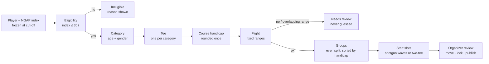

# Project plan: Starter (IGCC Tournament Desk)

Golf tournament management for **Iloilo Golf & Country Club (IGCC)**, built by **Syntaxure Labs**.
The organizer adds players; the system routes each one to a category, tee, flight, group and start
slot; the organizer reviews, overrides and publishes; players read their pairings on a phone.

> **Status date:** 17 Oct 2026 · **Branch state:** `develop` is the only long-lived branch ·
> **Working name:** "Starter" (not trademark-cleared, see [Open decisions](#10-open-decisions))

This is the single plan for humans and AI agents. Section 1 is the 60-second version. Everything
marked **Verified** was checked against the code, the migration or the tests on the date above.
Anything not marked is a plan, not a fact.

---

## 1. Where we are, in short

| Area | State | Evidence |
| --- | --- | --- |
| Routing engine (`src/lib/routing`) | **Built**, pure functions, no DB; **lock-aware re-run** | 26 unit tests |
| Draw checks (`src/lib/draw`) | **Built**: blocking / warning / info issues, move rules | 15 unit tests |
| NGAP CSV import logic (`src/lib/ngap`) | **Built**: mapping, match/merge review queue, strict plan | 25 unit tests; no `.xlsx`; no DB writes |
| Database schema (`supabase/migrations`) | **Applied to the real project** on 18 Oct 2026: `golf-management-system` (`egfwfyznbndunqfqzxjx`, ap-southeast-1), both migrations, club row seeded, `player-photos` created private, RLS checked against the anon key | 14 tables, RLS on all |
| Supabase data layer (`src/lib/auth`, `src/lib/supabase`, `src/lib/data/supabase`, `src/lib/store/legacy-supabase-store.tsx`) | **Merged (PR #5) and parked**: auth guard, club-scoped repositories, frozen published snapshot, optimistic writes. Written against the earlier store contract; **not yet wired to the shell store** | 24 tests among the 218 |
| Staff auth and roles (`20261019000000_staff_auth_audit.sql`, `src/lib/auth/roles.ts`) | **Built, migration not yet applied**: `owner` / `organizer` / `desk`; publishing, tournament settings and member management are owner/organizer only, in RLS; registration audit columns stamped by trigger; public sign-ups off | Roles + RLS policies in the migration; 4 unit tests |
| Organizer screens (`src/app`) | **Built on in-memory demo data**; a refresh resets everything | 14 routes: Overview, Tournaments, Players, Registration desk, Import, Draw, Print center, Settings, Course & holes, Clubhouse display, Player view, plus profiles |
| Data boundary (`src/lib/data`) | **Built as mock adapters** over the session store | `PlayerRepository`, `TournamentRepository`, `RegistrationRepository`, `HandicapImportAdapter`, `PairingsRouter`, public allow-list |
| Brand and visual design | Clubhouse design system, Ivory / Charcoal themes, crest | Tokens in `src/app/globals.css`, contrast guarded by `src/styles/contrast.test.ts` |
| Printing | **Demo built**: start sheet, pairings, scorecard shell with print CSS | Not tested on the club's paper or printer |
| Scores, results | **Not started** (Phase 2) | No `scores` table yet |

Whole suite: 18 test files, 218 tests passing (`pnpm test`); the contrast file generates 100 of those cases, checking every design-system pair in both themes.

**The one thing blocking a real event:** nothing the organizer does is saved. The next build step is
the database connection (section 8, step 1). Until then the app is a working demo, not a tool.

---

## 2. Source of truth (read in this order)

1. **The code and tests in this repo.** If this plan and the code disagree, the code is what runs.
2. [`docs/spec/IGCC_Tournament_Desk.md`](spec/IGCC_Tournament_Desk.md): the build spec v1 sent to the organizer, with the rules the organizer confirmed on 17 Oct 2026.
3. This plan: status, gaps, roadmap, decisions made since the spec.
4. [`README.md`](../README.md): how to run the project.

Rules in the spec are **tournament settings, not constants**. Never hard-code a rule from section 3 into
the engine; it must come from `TournamentConfig`, categories, tees or flights.

---

## 3. Confirmed rules (organizer, 17 Oct 2026)

Full table is in the spec. The ones that drive the code:

| Rule | Value |
| --- | --- |
| Handicap source | Imported from the NGAP export. The system never computes an official index. |
| Course handicap | `Index × (Slope ÷ 113) + (Course Rating − Par)`, then × allowance (100%), **rounded once** at the end. Plus handicaps are stored negative and shown as `+n`. |
| Max handicap | 30, checked on the **NGAP index** (not the course handicap). Above 30 cannot register. |
| Categories | Regular, Senior 60–69, Super Senior 70+ (Silver tee), Ladies (own category and own tees). Age is taken on tournament day. |
| Flights | Fixed handicap ranges per category. Basis defaults to index. |
| Shotgun | 18 holes × max 4 per hole = 72 per wave. Wave 2 starts at wave 1 + gap (default 300 min). A flight is never split across waves unless it exceeds the holes in a wave, and then it is flagged. |
| Two-tee ("barrel") | Holes 1 and 10, one pair of groups per interval (default 12 min). |
| Scoring | Paper cards. No live scoring. |
| Photos | Taken or uploaded with recorded consent; kept off the public pairings page. |
| Tenancy | IGCC only for now; data model is multi-club ready. |

### Defaults chosen while organizer answers are pending

| Open question | Default in code | Where |
| --- | --- | --- |
| Flights on index or course handicap | Index | `TournamentConfig.flightBasis` |
| Flight not divisible by 4 | Even split (14 → 4, 4, 3, 3); minimum group 3 | `src/lib/routing/groups.ts` |
| Order inside a flight | By handicap | routing engine |
| Photos on public page | Never | `PairingsView`, `photoOf` |

---

## 4. How routing works



Every step records its result so the organizer can see why a player landed where they did.
Nothing is guessed: a missing index, no matching category, or a missing or overlapping flight range
marks the player `needs_review`, not a silent default.

**Worked example (placeholder tee numbers):** male, 63, index 14.2, Senior tee 70.1 / 125 / 72.
`14.2 × (125 ÷ 113) + (70.1 − 72) = 13.81 → 14` → Senior flight containing 14.

### Start formats

- **Shotgun:** groups fill holes 1–18 in flight order. If the next flight does not fit in the holes
  left in wave 1, the whole flight moves to wave 2 (labels 1A…18A, 1B…). Wave 2 start = wave 1 start + gap.
- **Two-tee:** slot `n` starts at `first tee + floor(n ÷ 2) × interval`, hole 1 if `n` is even, hole 10 if odd.
  Capacity depends on pace of play (spec assumes ~2 h per nine, which the club has not confirmed).

---

## 5. Architecture and conventions

### Stack

Next.js 16 (App Router) · React 19 · TypeScript strict (with `noUncheckedIndexedAccess`) · pnpm 10 ·
Biome (lint and format) · Vitest · `supabase-js` and plain SQL migrations (no Prisma) · Vercel.

### Layout

```text
src/lib/routing/   pure routing engine (no DB, no network), lock-aware re-runs
src/lib/draw/      draw validation: issues + drop rules
src/lib/ngap/      CSV import, column mapping, match and merge review queue
src/lib/poster/    canvas poster generator (preview == export)
src/lib/data/      domain types (club_id), cut-off freeze rule, public allow-list,
                   mock adapters (PlayerRepository, TournamentRepository,
                   RegistrationRepository, HandicapImportAdapter, PairingsRouter)
src/lib/store/     session store (DEMO ONLY, to be replaced by Supabase behind the adapters)
src/lib/demo/      demo club, tees, categories, flights, players, events and the sample NGAP file
src/components/    UI; src/components/draw/ is the draw control room; src/components/print/ the print center
src/app/(desk)/    organizer screens;  src/app/(public)/  player-facing pages
supabase/migrations/   schema;  supabase/seed.sql   development seed
docs/              this plan, the spec and the handoffs
```

### Rules that keep it correct

- The routing engine and draw checks stay **pure functions**. Test them; do not put I/O in them.
- Pairings shown to players come from a **frozen `Published` snapshot** (names, hole, time only),
  never from the live board. Editing the board after publishing shows "Published, with changes"
  until the organizer publishes again.
- Publishing is **blocked** by blocking issues (duplicate player, over capacity, ready player with no
  group, ineligible player in a group). Warnings need acknowledgement.
- Photos are used only where consent is recorded (`photoOf`). Private bucket, never on public pairings.
- Colors are tokens on `:root` with dark redefinitions; contrast is guarded by `src/styles/contrast.test.ts`.
- No external font or script calls (fonts are bundled via `@fontsource`).

### Database design

Verified in `supabase/migrations`, and **applied to the `golf-management-system` project on 18 Oct 2026**:

- `club_id` on every table; row-level security through `public.is_club_member(club_id)`.
- Composite foreign keys `(id, club_id)` so a row in one club cannot reference another club's data.
- `public.public_pairings(tournament_id)`: security-definer function returning names, flight, hole and time only. No login needed.
- Private `player-photos` bucket, paths under `{club_id}/`.
- `btree_gist` exclusion constraint prevents overlapping flight ranges within a category.
- Registrations store `frozen_index` so a later NGAP upload cannot change a published draw.
- Clubs and memberships are created with the service role during onboarding, not from the app.

**Staff-only auth (`20261019000000_staff_auth_audit.sql`):**

- Roles are `owner`, `organizer` and `desk`, held in `club_members.role`. Golfers never get accounts,
  and `public.players` deliberately has **no `user_id`**, so a player record is never a login identity.
- `public.has_club_role(club_id, roles[])` is the role test; it is security-definer so it cannot
  recurse through `club_members` RLS.
- RLS is the enforcement, not the UI: `tournaments` is read-only to members and writable only by
  owner/organizer (publishing and every tournament setting live there), and `club_members` is
  manageable only by owner/organizer. Every other table stays open to all club staff.
- `registrations.registered_by`, `updated_by` and `updated_at` are stamped by trigger from the
  session (`auth.uid()`), so a client cannot set or spoof them. There is no separate activity table.

**Schema vs spec:** the migration has 14 tables: the spec's tables except `scores` (Phase 2), plus `club_members`
(needed for RLS).

### Git workflow

- Base branch `develop`. Multi-file work goes on a dedicated branch and a pull request into `develop`.
- `main` exists but trails `develop`; **`staging` does not exist yet** (see decisions).
- Commit messages and PR descriptions carry the attribution lines required by the tooling in use.
- A repo-state claim ("it is merged", "it is deployed") must be checked against the remote, not memory.

---

## 6. Screens: status

| Screen | State |
| --- | --- |
| Overview | Control room: illustrated course map with hole pins, event card, attention list (blocks, review, re-freeze, deferred imports, payments), quick actions, readiness, publish, divisions, Handicap Index histogram, session activity, open questions. Demo data |
| Tournaments | Demo events with dates, cut-off, entries and draw state; switch the working event, create a demo event, clear the selection to see the no-tournament state |
| Players list | Directory with search (name, nickname, NGAP ID, home course) and filters (status, category, gender, home course); add a player with photo consent. In memory |
| Player profile | Photo with consent flag, handicap history with the frozen marker, registration facts, private-details panel, poster generator (1080×1350 championship, 1080×1080 card) |
| Registration desk | Find a player or start a new one, member/guest, sponsor question, per-day tee-time preferences (Day 4 flagged), shirt sizes, extra fields, payment recorded by hand, eligibility review after saving |
| Import handicaps | CSV, column mapping, match and merge queue with decisions, apply, deferred rows, import history; applies to the session's handicap records |
| Draw control room | Generate, move (drag or Move, with a reason), lock, re-run keeping locks, override list, issues panel, publish dialog, routing explanation per player, draft / published / changed states |
| Print center | Start sheet, pairings, scorecard shell with placeholder dots, print CSS for A4/Letter. Published vs draft is labelled |
| Settings | Setup wizard: basics, course and tees (pending blocks, read-only sample values), cut-off and handicap rules, categories, flights, start and groups, registration fields, live readiness checks |
| Public pairings | Search by name, large text, print; built through the public allow-list projection (name, flight, hole, time only) |
| Course & holes | Hole 1 overview and green view with shot line and yardage markers drawn from anchor files. **Pictures are an illustration, not IGCC's real hole** |
| Clubhouse display (spotlight) | 16:9 player card for the clubhouse TV, single player or rotation. Shows recorded data only |
| Real course and tee entry | **Pending**: the tee values are deliberately read-only sample data until the club supplies the scorecard |
| Score encoding and results | Phase 2 |

---

## 7. Verified gaps between spec and code

These are places where the spec promises something the code does not do yet. Checked on 18 Oct 2026.

1. **Re-run and locked groups.** *Fixed in the demo shell*: `route()` takes locked groups, keeps
   their players and slots, releases a lock that no longer makes sense with the reason, and warns
   when a locked slot pushes a flight across waves. Covered by `src/lib/routing/locks.test.ts`.
2. **Nothing persists.** All screens use `DeskProvider` in-memory state. The Supabase repositories
   are merged and parked (`src/lib/data/supabase/*`, `src/lib/store/legacy-supabase-store.tsx`); the
   shell store still reads and writes demo data. Wiring them behind `src/lib/data/adapters.ts` is the
   open step, and it is why the auth model can be finished before the data flows through it.
3. **Cut-off date is applied in the desk** (frozen onto each registration; re-freeze offered), but
   the database write is still missing.
4. **Printing** has a demo print center (start sheet, pairings, scorecard shell). It has not been
   printed on the club's paper or printer, and the scorecard dots stay placeholders until the club
   supplies the stroke index.
5. **Settings are editable in the demo**, but the real tee data is deliberately read-only until the
   club supplies the scorecard, so it cannot pass as official.
6. **Tee data is placeholder.** Demo and test numbers (e.g. White 71.5 / 128 / 72) are invented.
7. **Wave rule vs. small flights.** Keeping flights whole can push a small flight to wave 2; an
   organizer decision is still needed (section 10).
8. **Import is CSV-only** and the NGAP format has still not been seen; the queue's column mapping is
   the guard against guessing it.
9. **Multi-day events are a demo assumption.** Age and the cut-off read the first day, because the
   club has not said which day of a multi-day event counts.

---

## 8. Roadmap

Order matters: each step unblocks the next. Effort is not estimated here on purpose; no velocity data exists yet.

### Phase 1: first IGCC event

1. **Database connection** *(needs Jeff at a computer with Supabase access)*
   - ~~Create the Supabase project (Pro)~~ **Done**: `golf-management-system` (`egfwfyznbndunqfqzxjx`).
   - ~~Link the CLI and apply both migrations; seed the club row~~ **Done**: `supabase link` and
     `supabase db push --include-seed`, verified with `supabase migration list --linked`; RLS
     checked with the anon key; `player-photos` exists as a private bucket.
   - Regenerate the database types (`supabase gen types typescript --linked`) to replace the
     hand-written `src/lib/supabase/types.ts`.
   - Auth: **staff-only model built** — roles `owner`/`organizer`/`desk` in `club_members`, enforced
     by RLS (`has_club_role`) with registration audit columns stamped server-side. Public sign-ups are
     turned off in `supabase/config.toml`. Still to do: create the Auth users and their `club_members`
     rows on the live project, then test RLS with a real login.
   - Add the course, tee and hole rows. The real IGCC Course Rating, Slope, Par and stroke index are
     still pending from the club, so this waits on the scorecard.
   - Verify the `player-photos` storage policy with a real upload.
   - **Wire the merged data layer to the shell.** The Supabase repositories, mappers and store were
     merged in PR #5 and parked at `src/lib/data/supabase` and
     `src/lib/store/legacy-supabase-store.tsx`; they were written against the earlier `Desk`
     contract. Port them to the shell's domain types (`src/lib/data/types.ts`) and implement the
     adapters behind `src/lib/data/adapters.ts`: players, handicap records, tournaments,
     registrations, groups, the import queue's write path and the frozen public snapshot. Until
     this is done, the desk runs on local demo data even when Supabase is configured.
2. **Real course data:** the setup wizard is editable, but the tee and hole values are deliberately
   locked as sample data. Enter IGCC's real Course Rating, Slope, Par and stroke index per tee and
   hole, checked against the club scorecard.
3. **NGAP import end to end:** get a real sample export, set the default mapping, review the merge
   queue with real names, and confirm the cut-off behaviour with the organizer.
4. **Lock-aware re-run:** built in the demo (`route()` takes locked groups; tests cover lock
   stability, release reasons and two-tee alternation). The database version follows step 1.
5. **Registration desk:** demo built (directory search, new player, member/guest, tee-time
   preferences, payment recorded by hand, cut-off freeze and re-freeze). Copying a list from a past
   event and writing to the database are not built.
6. **Print:** demo print center built (start sheet, pairings, scorecard shell). Print it on real
   paper at the club, and fill the stroke index so the handicap dots are real.
7. **Deploy:** Vercel project, env vars, `staging` and `main` branches, CI (typecheck, lint, tests, build).
8. **Dress rehearsal:** run a full fake tournament with the organizer using real IGCC data before the real event.

### Phase 2: results

Score encoding from paper cards, gross and net per flight, tie-breaks, results export. Needs the organizer's tie-break rule. Adds the `scores` table.

### Phase 3: growth

Player self-registration and online payment, SMS or Messenger notices, onboarding a second club.

### Not planned

Computing an official WHS index · live mobile scoring · posting scores back to NGAP.

---

## 9. Running costs (monthly, as of 17 Oct 2026)

Budget given to the funder: **₱5,000 per month**. FX used: 1 USD = ₱63.03.

| Item | USD / month | Notes |
| --- | --- | --- |
| Vercel Pro | $20 | One seat; includes usage credit. Hobby is non-commercial only, so Pro is needed. |
| Supabase Pro | $25 | 8 GB database, daily backups (7 days). Free tier pauses after a week idle and has no backups. |
| OpenCode Go (agents) | $10 | $5 for the first month. Claude models are not included in it. |
| **Total** | **$55 ≈ ₱3,467** | First month $50 ≈ ₱3,152. About ₱41,600 per year. With 12% VAT possible: ≈ ₱3,883. |

Cost controls to set when the accounts are created: a **low Vercel spend limit** (the default on-demand
budget is $200) and **Supabase spend cap on**. Prices change; re-check before paying. The full sheet
is a separate document and is not kept in this repo.

---

## 10. Open decisions

Decisions that belong to the people named, not to an agent.

| # | Decision | Owner | Blocks | Default meanwhile |
| --- | --- | --- | --- | --- |
| 1 | Real Course Rating / Slope / Par / stroke index per tee | Organizer / club | First real draw | Placeholder numbers (unsafe for real use) |
| 2 | Sample NGAP export | Organizer | Import mapping defaults | Mapping chosen in UI |
| 3 | Tees for Regular, Senior, Ladies; Ladies senior split? | Organizer | Category setup | Demo mapping |
| 4 | Flight basis: index or course handicap | Organizer | Flight assignment | Index |
| 5 | Flight not divisible by 4 | Organizer | Group sizes | Even split, min 3 |
| 6 | Ordering inside a flight | Organizer | Groups | By handicap |
| 7 | Photo visibility | Organizer | Privacy copy | Desk and organizer only |
| 8 | Results and tie-break rule | Organizer | Phase 2 | None |
| 9 | Small flight near the end of wave 1 (e.g. 3-group Ladies): split, fill from another flight, or move to wave 2 | Organizer | Shotgun layout | Keep whole, flag |
| 10 | Product name ("Starter" is not trademark-cleared) | Jeff | Public branding | "Starter" |
| 11 | Vector (SVG/PDF) crest from the club; real course pictures and hole positions | Jeff / club | Print, large displays, real course map | 320px PNG crest; illustrated placeholder course |
| 12 | Create `staging` and `main` branches; clean up old feature branches; consider a Syntaxure organization for the repo | Jeff | Pipeline | Only `develop` |

---

## 11. Risks

- **Data.** Wrong tee data means wrong handicaps for every player. Check against the club scorecard before the first event.
- **Process.** A stale NGAP file means players register on old indexes. Someone must upload a fresh export before every cut-off.
- **Privacy.** Photos, birthdates and contact details are personal data under the Data Privacy Act of 2012. Consent line before photos, private storage, names only on the public page.
- **Scope.** The router proposes; the organizer decides. Withdrawals and sponsor groups on the day are normal, so overrides are core.
- **Unproven schema.** The migration has not run on a real Supabase project. Expect small fixes in step 1.
- **Single point of knowledge.** The routing rules live partly in the organizer's head. Unconfirmed defaults in section 3 must be confirmed before launch.

---

## 12. Working with AI agents

Agents should read, in order: `AGENTS.md` → this plan → the spec → the code they are about to change.

Default model routing for the OpenCode Go setup (Jeff's preference):

| Task | Model |
| --- | --- |
| Scaffolding | DeepSeek V4 Pro |
| Complex tasks | Kimi 3 |
| Design | Claude Sonnet |
| Reasoning | GLM 2.5 |
| All-around, quick edits | MiMo v2.5 Pro |
| Frontend UI, minimal tasks | Flash 3.6 (Antigravity) |

Caveat: the cost sheet found that **Claude models are not included in OpenCode Go**, so the "Claude Sonnet — design"
row needs a separate Claude subscription or API access, or Claude Design for the final visuals.

Agent ground rules:

- Inspect the code before claiming something works or is broken.
- Run `pnpm typecheck && pnpm lint && pnpm test` before every commit; do not weaken a test to make it pass.
- Do not apply migrations to, or change, production data without the owner's explicit say-so.
- Schema changes, auth changes and rule changes (section 3) need the owner's decision first.

---

## 13. Launch checklist (first real event)

- [ ] Database applied to a real Supabase project and tested with a real login
- [ ] Real IGCC tee data entered and checked against the club scorecard
- [ ] Sample NGAP export received; import tested with the real file; fresh export uploaded before cut-off
- [ ] Open decisions 3–7 and 9 confirmed by the organizer
- [ ] Lock-aware re-run built (gap 1)
- [ ] Start sheet and scorecards printed on real paper at the club
- [ ] Photo consent line shown before every photo; private bucket verified
- [ ] Public pairings page checked on an older phone
- [ ] Vercel spend limit set; Supabase spend cap on; backups understood
- [ ] Dress rehearsal with the organizer
- [ ] Rollback plan: how the organizer runs the day from a printed sheet if the site is down

---

## 14. Decision log

| Date | Decision |
| --- | --- |
| 17 Oct 2026 | Rules confirmed by the organizer (spec v1). Rules are tournament settings, not constants. |
| 17 Oct 2026 | Stack: Next.js + Supabase (`supabase-js` and SQL migrations, not Prisma) + Vercel. |
| 17 Oct 2026 | Multi-tenant data model from day one (`club_id` + RLS), IGCC the only tenant. |
| 17 Oct 2026 | Importer is mapping-based so the app is not tied to a guessed NGAP format. |
| 17 Oct 2026 | Database work deferred until Jeff can set up Supabase in person; shell and UI built on demo data first. |
| 17 Oct 2026 | Interim brand forest / ivory / gold; final design to be done in Claude Design. |
| 17 Oct 2026 | Photos shown only with recorded consent and never on the public page. |
| 17 Oct 2026 | PRs #1 (organizer UI) and #2 (design system) merged into `develop`. |
| 17 Oct 2026 | Clubhouse design system adopted (Claude Design artifact). UI moves to Tailwind v4 + shadcn/ui primitives (Radix) + Lucide, themed from the design system tokens. Fonts bundled with `@fontsource` (Geist, Manrope, Cormorant Garamond, Bebas Neue). |
| 17 Oct 2026 | App chrome shows the club name and crest only; "Starter" is not shown until decision 10 is made. |
| 17 Oct 2026 | Frontend and backend split into two branches: `feat/clubhouse-ui` (UI) and `feat/supabase-data` (data layer, own worktree). They meet only at the `useDesk()` contract. Handoff prompt: `docs/handoffs/backend-supabase-data.md`. |
| 18 Oct 2026 | Phase 1 shell work continued on `feat/igcc-tournament-desk-shell` (own worktree, base `develop` @ 6d49b6c). Screens added: Tournaments, Registration desk, Print center; Settings became an editable wizard; Import gained a match/merge review queue; the draw gained lock-aware re-runs, override reasons and per-player routing explanations. |
| 18 Oct 2026 | The event's demo name is "Bamboo Tee (demo sample title)": the repo materials never name the November event, so the title is editable and flagged for confirmation. |
| 18 Oct 2026 | Two demo events: Bamboo Tee (12 to 15 Nov 2026, shotgun, cut-off 1 Nov) and an empty Monthly Medal sample for empty states. All demo dates and the cut-off are labelled as needing confirmation. |
| 18 Oct 2026 | Day 4 "11:30PM Tee Off" is stored exactly as supplied and shown with a "needs organizer confirmation" flag; it is never silently changed. |
| 18 Oct 2026 | Freeze semantics: the latest NGAP record on or before the cut-off is copied onto the registration; a later import never moves it, and the desk offers a manual re-freeze. |
| 18 Oct 2026 | The interface carries a "Demo shell · local session data" badge; public pairings are built through an allow-list projection; payments stay manual and unverified. |
| 18 Oct 2026 | Supabase data layer merged (PR #5, `feat/supabase-data`): email/password auth, membership guard, club-scoped repositories, `tournaments.published_snapshot` and the reworked `public_pairings` RPC. It was written against the earlier `Desk` contract. |
| 18 Oct 2026 | `feat/igcc-tournament-desk-shell` merged into `develop` directly (owner's instruction). The shell keeps the app: it runs on the session store and the mock adapters. The Supabase layer was preserved rather than dropped: it moved to `src/lib/data/supabase` with `src/lib/store/legacy-supabase-store.tsx`, still compiling and tested. |
| 18 Oct 2026 | The Supabase project `golf-management-system` (`egfwfyznbndunqfqzxjx`) was linked with the CLI and both migrations are applied, with the club row seeded and `player-photos` created as a private bucket. RLS checked with the anon and service keys. The database is empty of players, registrations and events. `supabase/config.toml` is committed so the CLI runs from the repo. |
| 18 Oct 2026 | Known state after the merge: with Supabase configured, the sign-in guard and login page work, but desk screens still read and write local demo data. The data layer must be wired behind the shell's `src/lib/data/adapters.ts` interfaces. The interface says so in a banner. |
| 18 Oct 2026 | **Staff-only auth model.** Three roles in `club_members.role`: `owner`, `organizer`, `desk`. Desk may register players and edit registrations; only owner/organizer may publish, unpublish, change tournament settings or manage members. Enforced in RLS (`has_club_role`), not by hiding buttons. Public sign-ups are off. Golfers do not need accounts, and `public.players` keeps no `user_id` so a player record is never a login identity. |
| 18 Oct 2026 | **Registration audit is columns, not a table.** `registrations` gains `registered_by`, `updated_by` and `updated_at`, stamped by trigger from `auth.uid()` so a client cannot spoof them. No separate activity-log table. |
| 18 Oct 2026 | Jeff supplies the first staff accounts (`admin` as owner, `member1` as desk); the golf pro's real account is added later as `organizer`. Passwords are generated at setup time and never committed or pasted into chat. |

---

## 15. Glossary

- **NGAP:** the national golf association whose handicap index export the club provides.
- **Index / handicap index:** the player's NGAP number; not course-specific.
- **Course handicap:** index adjusted for a tee's Slope, Course Rating and Par.
- **Playing handicap:** course handicap × allowance (100% for now), rounded.
- **Category:** Regular, Senior, Super Senior, Ladies. Decides the tee.
- **Flight:** a handicap band inside a category; players in a flight play together.
- **Shotgun start:** everyone tees off at once from different holes. **Wave:** a full set of 18 holes; the second wave (B) starts after a gap.
- **Two-tee ("barrel") start:** groups start from holes 1 and 10 at timed intervals.
- **Cut-off date:** the date whose index is frozen for the event.
- **Draw:** the set of groups and start slots; **published** means players can see it.
- **RLS:** row-level security, the database rule that keeps one club's data from another.
